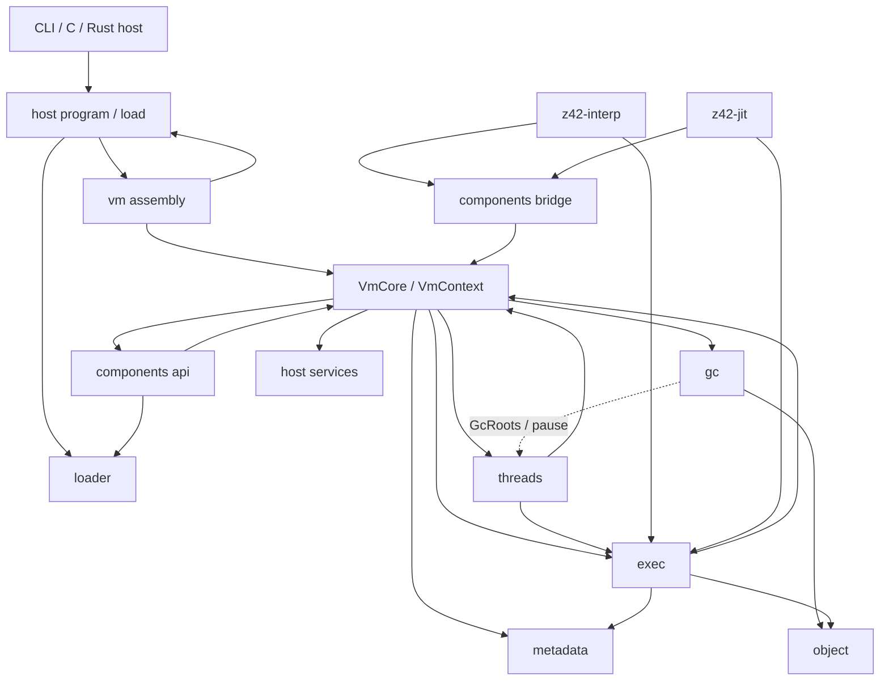

# z42 Runtime 架构审计

基线：2026-11-19 从 GitHub `main` 获取的 `b2a55911475aaf871ca987d77ecf004ed46c8bec`；审计范围为工作树 `src/runtime` 的生产源码、组件 crate 和相关测试。源码链接均指该基线。本文是定向静态审计，不声称逐行检查了全部文件，也没有运行动态测试、完整依赖图工具或性能基准；涉及可达性、回滚完整性与性能的未验证判断明确标为待确认。用户提出的方向合理，但“引用多”“存在双向协作”“语义有两套代码”本身都不足以证明缺陷；先收口真实反向依赖和策略流，再评估其它改动。

## 实际结构与 crate

`src/runtime/Cargo.toml` 的 workspace 成员为根 `z42`、`tests/data/component`、`z42-interp`、`z42-jit`、`z42-profiler`、`z42-zpkg`、`z42-abi`、`z42-rs`、`z42-macros`、`z42-compression`、`z42-repl`；根的生产依赖不包含具体 interp/JIT 实现，最终测试/示例链接它们。`src/runtime` 还包含 `include/` C 头、`tests/` 集成测试、`examples/`、`benches/` 和 `build.rs`。`src/runtime/src` 的一级源码组织：

| 目录/文件 | 实际职责和主要组成 |
|---|---|
| `vm/` | `mod.rs` core/context、固定地址和生命周期；`assembly.rs` 程序装配；`defaults.rs` 默认输入；`services.rs` 扩展服务；`extensions.rs` 类型化扩展状态。 |
| `host/` | `program.rs` 长期程序和调用；`load.rs` 产物准备；`app.rs` 一次运行；`c/` C 宿主；`rust.rs` Rust 适配；resolver、应用状态及服务。 |
| `loader/` | `package/` 解码/索引/merge，`locate/` 查找，`lazy/` 惰性登记，`runtime.rs` 链接，native 装载、上下文回收和映像缓存。 |
| `exec/` | engine、线程执行状态、栈和异常、`call/` 帧/参数/arena、`ops/` 共享操作、init、native 调用；非解释器主循环。 |
| `components/` | api、角色绑定、backend 策略、catalog、instance、ABI/bridge 和 profiler；加载代码交给 loader。 |
| `gc/` | heap 分配、屏障/收集、roots 回调、增量/代际、TLAB、SATB、region 与测试。 |
| `object/` | header、value、array、string、types、存储与对象协议。 |
| `metadata/` | module/function/type、ID 表、dispatch、statics、resolve、reflection 和初始化事实。 |
| `threads/` | 线程状态、注册、roots、GC 暂停、safepoint、monitor。 |
| `interop/`、`corelib/`、`pal/` | native 调用与提供者、标准库内建实现、文件/线程/网络/内存等平台原语。 |
| `config/`、`diagnostics/` | 配置解析/快照与观察、统计、采样。 |
| `lib.rs`、`main.rs`、`main_command.rs`、`main_startup.rs` | 库导出及 CLI 进程入口。 |

完整文件清单可在基线执行 `git ls-files src/runtime`；这里按目录列出，避免数百条测试和叶实现掩盖职责。解释器包含 `interp/{engine,component,frame,run,ops}`；JIT 包含 `jit/{engine,component,compile,runtime,translate,helpers}`；profiler 为组件；zpkg 为格式/IR；abi 为协议；rs/macros 为 native 扩展支持；compression/repl 为独立运行时库。类别以其 Cargo 源码依赖和实际调用为准，测试和同构建链接胶水不等同生产依赖。

## 已具备的边界

- `VmCore` 按领域组合共享状态，`VmContext` 保存线程执行、诊断、元数据和线程状态；`ctx.loader()` / `statics()` 已形成借用视图，`resolve_services()` 将解析适配放在组合层（[vm/mod.rs](../../src/runtime/src/vm/mod.rs#L29)、[vm/mod.rs](../../src/runtime/src/vm/mod.rs#L367)）。聚合本身是必要的，不应因访问量大拆掉。
- 根生产 crate 不依赖具体解释器/JIT，`EngineRegistry` 按调用/层级使用现有动态分发，组件先绑定能力并保留代码租约（[Cargo.toml](../../src/runtime/Cargo.toml)、[exec/engine.rs](../../src/runtime/src/exec/engine.rs#L11)、[components/api.rs](../../src/runtime/src/components/api.rs#L54)）。这不是逐指令组件查表；不建议再造通用 backend trait。
- `GcToVm` 明确暂停和根访问安全条件，`CoreRoots` 用 `Weak<VmCore>`，对象协议对 Context/Error 泛型化（[gc/to_vm.rs](../../src/runtime/src/gc/to_vm.rs#L5)、[threads/roots.rs](../../src/runtime/src/threads/roots.rs#L7)、[object/protocol.rs](../../src/runtime/src/object/protocol.rs#L9)）。必要的 roots、写屏障及类型布局协作并非可直接消除的循环。
- 解释器和 JIT 已共用 scalar、struct、array 等操作：例如 [interp/ops/mod.rs](../../src/runtime/crates/z42-interp/src/interp/ops/mod.rs#L54)、[jit/helpers/arith.rs](../../src/runtime/crates/z42-jit/src/jit/helpers/arith.rs#L7)、[jit/helpers/array.rs](../../src/runtime/crates/z42-jit/src/jit/helpers/array.rs#L3)。JIT 的内联 fast path 与解释器不同是实现差异，不能仅凭重复判断语义不一致。
- CLI、Rust、C 的主要程序执行路径已复用 `LoadedProgram` / `run_app`，字节加载有会话 `ImageCache`；不是三份完全独立 VM 初始化（[host/program.rs](../../src/runtime/src/host/program.rs#L74)、[host/c/ops.rs](../../src/runtime/src/host/c/ops.rs#L44)、[host/app.rs](../../src/runtime/src/host/app.rs#L48)）。`Aot` 目前显式报未实现，不应把 feature 标志误认为完整后端（[exec/engine.rs](../../src/runtime/src/exec/engine.rs#L87)）。

## 当前依赖图（代表性源码引用，不是 Cargo 的完整传递闭包）

箭头 A → B 表示 A 引用 B；虚线表示回调/编排协作。Rust 同 crate 模块可循环引用，此图不声称 Cargo crate 循环。

`host ↔ vm::assembly` 是确切的源码层双向依赖：`host/load.rs` 调用 `assembly::build`，后者以 `host::program::{LoadOptions, LoadedProgram}` 为参数和返回值；`vm/services.rs` 还安装 `host` 服务。`vm ↔ threads/exec/components` 中一部分是组合根与适配器的协作，不自动推断为内存所有权环；根回调有 Weak，实际强引用环仍需逐个证明。

## 生命周期与加载/执行

1. 宿主构造 `LoadOptions`；文件/bytes 通过 loader 解析 artifact，`host::load::prepare` 准备搜索路径、依赖和候选。当前默认逐包注册，`Z42_EAGER_MERGE` 可选旧 merge 路径；不能在本次重构中删除任一轨道（[host/load.rs](../../src/runtime/src/host/load.rs#L59)）。
2. `assembly::build_context` 先 fold availability、重建必要索引，`defaults::construct` 构造 core/context；登记 cctor、安装 lazy loader，登记 eager artifact/impl/deps。随后 `build` 配置 native、解析 token、准备并绑定组件，回放加载事件，最后发布 `LoadedProgram`（[vm/assembly.rs](../../src/runtime/src/vm/assembly.rs#L29)）。加载登记不等于运行托管初始化。
3. `with_runtime` 建立 `Arc<VmCore>` 后连接元数据 observer、GC 收集信号/safepoint、roots 和 context reclaimer；回调采用 Weak；`new_with_core` 先 Pin 再注册，绑定 TLAB/SATB（[vm/mod.rs](../../src/runtime/src/vm/mod.rs#L189)、[vm/mod.rs](../../src/runtime/src/vm/mod.rs#L245)、[vm/mod.rs](../../src/runtime/src/vm/mod.rs#L317)）。这已经对应 Construct/Wire/Activate 的概念阶段，但未单独建状态机。
4. `LoadedProgram::invoke_index` 校验参数，设置 active VM/heap guard、pin 参数根，OnceLock 首次清理 statics/处理待加载类型，再通过 engine 调用；异常转换和返回值 rooting 契约在该处（[host/program.rs](../../src/runtime/src/host/program.rs#L124)）。类型/包 cctor 屏障仍在执行层，不能和首次调用的 OnceLock 简化成同一初始化。
5. Drop 先 retire TLAB、解绑 SATB/线程本地，再按 registry 锁纪律注销；`VmCore` 字段顺序与组件、heap、引擎、扩展寿命有关，`VmComponents` 逆序释放实例，代码 lease 保护已注册的后端代码（[vm/mod.rs](../../src/runtime/src/vm/mod.rs#L341)、[components/instance.rs](../../src/runtime/src/components/instance.rs#L219)、[exec/engine.rs](../../src/runtime/src/exec/engine.rs#L58)）。`run_app` 的 `exit_after_run` 显式 `forget` 是进程即将退出的特殊行为；嵌入端不能照搬。

## 问题与判断

### P0-1 装配对 Host 的反向依赖和策略读取

证据：[vm/assembly.rs](../../src/runtime/src/vm/assembly.rs#L11) 的 `LoadOptions`、`LoadedProgram`，`build` 读取全局配置 `runtime_config_snapshot().jit_config()`；[host/load.rs](../../src/runtime/src/host/load.rs#L59) 反向调用 assembly；[vm/services.rs](../../src/runtime/src/vm/services.rs#L21) 默认装入 host service 和 app state。影响：内部装配契约与宿主选项/返回包装绑定，新的宿主需复用宿主实现细节；同一次准备的 JIT 策略捕获点不明显。改善：先将已解析的内部装配输入及装配结果定义在 VM 组合侧，host 适配公开 `LoadOptions` 并包装 `LoadedProgram`；将 JIT 快照作为显式输入。宿主 service 从宿主组合入口注入或使用既有扩展机制，必须保留默认行为；分独立 PR 实施。`LoadedProgram` 仍是宿主 API，`ProgramInputs` 是内部装配输入，不应机械移成公开 loader 类型。

### P0-2 生命周期横跨构造与装配，失败路径需明确验证

证据：[vm/mod.rs](../../src/runtime/src/vm/mod.rs#L197) 同时创建 Core、接线、注册上下文，[vm/assembly.rs](../../src/runtime/src/vm/assembly.rs#L38) 随后绑定 native/组件并发布。影响：阅读者很难审查部分失败时所有资源退订和绑定顺序；不是已证实泄漏。改善：用局部私有函数标示 Construct/Wire/Activate/Dispose；先建立行为测试，保持调用顺序和 RAII，尤其检查组件 attach 失败、eager 注册失败、worker 活跃时 lease 和外部根。不要引入公开状态机。失败注入的覆盖与跨线程析构约束待确认。

### P0-3 宽能力访问与固定布局耦合

证据：[vm/mod.rs](../../src/runtime/src/vm/mod.rs#L83) 公共 `core()` 暴露全部子系统，[exec/engine.rs](../../src/runtime/src/exec/engine.rs#L11) 的引擎契约接受整个 `VmContext`；[threads/roots.rs](../../src/runtime/src/threads/roots.rs#L31) 直接访问线程及执行 roots。这使非热路径容易获得不需要的能力，但不能从签名推断每个调用均不合理。优先从加载、初始化、解析等冷路径抽取已有 `RuntimeLoader` 等借用视图；先逐调用记录实际所需能力，保留执行/根扫描必要访问，不扩大动态分发。`VmContext` 未声明 `repr(C)`，JIT 使用同构建 `offset_of!` 导出常量而非对外固定数字：[vm/mod.rs](../../src/runtime/src/vm/mod.rs#L70)、[jit/translate/control.rs](../../src/runtime/crates/z42-jit/src/jit/translate/control.rs#L61)、[components/bridge.rs](../../src/runtime/src/components/bridge.rs#L4)。重排仍可能改变偏移，须保持同构建身份校验、现存已编译代码寿命和编译时常量一致；不承诺跨版本 Rust 布局 ABI。JIT frame/header 自身的 `repr(C)` 及对象偏移也须保护。

### P1-1 执行语义与后端契约

证据：共享 scalar/array/struct 操作如上；[jit/translate/control.rs](../../src/runtime/crates/z42-jit/src/jit/translate/control.rs#L24) 内联 safepoint，[exec/engine.rs](../../src/runtime/src/exec/engine.rs#L58) 仍把 baseline/JIT 编码成固定角色，AOT 明确不可用。影响：未来新角色要检查注册和模式分派，但当前没有证明必须泛化 registry；先定义语义矩阵并加针对边界的双后端差分测试，仅将验证存在分叉的冷规则提取共享函数。保留 JIT 无额外调用的快路径。

### P1-2 Components 角色与服务边界

证据：[components/api.rs](../../src/runtime/src/components/api.rs#L13) 同时按角色选择、装实例、attach 引擎和可选 profiler；[components/instance.rs](../../src/runtime/src/components/instance.rs#L233) 验证绑定并创建实例。影响：这里是合理的组件组合门面，但具体角色/模式映射可能随新后端增加；不应把 loader、host 或所有服务进一步放入 components。先测试查询无副作用、失败回滚和租约；仅在新角色实际到来时调整映射。源码显示的失败顺序不等于已经证明全部跨组件失败注入覆盖。

### P1-3 Object / GC / Metadata / Threads 协作

证据：[threads/roots.rs](../../src/runtime/src/threads/roots.rs#L31) 统一扫描 statics、字符串、各线程异常、帧及 arena，持 registry 锁且要求暂停；[gc/to_vm.rs](../../src/runtime/src/gc/to_vm.rs#L23) 定义暂停能力；[object/header/block.rs](../../src/runtime/src/object/header/block.rs#L138) 定义布局；对象写屏障和 JIT fast path 需要配套。影响：所有权分散是跨领域事实，不等于所有权冲突；静态审计未发现已证实的强引用环。建议明确根和屏障不变量、梳理更窄的冷路径参数，禁止仅为依赖图单向化而搬动或拆散同步与 trace 协作。

### P2 文件与公开面

`host/load.rs` 同时处理依赖准备、候选及调用装配；应先确定输入所有权，再考虑将纯产物准备移动到 loader（需证明 resolver 策略不倒灌）。`vm/mod.rs` 同时包含状态、注册、GC 接线、Drop、访问器，可在 P0 生命周期测试后按 construct/wire 私有职责拆文件，保持导出及字段顺序；`vm/services.rs` 的 Host 依赖先解决再改名。`lib.rs` 多领域为 `pub`，其中同构建组件实际依赖需逐项盘点；[host/program.rs](../../src/runtime/src/host/program.rs#L107) 的 hidden `context()` 仍是公开 Rust 符号，不能简单删除。当前没有依据要求批量私有化或重命名 `state.rs`。

## 待确认与验证边界

- 未运行测试、基准或故障注入；不能据此宣称性能、内存安全、失败回滚或行为已经得到动态验证。
- 执行模式特定组件和部署矩阵（静态、共享链接、动态装入）需按实际平台构建；AOT 只讨论未来契约，不宣称已有实现。
- 所有 public 符号的外部使用、process-global 配置冻结时序、跨 VM 并发和退出报告的完整语义需要在对应 PR 先枚举消费者和测试；不可用静态引用数量代替兼容分析。
