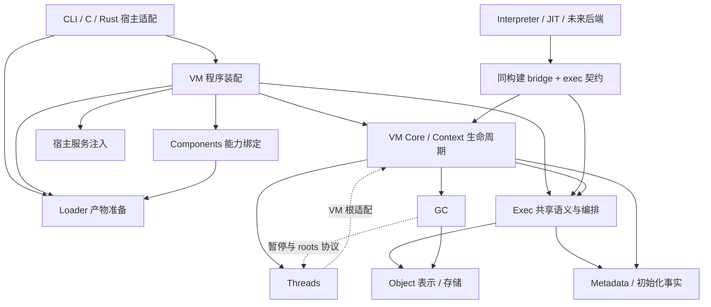

# Runtime 目标架构与依赖规则

基线及事实证据见 [审计报告](runtime-audit.md)。目标是收紧真实耦合，保留既有模块、共享语义和生命周期机制；图是目标职责方向，不是立即拆成独立 crate 的计划。

虚线是明确的回调或适配协作，不要求所有源码引用形成严格 DAG；禁止低层机制依赖宿主具体实现或通过隐藏的全局配置获得宿主策略。`AS` 是已有 `vm::assembly` 角色，不意味着新增公共框架或状态机。

## 所有权和边界

| 领域 | 拥有 | 输入 / 输出与规则 |
|---|---|---|
| host | 用户请求、`LoadOptions`、`LoadedProgram`、C/Rust 适配、进程行为 | 把请求转换为内部已解析输入；对外公开面保持兼容；包装 VM 装配结果。宿主应用状态/回调在组合时注入。 |
| loader | 产物读取、索引、候选/依赖解析、映像和代码寿命、惰性登记 | 接收 VFS、路径、resolver 和明确策略；返回准备产物。尚未证明 `host/load.rs` 全部能不带宿主语义迁移，先拆解再决定。 |
| vm assembly | 内部 `ProgramInputs`、装配请求/结果、构造/接线/激活编排 | 只接收内部解析后的事实、配置和能力，返回 context 与发布所需数据；不得依赖 `host::LoadOptions`/`LoadedProgram`。调用顺序和出错回滚不变。 |
| vm core/context | Arc 共享状态、每线程固定地址和注册寿命 | 子系统拥有自身状态与同步；新增访问先从已有借用视图选择。保留 JIT/GC 必须的整体上下文访问。 |
| exec | 引擎接口、调用/帧、初始化屏障、异常交接和共享语义 | 运行时已绑定 engine 的调用分发保留；新语义共享基于可证明差分，不把内联实现一律挪成函数调用。 |
| components | 描述校验、角色绑定、实例与代码 lease | loader 管来源和代码；查询不触发加载；装配时确定选择。不要成为通用服务中心。 |
| object | 对象/value/header 布局、存储与协议 | 普通存储调用直接提供堆/句柄/已解析类型；带屏障的写入顺序不变。 |
| GC | heap、追踪、分配、屏障、TLAB/SATB | 利用已有 `GcToVm`、roots 和 context-reclaim 协议；线程暂停前提与 root 不可逃逸。 |
| metadata | 类型/函数/字符串 ID、解析和静态字段/初始化事实 | 不运行宿主策略；按需借用 resolve services。 |
| threads | 注册、safepoint、暂停与 VM roots 适配 | 扫描、注销持同一注册锁，暂停覆盖借用期；线程所属 TLAB/SATB 配平。 |
| PAL / interop / corelib / diagnostics | 平台原语、native 调用、库实现、观察 | 通过已有服务注入和所属模块契约协作，避免机制反向引用 host。 |

## 接口变化与兼容

1. 第一项实现仅在 `vm::assembly` 定义 crate-private、已解析的 assembly 参数和结果；host 构造它并将结果包装成 `LoadedProgram`。将 `mode`、native 设置、profiling 意图、JIT config 等实际需要的数据显式传入，具体字段以实现前调用点为准；避免把完整 `LoadOptions` 原样改名复制。`ComponentInputs` 留在内部，禁止透过普通宿主 API 暴露组件 ID。
2. 已有 `RuntimeInputs`、`VmExtensions`、`RuntimeLoader`、`StaticFields`、`GcToVm`、`ObjectProtocol` 与 `Engine` 优先复用；不新增无消费者 trait，不在每次对象操作或指令上引入组件查询。优先直接借用或具体窄结构。
3. 宿主 `LoadOptions`、`LoadedProgram`、C 头和现有符号保留；`context()` 等跨 crate 公共路径只有完成消费者审计和兼容策略后才能调整。现有组件 bridge 是同构建协议，不是稳定跨版本 Rust ABI。
4. 除专门验证的后续 PR 外不删除接口。旧公开路径兼容与仓库一般内部重命名规则冲突时，以本任务明确的 API 兼容约束为准，避免未经验证地删导出。

## 生命周期与布局不变量

Construct 创建领域状态；Wire 绑定 Weak roots、safepoint 和回收回调；Activate 固定地址后注册并绑定线程资源、准备组件、发布程序；Dispose 保持 TLAB retire、SATB/TLAB 解绑、注册表注销、组件逆序销毁和代码 lease 顺序。它们描述现有阶段，并不要求改变真实顺序（例如 context 注册目前发生在部分程序装配前），更不要求新增枚举或状态机。

`VmContext` 固定地址、JIT 的 `VM_CONTEXT_*_OFFSET`、`JitFrame` 和对象头布局、同构建 core identity、扫描暂停和锁顺序、写屏障/SATB、native park 以及代码存活期均为验收边界。偏移由实际类型计算，不应在文档中承诺跨构建数值固定；若重新布局必须确保所有同构建组件重新编译且不能有旧代码使用新布局。热路径改动需同 runner A/B 数据及代表性 GC/执行场景。

## 文件调整（按证据触发）

- P0：`vm/assembly.rs` 抽出内部输入/结果，`host/load.rs` 和 `host/program.rs` 负责宿主转换；先不搬动文件。后续把 `vm/services.rs` 对 host 的依赖改成显式服务注入，保留现有默认应用行为。
- P0：`vm/mod.rs` 构造和接线过长，在生命周期回归测试后可抽私有 `vm/wiring.rs`；只搬接线，不改变 Core 字段声明顺序或 pin/注册时点。
- P1：`host/load.rs` 中独立于宿主的依赖准备若可证明有清晰输入，迁到 `loader` 内具名文件；宿主 resolver 的适配留 host。若依赖事实不足则继续留原处。
- P1/P2：针对 `exec/ops` 的已证实语义分叉提取共享操作；纯后端寄存器、frame 和 JIT lowering 留后端。文件重命名、合并或公开性收口只在职责和消费者确定后进行。

计划与依赖见 [PR 计划](runtime-refactor-plan.md)。
