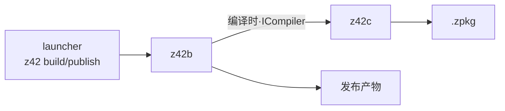
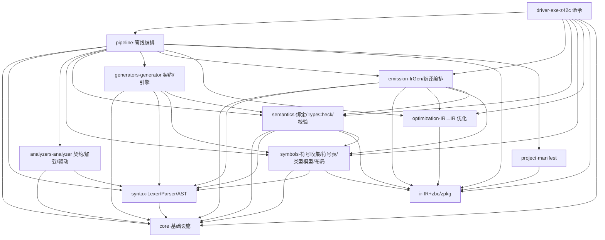
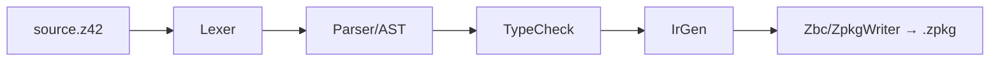

# 架构总览

> **页型**: 机制页 ｜ **代码**: `src/compiler/`（z42c）· `src/toolchain/builder/` + `src/compiler/z42.build/`（z42b）
> **相关**: [源代码编译流程](source-compile.md) · [工程模型、依赖解析与工作区编译](project-model.md) · [项目构建与发布编排](../toolchain/z42b.md)

## 两个角色

- **z42c** — 编译器本体，负责将 `.z42` 源码编译为 `.zpkg`
- **z42b** — 构建编排器，负责将项目从编译推进至发布（裁剪、原生构建、打包）；其中的编译环节经 `ICompiler` 接口在同一进程内交由 z42c 完成，不另起编译器子进程



## z42c 的组成

z42c 按依赖顺序分成十一个逻辑包；`driver` 是唯一的可执行程序，也就是 `z42c` 命令。**物理布局**：全部在 `src/compiler/` 这一个 workspace 里——可移植前端 `z42c.core` / `z42c.syntax`，符号层 `z42c.symbols`（符号收集 / 符号表 / 跨包导入装载 / 类型模型 / struct 布局；物理上独立成包，命名空间与语义层同为 `Z42.Semantics`），语义层 `z42c.semantics`（绑定 / 类型检查 / 校验 / 导出抽取），后端四包 `z42c.optimization` / `z42c.emission` / `z42c.pipeline` / `z42c.driver`，编译期扩展 `z42c.plugin`（一个包双命名空间：`Z42.Analyzers` analyzer 契约 + 引擎只读 AST；`Z42.Generators` generator 契约 + 多轮引擎改写源码结构），IR·后端库 `z42.package`（含 zbc/zpkg 后端），清单模型 `z42.project`。依赖单向无环，各包细节见后续各章。符号层与语义层零引用代码生成层（`emission`：Bound → IR + 编译编排），代码生成只对无错误的程序运行。同一 workspace 还住着三个不属于 z42c 本体的编译器域库：`z42.build`（z42b 构建框架，见下）、`z42.doc`（文档索引与 `z42 doc`，见[文档索引与 `z42 doc`](../toolchain/doc.md)）、`z42.scripting`（REPL / 脚本引擎，见 [REPL](../toolchain/repl.md)）。

| 包 | 职责 | 关键文件 |
|------|------|---------|
| `z42c.core` | 基础设施：`Span` / `Diagnostic` / `DiagnosticBag` / `DiagnosticCodes` / `LanguageFeatures` | `Span.z42`、`Diagnostic*.z42`、`LanguageFeatures.z42` |
| `z42c.syntax` | **语法层**：Lexer + Parser + AST | `TokenKind.z42`、`Lexer.z42`、`Parser.z42`、`Ast.z42`、`Stmt.z42`、`Decl.z42`、`TypeExpr.z42` |
| `z42c.symbols` | **符号层**：符号收集（`SymbolCollector` 及各簇 pass）、符号表、跨包导入符号装载、attribute 脱糖（`HandlerRegistry` / `AttributeSynth`）、类型模型（`Z42Type` 家族）、类型代换 / 转换分类 / 泛型约束、struct 布局、常量求值、类级访问强制；只依赖 `z42c.core` / `z42c.syntax` / `z42.package` | `SymbolCollector.z42`、`SymbolTable.z42`、`ImportedSymbolLoader.z42`、`Z42Type.z42`、`StructLayout.z42` |
| `z42c.semantics` | 语义分析（绑定 + TypeCheck + 流 / 依赖校验 + 导出抽取），不含代码生成；**不得引用** `z42c.emission` | `TypeChecker.z42`、`ExprTyper.z42`、`BoundExpr.z42`、`FrontEnd.z42` |
| `z42c.emission` | Codegen（Bound → IR，用 `z42.package` 的模型）+ 单文件 / 包编译编排；只对无错误的程序生成 | `IrGen.z42`、`ExprEmitter.z42`、`IrDump.z42`、`CuCompile.z42` |
| `z42c.optimization` | IR → IR 优化管线（只依赖 `z42.package`）+ `Opt` 开关 | `IrOptPipeline.z42`、`IrOptInfo.z42`、`OptSet.z42`、`IrInline.z42` |
| `z42c.pipeline` | 编译管线编排 + 依赖扫描 + `CacheStore`（增量缓存）；workspace 规划在 `z42.project` 的 `WorkspacePlan` | `BuildSession.z42`、`DepScan.z42`、`CacheStore.z42` |
| `z42c.driver` | CLI 入口（exe）：`Main.z42` 只做命令分派，各命令体独立成文件 | `Main.z42`、`BuildCommand.z42`（参数解析）、`BuildRun.z42`（单包构建相位）、`WorkspaceBuild.z42`、`SingleFileCommand.z42` |

> IR / zpkg 后端（`IrModule` / `IrInstr` / `ZbcWriter` / `ZpkgWriter` / `ZpkgBuilder` / `TsigReconcile` /
> `DependencyIndex` 等）在 `src/compiler/z42.package/`——见其 README。清单模型 `.z42.toml` 解析在
> `src/compiler/z42.project`。



## z42b 的构建阶段

z42b 位于 `src/toolchain/builder/`（`z42b.zpkg`），由 launcher 分发（`build` / `publish` / `run --rid` …），驱动一条固定的构建流水线（框架位于 `src/compiler/z42.build/`），平台相关逻辑由各 workload 以 `: WorkloadBase` 注入：

```
Resolve → Compile → Trim → Assets → Configure → GenerateProject → NativeBuild → Package
```

## 两条主数据流

**A · 源代码编译**（z42c 内部，详见[源代码编译流程](source-compile.md)）



**B · 项目构建编排**（z42b 的构建阶段，详见[项目构建与发布编排](../toolchain/z42b.md)）：即上文的构建流水线，其中 **Compile 阶段**经 `ICompiler` 接口调用流程 A 完成编译、产出 zpkg，随后继续裁剪与打包等阶段。z42b 把整份清单随请求传入，编译器侧由 `z42c.pipeline` 的 `BuildSession` 按清单决议全部编译旋钮——与 `z42c build` 读同一组清单段（`z42c build` 自身迁到 `BuildSession` 是后续一步）。

## 迭代计划

- z42.build 框架接口先行，部分实现体为桩，按 spec-first 落地。
- z42b CLI：`test` / `bench` / `clean` / `publish` 已可用；`new` / `build` / `export` 待接入。
- `ICompiler` 拟抽为中立微库，让 z42c 与 z42b 都只依赖它。索引见 `docs/roadmap.md` Deferred Backlog。
