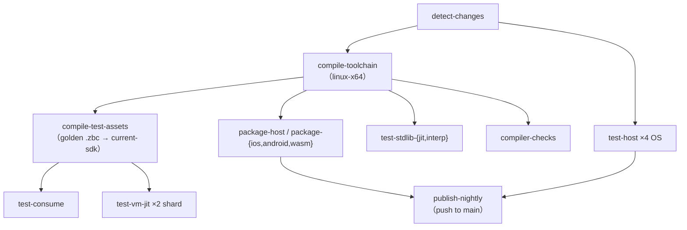

# CI 拓扑与 job 表

> 代码：`.github/workflows/ci.yml`、
> `.github/actions/ci-bootstrap/`、`.github/actions/xtask-bootstrap-artifact/`、
> `.github/workflows/{bench-pr,release,deploy-book,jit-fixpoint-check,retry-ci-runner}.yml`、`.github/ci/retry_runner.py`
>
> 每个 job 具体跑哪条 `xtask` 命令见[测试怎么跑](testing.md)；gate 的 stage 组成见[测试门禁](test-gate.md)。
>
> 待办：`ci-bootstrap` 每代构建前清空其就地 artifacts 的那一步（§1.5）只在冷启动 + 格式 bump 时走到、本地不可验，
> 暂时保留；下一次格式 bump 的 PR 里删掉它并观察 CI——那时它正好被真实行使一次。

改 CI 编排、或者想知道「这条腿为什么没跑 / 我这个改动会触发哪些 job」时读这页。

## 1. 流水线形状



核心思想：**平台无关的东西编一次、下游消费**。`compile-toolchain` 把当前源编成一套
`{z42c, stdlib, xtask}` zpkg 上传成 `toolchain-ubuntu-latest` artifact；`compile-test-assets` 再消费它
regen 一次 golden `.zbc`、连同 `.z42` 布局打成 `current-sdk-ubuntu-latest`。下游测试 job 下载这些产物
直接运行。`goldens.tar` 同时保存 `artifacts/build/tests/` 下的语言 golden 和各库 `release/tests/` 下的 golden，
路径相对 `artifacts/build/`。Interp 消费验证和 JIT 分片解包回同一镜像，使用 `--no-rebuild` 运行。

这两个 job **只有 linux 一条腿**：产物全是 zpkg，与宿主无关，macOS / Windows 的消费方
取的是同一份（只有 z42vm 按宿主 cargo 现编）。

`xtask-bootstrap-artifact` 按消费方选择 VM 准备方式。默认 `vm: build` 在本机编 release VM 和原生库。
只消费现成 release VM 的 job（`compile-test-assets`、`compiler-checks`、`test stdlib --no-build`、`publish-nightly`）使用 `vm: prebuilt`，
Linux x64 直接取 `compile-toolchain` 上传的 `z42vm-linux-x64`（VM 和同目录的 cdylib），其他宿主仍在本机编译。
预编译 artifact 只有运行文件，后续调用 Cargo 的 job 需要自己的 Rust 环境和依赖缓存。
`test-vm-jit` 使用 `vm: deferred` 准备 Rust 和 debug 依赖缓存，由 `xtask test e2e` 构建 debug VM 和压缩库，
保留 debug 断言及溢出检查，并跳过 release 链接。

`compile-test-assets` **故意从 `compile-toolchain` 里拆出来**：golden regen 很慢，留在里面会卡住
`package-*` → `publish-nightly` 这条关键路径，而打包根本不消费测试资产。

`test-consume` 用下载的 SDK 编译并运行 xtask，再调用一次无筛选的 `test e2e --mode interp --no-rebuild --jobs 4`：
golden 消费共享 `.zbc`，随后 cross-zpkg 与 multi-exe 各编跑一次，整条路径都只使用下载的工具链。

`test-host` 是例外——它每条腿自己从上一版 nightly 种子完整自举一遍（`ci-bootstrap` action），
这既是 gate 也是「种子能编当前源」这条边界的实测。

### 步骤里怎么调 xtask

两个 bootstrap action（`ci-bootstrap` / `xtask-bootstrap-artifact`）结束时都把
[`.github/ci/xtask`](https://github.com/z42-lang/z42/blob/main/.github/ci/xtask) 所在目录加进 `$GITHUB_PATH`，之后的步骤一律写

```bash
xtask test --no-build --skip "$SKIP"
```

**xtask 跑在 `.z42` SDK 上，与本地 `./xtask` 完全一致**。两个 bootstrap action 都先经
[`setup-z42-sdk`](https://github.com/z42-lang/z42/blob/main/.github/actions/setup-z42-sdk/action.yml) 把上一版 nightly 装进仓库根 `.z42/`——
与本地 `scripts/install-z42.sh` 同位置同形态；xtask.zpkg 也是用这份 SDK 的 z42c 编的。垫片于是只做本地
apphost 做的事：`.z42/bin/z42vm`（Windows 带 `.exe`）+ `Z42_LIBS=.z42/libs`（调用方设了则尊重）跑
`artifacts/xtask/xtask.zpkg`，**不设** `Z42_PORTABLE_VM` / `Z42_HOME`。

这带来两点：

- **编 xtask 与跑 xtask 是同一个工具链**。若用种子编 xtask、却在 cargo 现编的构建树 z42vm 和构建树
  stdlib 上跑它，本地和 CI 就不一样。xtask 引用的 SDK 库（`z42.project` / `z42.build`）因此能直接用 SDK 里的，
  不必复制进产物。
- **Windows 不需要「从拷贝启动」**。xtask 跑在 SDK 的 VM 上，cargo 碰不到它；若垫片跑构建树的 `z42vm.exe`，`package` 等命令让 cargo 重链它时会
  撞上「不能覆盖正在运行的 exe」。

构建树的 z42vm（Cargo 现编或同轮预编译产物）仍然要有：那是**被测对象**，xtask 构建、测试当前源码时由它自己去
定位，与本地相同。

`xtask-bootstrap-artifact` 消费的 xtask.zpkg 来自 `compile-toolchain`，是用**那个 job** 装到的 SDK 编的，
同目录的 `seed-id.txt` 记着那份 SDK 的身份。如果两个 job 之间 nightly 被重发了（并发运行的 `publish-nightly`
会这样），本 job 装到的就是新的一版，而跨格式 bump 时旧 xtask.zpkg 在新 VM 上加载不了。所以 action 会比对
`artifacts/xtask/seed-id.txt` 与 `.z42/seed-id.txt`，不一致就用本机 SDK 的 z42c 原地重编 xtask（约 1 分钟）。

⇒ xtask 的启动方式只在这一个文件里，**CI 侧只改这一个文件**。`ci.yml` / `release.yml` / `bench-pr.yml` 全部走它。
例外：`test-consume` 故意用下载来的 current-sdk 里的 z42vm 跑，不走垫片。`bench-pr.yml` 里
`cd base-src && xtask …` 也成立：垫片按**自己所在位置**定位 PR 树的三样东西、不看 cwd，于是跑的仍是
PR 的 xtask，而 xtask 的 `_root()` 取 cwd 的仓库根 = base-src（base 工具链另经 `--base-vm` 等显式传入）。

## 2. 触发与门控

### 构建测试与发布的选择边界

新增用例先按[测试用例组织规范 §1](test-layout.md#1-用例放哪)确定被测对象、位置和本地命令。
维护 CI 选择规则时分别回答下面三个问题；执行某个工具不等于要测试这个工具的全部消费者。

| 选择 | 判据 | 例子 |
|---|---|---|
| 构建前提 | 所选命令需要哪些产物、这些产物的真实输入是否改变 | 跑标准库用例需要 VM 和编译器，但不因此需要执行 Rust 单测；已有产物须核对来源、RID、profile 与工具链身份 |
| 测试范围 | 改动影响哪个组件的契约，以及哪些消费者使用该契约 | 私有库测试归该库；stdlib 生产 API 还需考虑消费者；原生绑定、ABI、BundleRunner 改动需对应集成验证 |
| 打包与发布 | 发布内容或打包机制是否改变，以及 nightly 还缺哪些生产改动 | Runtime 包含 native 与 stdlib：只改 stdlib 可能仍须更新包内 libs，但不自动要求重跑全部 Rust / 嵌入用例 |

工程与源集归属复用现有项目 / workspace TOML 和实际依赖。目录约定区分生产源、私有测试、benchmark 与
夹具；共享 helper 若被生产或 benchmark 引用，也保留对应消费者。不要把用例名或逐用例 tier 列表复制进 workflow。
工具链自身的用例归桌面宿主；通用语料是否能在设备执行由运行期能力判断，见[test-layout §4](test-layout.md#4-平台与能力)。

`xtask` 作为工具时需要能编译、启动并执行选中的命令；修改它的计划、调度或退出码时，才测试这些自身行为。
“源码编成同一个 zpkg”不定义测试影响范围。测试计划中没有被所选套件覆盖的验证义务（例如 SDK 验证、
整程序 benchmark）也要保留，不能被一次完整 GREEN 的选择静默覆盖。

**当前自动选择范围**见下面的路径表和 job 表：PR 和 main push 的 test-host 使用 `--changed`；
完整 GREEN 的构建波与 interp goldens 仍是必跑阶段，xtask 的计划等自检当前随 builder 夹具执行。
这些执行入口与本节的归属判据分别描述“现在怎么跑”和“调整路由时要核对什么”。
定期全量测试用于补全覆盖，nightly 发布则按标签到 HEAD 的累计差异判定；不能用单个 push 的 diff
替代发布判定，漏掉尚未进入种子的生产改动。

### 事件与文档快速通道

| 事件 | 行为 |
|---|---|
| `pull_request` / `push` to main | 无路径过滤——**纯文档改动照样跑 CI**，但走快速通道（见下） |
| `schedule`（每日 16:00 UTC） | 无条件全跑，外加只在这里跑的 Tier-2 平台测试 |
| `workflow_dispatch` | 无条件全跑；格式 bump 后手动重发 nightly 的逃生口 |

**纯文档快速通道**：改动**全部**是 `docs/**` 或 `*.md`（`docs/learn/**`、`examples/**` 除外——学习手册的
示例会被重放）时，`detect-changes` 输出 `docs_only=true`，只跑 `docs-check`。改动集合：PR 取 PR 的文件列表，
main push 取 `before...sha` 的 compare（新分支的全零 `before`、API 失败、到 compare 的 300 文件上限 ⇒ 当作非纯文档）。
重命名的旧路径和新路径都参与分类。生产文件或学习手册页移入普通文档时，旧路径仍保留对应检查。
`docs-check` 的内容：ci-bootstrap 的 `xtask-only`
模式（种子 z42c 只编出 xtask，省掉 build compiler / stdlib）+ `xtask test docs links`（先生成 reference stdlib 页，
再查相对链接与文档结构）+ `xtask check diagcodes` + `xtask check layout`（测试类别与能力词表等机器清单对账）。
布局检查读取仓库文件，保留种子 xtask 的轻量路径。符号引用检查用 `z42 doc --page` 按需手动查看，
docs-check 不为它安装 Rust 或编译索引器。doc-lints 随 test-host 检查源码注释。
`test-host` ×4 与 toolchain 链（`compile-toolchain` → `compile-test-assets` / `test-consume`）随之 skip；
main push 上 `publish-nightly` 也随之不跑（纯文档本来就不影响 SDK，见下节的 `sdk` 判定）。schedule / dispatch 不走快速通道。

### main 上的运行不互相打断

PR 上新 push 照常取消旧运行；**push to main 每个 commit 单独一个 concurrency group**，GitHub 不自动取消。
否则连续合并时每个 main 运行都被下一个取消，一个都跑不完 ⇒ nightly 发不出来，而「support 先行、晚一个
nightly 再 use」（见[编译器自举](../compiler/self-hosting.md)）的后续提交等的正是那份 nightly。

取消改由每个 main 运行在 `detect-changes` 里自己做（`.github/ci/main-supersede.sh supersede`）：

1. 找出比自己早、还没结束的 main push 运行（带过滤的运行列表是最终一致的，只用来找候选；取消前逐个再查状态）；
2. 对每一个，看**当前 nightly → 它的 commit** 的累计改动是否影响 SDK：**不影响就取消，影响就留着跑完发布**；
3. 同样判出本运行自己的 `sdk`，作为 `detect-changes` 的输出；`sdk == false` 时 `publish-nightly` skip（没有新东西可发）。

按**累计**改动判、而不是只看那一个 commit：nightly 还没收进的 SDK 改动，后面每个运行都带着，它们也得能发布。
重命名同时检查 `filename` 与 `previous_filename`。生产文件移入私有测试目录时，其删除仍影响 SDK。

「不影响 SDK」= 改动的文件**全部**落在下面这些路径里；其余一律算影响（含 xtask 的 build / package / common /
setup、安装器 `scripts/install-z42.*`、`ci.yml`、`.github/actions/`——它们决定 SDK 里装什么或怎么装）。拿不到 nightly、compare 结果被截断
（≥300 个文件）也算影响。

| 不影响 SDK 的路径 | 理由 |
|---|---|
| `docs/`、`*.md` | 文档 |
| `**/tests/**`、`**/benches/**`、`examples/` | 测试 / bench 源码与夹具、学习手册示例，不进包 |
| `scripts/src/test/`、`scripts/src/bench/`、`scripts/src/common/harness/` | xtask 只做测试 / 检查 / 性能编排的部分与测试执行机制 |
| `.github/workflows/{bench-pr,deploy-book,jit-fixpoint-check}.yml` | 不参与发布的 workflow |

SoT 是脚本里的 `non_sdk_re`，这张表随它改。

**怎么确认 nightly 已包含某个提交**（阶段 1 落地后判断"能不能开始用"）：

```bash
gh api repos/z42-lang/z42/compare/<阶段1 的 main 提交>...$(gh api repos/z42-lang/z42/git/ref/tags/nightly -q .object.sha) -q .status
```

返回 `ahead` 或 `identical` 才算包含——**不是**「发布时间晚于合并时间」。阶段 1 合并后不必盯着它的 main 运行：
改到 SDK 路径的 main 运行不会被后来的合并取消，一定跑完发布（见上节）。

`publish-nightly` 自身仍是全局串行（job 级 `cancel-in-progress: false`）。main 运行不再互相取消后，较早的运行
可能排在较新的之后才发布，所以它先查一次：**nightly 已指向本 commit 的后代** ⇒ 跳过，不拿旧 commit 覆盖新 nightly。

串行靠 job 级 concurrency group，而 GitHub 每个 group **只保留一个等待者**：连续合并时，排队中的较早发布会被
更新运行的发布顶掉（`Canceling since a higher priority waiting request …`）。这是想要的结局——顶替者已过全部
前置 job、发布的是超集——所以 `ci-ok` 把 `publish-nightly = cancelled` 视为可接受（打印一行说明），main 上的
commit 不因此挂红。publish 真失败照样红。

### PR 调度

`detect-changes` 完成路径分类后直接创建下游 job，由 GitHub 原生队列分配可用 runner。
PR 之间不在运行中的 job 内轮询排队；同一 ref 的新提交通过 workflow concurrency 取消旧运行。
main 上的运行替换规则与 nightly 发布串行化分别由对应机制管理。

### macOS 资源队列与 runner 获取失败恢复

主 CI 在 `detect-changes` 中为 macOS 的宿主测试、宿主打包和其余检查分别选择一个资源槽：
按 `run_number` 加 0 / 1 / 2 后对 3 取余，输出 `macos_{host,package,checks}_lane`。
`test-host` 的 macOS 腿使用 host 槽，`package-host` 的 macOS 腿使用 package 槽；
`test-stdlib-interp` 的 macOS 腿、`package-ios`、`test-ios` 使用 checks 槽。

job 级 concurrency group 统一为 `ci-macos-arm64-<lane>`，一个槽同时只申请一个 macOS runner。
三个槽之间并行，主 CI 的 macOS 并发需求上限为 3；同一次运行的三个 job 类别也可以并行，
不同运行按 run_number 轮转分配，避免某一固定类别成为全仓单一瓶颈。重跑保持原 run_number，槽位不变。

槽数的唯一配置在 ci.yml 的 `Select bounded macOS runner queue` 步骤。3 低于
[Free / Pro / Team 默认的 macOS 并发上限 5](https://docs.github.com/en/actions/reference/limits)，
为其它 workflow 留出余量；它不是 GitHub 容量保证。每个槽的 `queue: max` 允许最多
100 个 job 等在 concurrency 队列中，`cancel-in-progress: false` 保留当前执行者；不能只用默认队列，
默认只保留一个等待者、后来的 job 会取消前一个等待者。Linux / Windows 的矩阵腿按 run ID、job 类型、
平台分组，保持并行。PR 的 workflow 级新提交取消旧运行规则仍然生效。

这个队列限制本仓库发给 macOS runner 池的并发需求，但不保证 GitHub 始终有可用的 hosted runner。
GitHub 放弃获取 runner 时，job API 可能报告 `cancelled`，`needs` 矩阵结果可能为 `abandoned`；
两者都代表测试没有完成，`ci-ok` 仍须判红。

`retry-ci-runner.yml` 在 PR CI 失败后读取 API，由 `.github/ci/retry_runner.py` 决定是否重试：

- 仅处理 `.github/workflows/ci.yml` 的 PR 运行，且 PR 仍开放、目标为 main、head 与该次运行一致。
- 运行已结束且结论为 failure；不恢复手动取消、被新提交取消的运行，也不处理过期的完成事件。
- 除作为汇总门的 `ci-ok` 外，每个失败 / 取消的 job 都必须没有 runner、没有执行步骤，且所有 failure
  annotation 均明确说明 hosted runner 获取失败。出现任意实际编译 / 测试错误或无法识别的故障就不重试。
- 一次 API 请求重跑失败 job 及其下游（含 `ci-ok`），复用成功 job 的产物。最多两次自动重试，总 attempt
  上限为 3；用户手动重试也计入这个上限。请求前再次检查运行状态与 PR head，避免恢复已过期的运行。
- 恢复 workflow 只执行自身可信 revision 的脚本，不检出 PR、不消费 PR artifacts；写权限只用于请求重跑。

auto-merge 等待实际测试与 `ci-ok` 重跑通过后继续；恢复 workflow 自己成功不代表 PR 已通过。
重试耗尽仍失败时保持阻挡，需排查 runner 容量或改用有保障的 runner。

自动恢复 workflow 必须先合入默认分支才会接收事件。对已经失败、仍对应当前 PR head 的运行，可手动触发
相同的受限恢复逻辑（仍会检查故障类型和 attempt 上限）：

```bash
gh workflow run retry-ci-runner.yml --ref main -f run_id=<失败运行ID>
```

本地回归测试：`python3 -m unittest discover -s .github/ci -p 'test_*.py'`。
只读诊断：`GITHUB_REPOSITORY=z42-lang/z42 python3 .github/ci/retry_runner.py --run-id <ID> --dry-run`。

`detect-changes` 用 `dorny/paths-filter` 输出 flag，下游 job `needs: changes` + `if:` 门控：

| flag | 命中路径（节选） |
|---|---|
| `platform` | `src/runtime/**`（排除顶层 Rust 测试与纯测试数据）、`src/toolchain/{workload,launcher,devtools,interactive,builder}/**`（builder、interactive、launcher 排除私有 `tests/`）、`scripts/src/{package,setup}/**`、`scripts/packages.toml`、`scripts/src/common/{packages_config,publish,versions,layout}.z42`、`scripts/src/common/harness/fixtures.z42`、`scripts/src/test/app/**`、`scripts/versions.toml` |
| `sdk_checks` | `scripts/src/test/sdk/**`、`scripts/install-z42.{sh,ps1,bat,command}`（安装器）、`src/toolchain/launcher/tests/fixtures/package/**`（桌面发行包验证） |
| `examples` | `examples/**`、`docs/learn/**`（只门控 `package-host`——唯一用打包 SDK 重放示例的 job） |
| `compiler` | `src/compiler/**`（排除私有 `tests/**` 与 `benches/**`） |
| `compiler_checks` | `src/compiler/**`（含私有用例）、`scripts/src/build/compiler*.z42`、`scripts/src/test/compiler/{runner,e2e,selfhost,selfhost_selfcheck,projects_selfcheck}.z42`、`scripts/src/common/projects.z42`、`src/toolchain/devtools/vscode/**` |
| `vm` | `src/runtime/**`（含 `.cargo/`，排除顶层 Rust 测试与纯测试数据）、`scripts/src/test/runtime/runner.z42` |
| `runtime_checks` | `src/runtime/**`（含私有集成测试与数据）、`scripts/src/test/runtime/runner.z42`；控制四个平台的完整 Rust harness |
| `stdlib` | `src/libraries/**`、`src/compiler/**/tests/**`、`src/toolchain/builder/**`（排除 builder 私有 `tests/`；z42b 是 [Test] 执行器）、`scripts/src/test/stdlib/runner.z42`、`scripts/src/common/harness/{package_units,manifest_targets,unit_projects}.z42`、`scripts/src/common/{projects,golden}.z42` |

builder 的生产输入同时触发 `platform` 与 `stdlib`：z42b 既是 [Test] 执行器，它的 `publish`
（apphost / iOS / Android 导出）又只在 `package-*` 里被执行，不能只跑标准库专项。
builder、interactive、launcher 的私有 `tests/` 由桌面职责覆盖。REPL 单测走宿主的 toolchain 阶段，
builder 夹具走宿主的 manifest targets 阶段，launcher 的发行包夹具由 `sdk_checks` 选择桌面 SDK 验证。
平台宿主与编辑器资源仍按其打包输入选择。路径筛选使用 `some-with-excludes`，对每个文件分别判断正向和排除规则，
混合改动中的生产输入仍选择对应专项。

每个 filter 都额外包含 `.github/workflows/ci.yml` 自身 → **改 CI 保底全跑**。

Runtime 顶层 `tests/*.rs`、`tests/data/` 的三个 manifest JSON 夹具、`tests/data/embedding_hello/` 与
`tests/data/z42_native_e2e/` 只由完整 Runtime harness 消费。仅改这些文件时，`runtime_checks`
保留四个平台的 `test runtime`，`platform` / `vm` 不拉起未改变的消费者与打包。
`tests/data/numz42-c/` 仍是 build.rs 在非 wasm、native-interop 构建中的输入，保留全部检查；
不能仅凭“不装进包”就把构建依赖排除。未知测试数据、生产源码、Cargo 配置、build.rs、嵌套 crate
测试与混合生产改动继续保留消费者。宿主自举、golden 与静态检查按既有规则执行。
`schedule` / `workflow_dispatch` 下 paths-filter 没有 before-sha 可比、几乎恒 false，所以每条
门控的 `if:` 都显式带 `|| github.event_name == 'schedule' || ... == 'workflow_dispatch'` 逃生口；
少了它，每日全量 sweep 里这些 job 会一个都不跑。

编译器域（z42c 前后端 + `z42.project` / `z42.build` / `z42.package`）已全部在 `src/compiler/` 下，
`compiler` 覆盖生产输入，驱动 VM / stdlib 的消费者一致性检查；`compiler_checks` 还包含私有测试与 benchmark，
保留编译器单元及其引用的 bench helper 回归，不因收窄消费者专项而丢失正确性验证。
编译器私有 tests 同时触发 `stdlib`：该执行器负责扁平单元与显式 `[tests]` 源集，compiler-checks 只发现目录工程；
两种发现格式都保留覆盖。私有 benches 不触发无关的 VM / stdlib 消费者专项。
`examples` 单独成 flag 而不并进 `platform`：否则改一页 learn 会拉起
`package-{ios,android,wasm}` + `test-desktop`，而它们一个示例都不跑。

> 只有这五个 flag。e2e golden **没有**内容级门控——真要加，得在同一个提交里把消费方
> （某个 job 的 `if:`）一起接上，否则就只是一个没人读的输出，反而让人以为门控存在。

## 3. job 表

job 的 **key**（`needs:` 用的）与 **display 名**（PR 检查列表里显示的）不同名，
下表两列都列出。display 名的约定是 `<动作>-<目标>[-<scope>](<host-arch>)`。

| display 名 | job key | 门控 | 矩阵 |
|---|---|---|---|
| `detect-changes` | `changes` | 总跑 | — |
| `docs-check(linux-x64)` | `docs-check` | **仅**纯文档改动（PR / main push） | — |
| `test-host(<plat>)` | `build-and-test` | 非纯文档改动 | linux-x64 / linux-arm64 / macos-arm64 / windows-x64 |
| `compile-toolchain(linux-x64)` | `toolchain-bootstrap` | 非纯文档改动 | — |
| `compile-test-assets(linux-x64)` | `assemble-current-sdk` | 随 `compile-toolchain` | — |
| `test-consume(linux-x64)` | `consume-current-sdk` | 随 `compile-test-assets` | — |
| `test-vm-jit(linux-x64) shard k` | `vm-jit-consistency` | `vm ‖ compiler` | 2 shard |
| `test-stdlib-jit(linux-x64) shard k` | `stdlib-jit-consistency` | `vm ‖ stdlib ‖ compiler` | 2 shard |
| `test-stdlib-interp(<plat>)` | `stdlib-interp-consistency` | `vm ‖ stdlib ‖ compiler` | 3 OS，不分片 |
| `compiler-checks(linux-x64)` | `compiler-checks` | `compiler_checks` | — |
| `package-host(<plat>)` | `host-package` | `host_package` | linux-x64 / linux-arm64 / macos-arm64 / windows-x64 |
| `package-ios(macos-arm64)` | `package-ios` | `platform_package` | — |
| `package-android(linux-x64)` | `package-android` | `platform_package` | — |
| `package-wasm(linux-x64)` | `package-wasm` | `platform_package` | — |
| `test-desktop-cabi(linux-x64)` | `test-desktop` | `platform ‖ schedule ‖ dispatch` | — |
| `test-wasm-browser(linux-x64) shard k` | `test-wasm` | **仅** schedule ‖ dispatch | 3 shard |
| `test-ios-sim(macos-arm64) shard k` | `test-ios` | **仅** schedule ‖ dispatch | 3 shard |
| `test-android-emu(linux-x64) shard k` | `test-android` | **仅** schedule ‖ dispatch | 3 shard |
| `publish-nightly` | `publish-nightly` | （push to main 且 `sdk` 非 false）‖ dispatch | — |
| `ci-ok` | `ci-ok` | 总跑（`if: always()`） | — |

**`ci-ok` 是本 workflow 的单一结论，也是 main 分支保护唯一的必需检查**（钉在 GitHub Actions app 上，别的应用
冒充不了同名检查）：`needs` 全部其它 job，任一 failure / cancelled 即红，success / skipped 即绿。所以**凡在它
`needs` 里的 job，失败都挡合并**；不在里面的（如另一个 workflow 的 `bench-pr.yml`）红了也挡不住人。

不逐个列 job 当必需检查，原因有两条：新增 / 改名 job 时会漏（保护里挂着已删掉的 job，PR 永远等不到它）；而且
在 job 级被 `if:` 整体跳过的**矩阵** job 只上报一个未展开的名字（如 `test-host(${{ matrix.platform }})`），按平台名
列的必需检查（`test-host(linux-x64)`……）永远不会出现——纯文档 PR 走快速通道时就是这样卡住的。

`if: always()` 是关键：没有它，上游一红它就被 skip，而被 skip 的必需检查视同通过。新增 job 时记得加进它的 `needs`。

几条不显然的编排理由：

- **`test-vm-jit` 门控带 `compiler`**：z42c 改了 codegen / 优化 pass 会重构 IR，JIT 的**输入**
  就变了；`test-host` 的 interp golden 只覆盖新 `.zbc` 的解释执行，不覆盖它的 JIT lowering。
- **wasm / iOS / Android 的 Tier-2 测试只在 nightly 跑**：每个 15~25 分钟且要模拟器，
  挂在 per-push 上会把 runner 池打满。
- `platform_package` 在 `platform` 验证、定期 / 手动运行和需要发布的 main push 上选择全部平台包。
  `host_package` 也响应 `sdk_checks` 和 `examples`，用打包的桌面 SDK 验证夹具与示例。
  main push 使用 nightly 的累计 SDK 差异。确认 `sdk=false` 时只按验证职责打包，未知结果保留发布所需的归档。
  `package-host` 始终构建并验证桌面 SDK，使用其归档离线安装，并用打包后的 SDK 重放手册示例。
  桌面 runtime / workload 归档与链接 runtime 包的 C 宿主检查由 `platform_package` 选择。
  只选择桌面 SDK 的 main 运行仍上传 SDK 归档，供 CI 种子回退使用。
  修改生产打包实现、混合生产输入、CI 配置及定期 / 手动事件均保留对应覆盖。
  执行失败经 `ci-ok` 挡合并；被职责选择跳过的 job 由 `ci-ok` 接受 skipped。
- **`publish-nightly` 的 `needs` 故意不含两条 jit 腿**：那些 job 在
  zbc/zpkg 格式 bump 那一轮会暂时红（要等一个兼容的 nightly），gate 上去就是死锁。
  「行为正确」由在 `needs` 里的 `test-host` + `package-*` 保证。

- **没有专门的「种子自举边界」job**：「上一版 nightly 能编当前源」由每个跑 `ci-bootstrap` 的
  job（`test-host` ×4 OS、`compile-toolchain`）顺带实测，且它们会真的**运行**刚建出的 gen1 z42c
  （编 stdlib + golden）；`compiler-checks` 用 `xtask test compiler --no-build` 消费同轮 release VM、gen1 和 stdlib，
  执行编译器单元和 CLI 夹具，并实际重建 gen2 进行不动点对账。再单设一个
  `ci-bootstrap` + `test compiler` 的 job 两半都与上述重复。
- **没有专门的 feature 组合 job**：host 上 `cargo check` interp-only / wasm / ios /
  android 四个组合没有必要：后三者 `package-*` 本就在真实目标平台上完整构建；「interp-only 不含
  cranelift」断言在 `package-wasm` 里。`.cargo/**` 并入 `platform` 过滤器（配置只有 `src/runtime/.cargo` 一份，由 `src/runtime/**` 覆盖）。

学习手册示例按 `changes.outputs.host_package` 分工。它集中原有的打包选择条件：platform、sdk_checks 或 examples flag 为 true，
或事件不是 PR。打包 job 会执行时，每个平台只在打包 SDK 上重放会话；非 Windows 的 test-host 跳过开发 SDK 准备与
examples stage。打包 job 不执行时，test-host 用 `--changed` 决定是否执行 examples；开发 SDK 的准备属于该 stage，
只有实际执行时才构建 apphost 并组装，不再由 workflow 提前准备。本地完整 `xtask test` 也保留 examples。
两条路径调用同一个 `test docs examples`、校验同一套会话输出与退出码，打包失败仍经 `ci-ok` 挡合并。

测量这段重复工作时，在同一机器预热开发 SDK 与打包 SDK 后，交替测量三组：原编排为
`xtask test docs examples` 加 `xtask test docs examples --sdk <打包 SDK>`，复用后只执行后者。
每次核对会话数、步骤数与成功状态。两条 CI job 可以并行，时间总和反映 runner 的执行工作量；
整条 CI 墙钟收益要另看 Actions 的依赖与排队，不能直接用该总和替代。

`test-host` 各腿用 `--skip` 把 stage 卸给并行 job：linux-x64 跳 `stdlib,compiler,vscode`，
其余 OS 再多跳 `cross-zpkg,bench`（这两者 host 无关，一条腿够了）。PR 另加 `--changed <PR base sha>`，
main push 另加 `--changed <github.event.before>`，沿用同一份阶段映射跳过不受影响的重 stage
（见[测试门禁](test-gate.md) §5、§7）。`.github/ci/changed-base.sh` 获取并验证对应 commit，
只把 SHA 写到 stdout；首次 push、缺失 / 无法获取基线时返回空结果，退回全量。schedule / dispatch 保留全量。
测试基线只用于本次提交的选测；`publish-nightly` 仍按 nightly 到 HEAD 的累计 SDK 差异决定，不受此基线替换。

完整 Rust 测试用 job 环境变量 `RUN_RUST_RUNTIME` 统一决定：`runtime_checks` filter 为 true，或事件是 schedule / dispatch 时，
独立执行完整 `xtask test runtime`；此时非 Windows 腿的 `test` 追加跳过 `rust-units`，避免重复执行 `--lib`。
完整 harness 使用同一 workspace、feature 与串行参数，覆盖窄版的库单测和所有 target 编译，并执行集成与文档测试。
其余情况下，窄版 `rust-units` 是否执行由改动映射决定：例如仅标准库改动不选 Rust 阶段，
未知输入或无法读取基线则保留保守的全量路径。本地不带改动分流的 `xtask test` 仍运行 `rust-units`。
Windows 腿不跑 `test`；仅在完整 harness 会执行时，先 `build test` 再 `xtask test runtime`。

测量重复 Rust 阶段时，先以同一源码与 Cargo cache 预热，再交替计时三轮：原编排为
`cargo test --lib`、`cargo test --no-run`、`cargo test --lib`，精简编排为一次 `cargo test --lib`；
两边都带 `--locked --workspace --features z42-test-fixtures --manifest-path src/runtime/Cargo.toml` 和运行时 Cargo config，
执行测试时带 `-- --test-threads=1` 及 `RUST_MIN_STACK=8388608`。两边共同的集成 / 文档测试不计入这个重复片段。
核对每次库测试的数量与成功状态，整条 CI 的耗时另外从 Actions 记录读取。

三条非 Windows 腿在 `test` 之后
跑 **zbc-format 字节基线门**（`git diff --quiet -- src/compiler/z42.package/tests/fixtures/zbc-format`；regen 就地重写了基线，
有 diff = 提交的基线过期）——一次覆盖三个架构，失败经 `ci-ok` 挡合并。

### 3.0 PR 的绿是「过期快照」——与抢号预检

**一个 PR 的绿灯说的是：它的 head 与「那次 run 触发时」的 base 合起来是绿的。**
`actions/checkout` 在 `pull_request` 事件下拿的是 merge ref，所以跑的确实是合并结果；
但 **base 后来前进不会自动重跑**。于是两个并行 PR 可以各自全绿、双双合入、main 才红。

实测：#747 在 13:43:15 合入 main，#759 在 13:46:00 合入而它的 `baseRefOid`
还停在 #761 —— 两边的绿都不含对方，两个 PR 各拿走了同一个诊断码号 `E0481`，
[诊断码唯一性](test-gate.md)的门在各自的 base 上都看不见冲突，`main` 才红（#762 收拾残局）。

根治是分支保护的 **`require branches to be up to date before merging`**（当前 `strict: false`，
**有意不开**）：它要求每个 PR 合并前 rebase 并重跑**整套**自举/多平台 CI，把并行开发串行化，
对这条 CI 太贵。

替代是 `test-host(linux-x64)` 末尾的 **抢号预检** 步骤：GREEN 已经跑完、树可以随便动，
于是 `git merge` 进**最新** main，重跑一次纯文本扫描的 `xtask check diagcodes`（秒级）。
窗口从「PR 的整个生命周期」缩到「最后一次 CI 到合并之间」；**按下 merge 前重跑一次这个 job
就能把窗口压到近零**。挖不到共同祖先（浅克隆）或与 main 有文本冲突时它**放行**——
前者是环境限制，后者 GitHub 本身已经挡住合并，不重复报警。

> ⭐ **为什么挂在 `test-host(linux-x64)` 末尾**：它无路径过滤、PR 上必跑，失败经 `ci-ok` 挡合并，零额外 job。
> 新开 job 也可以，但必须加进 `ci-ok` 的 `needs`——不在里面就是「会红但不挡人的门」（[测试门禁](test-gate.md)里对
> 「它真会红吗 / 它真挡得住人吗」的讨论同理）。这个思路可以推广到**任何「两个 PR 各自合法、合起来才错」的维度**：
> 加判据时先问「它红了会不会经 `ci-ok` 挡人」。

### 3.0.1 Rust 缓存 key

Swatinem `rust-cache` 用 `shared-key` 跨 job 共享；**一个 key 命中后不回存**（post 步骤报
"Cache up-to-date"）。所以两个构建集合不同的 job 共用一个 key，后写的那个多编的东西永远进不了
缓存。规则：**构建集合不同 ⇒ key 不同**。

| key | 用它的 job | 构建集合 |
|---|---|---|
| `test-host-v1` | `test-host` | release + debug + test profile |
| `host-v2` | `compile-toolchain` | release（ci-bootstrap） |
| `artifact-host-v1` | `xtask-bootstrap-artifact` 默认 | release workspace |
| `vm-jit-debug-v1` | `test-vm-jit` | debug VM + 压缩库 |
| `package-host-v2` / `ios-v2` / `android-v2` / `wasm-v2` | 各打包 job | + cdylib / staticlib / 交叉编译 |

⚠️ target 目录由 `src/runtime/.cargo/config.toml` 重定向到 `artifacts/build/runtime`（toolchain 平台 crate
经 xtask 显式传 `--config` 共用同一个 target-dir）。cargo 只从
**cwd** 向上找配置（不看 `--manifest-path`），所以 CI 不直接调 cargo，一律走 `xtask`（它显式传 `--config`）；
唯一例外是 `bench-pr.yml`：预热 job 不装 SDK、base 侧编的是另一棵树，它们在 `src/runtime` 下跑 cargo。**所有** job 的
`workspaces` 都要写 `src/runtime -> ../../artifacts/build/runtime`——写裸 `src/runtime` 缓存的是
一个空目录。

## 3.1 自举种子从哪来

**每个**跑 xtask 的 job（`ci-bootstrap` 与 `xtask-bootstrap-artifact` 两条路径都一样）都要先经
[`setup-z42-sdk`](https://github.com/z42-lang/z42/blob/main/.github/actions/setup-z42-sdk/action.yml) 拿一份上一版 SDK，装进 `.z42/`。
它既是 xtask 运行所在的 SDK，也是 **z42c 种子**：用它编当前源码，xtask 的 `_seedSdkDir` 会自己找到 `./.z42`。
`ci-bootstrap` 的 `xtask-only=true` 只用这份 SDK 编译并运行当前 xtask 及其工具依赖，不暂存产品种子、
不读取当前产品的格式常量，也不执行产品格式的两代自举。xtask 的编译器、输出格式与执行 VM 均属于同一份 SDK；
当前产品格式和 SDK 不同时，文档 / 源码检查也不必先构建当前编译器和 stdlib。
普通模式仍检查格式差异并在需要时执行两代自举，再构建当前产品。
取用顺序如下：

```
nightly release 的 z42-sdk-nightly-<rid>          （首选，10 次重试）
  ↓ 下载不到，或包里没有 programs/z42c/
main 上最近 5 次成功 CI 运行的 release-host-<rid> artifact（回退，逐个试；内含 z42-sdk-nightly-<rid> 归档）
  ↓ 全都过期 / 没有本 RID
报错退出（错误信息带人工恢复指引）
```

**回退为什么是安全的**：自举纪律（[编译器自举](../compiler/self-hosting.md)）
保证「上一版 z42c 永远能编当前源码」——新语法与格式 bump 都是 support 先行、晚一个
nightly 再 use。成功 CI 运行的产物顶多落后一两个 commit，牢牢在这条**单向递推**的纪律内。

> 🔴 **回退目标必须是 CI artifact，不能是「最近的正式 release」。**
> 若回退到最近的正式 release，实测**救不回来**：正式 release 可能落后很多个 zpkg 格式 bump
> （实例：v0.5.0 是 minor 43、当时源码 48，差 5 个），会触发 [1.5] 两代自举；
> 而两代自举**全程用种子自带的旧 VM**，它加载不了 gen1 产出的新格式 stdlib——
> run 35290607109 的日志就停在
> `z42.core.zpkg … zpkg minor 48 not supported (writer is at 0.43)`。
> 成功 CI 运行的 artifact 格式天然对得上，**根本不进两代路径**。
>
> 附带一个好处：不依赖 release 是否被正确发布（artifact 里就是 package job 出好的同一份归档）。保留期 90 天，所以逐个试最近 5 次。

> 🔴 **候选运行从 artifact 列表挑，不能用 `gh run list --branch main --status success`。**
> 带过滤条件的运行列表是**最终一致**的，故障期间会长时间返回陈旧结果（实测返回的「最近 5 次成功运行」
> 全是一个月前的、artifact 早已过期，回退因此整条失效）。现在的做法：
> `GET /actions/artifacts?name=release-host-<rid>`（实时、新→旧）→ 留未过期且 `workflow_run.head_branch == main` 的
> → 逐个 `GET /actions/runs/<id>` 确认 `conclusion == success`（单个运行查询不走过滤索引）→ 前 5 个依次试。
> 每次下载失败都打印**该次**的错误，便于判断是没归档、过期还是权限问题。

> ⚠️ **权限**：这条回退要 token 的 `actions: read`。仓库默认 workflow 权限是 read（含 actions），
> 但自定义了 `permissions:` 块的 job（`publish-nightly`、`test-*` 平台测试、`release.yml`、
> `jit-fixpoint-check.yml`）**必须显式带上 `actions: read`**，否则回退会静默失效。现有的这些 job 都已带上，
> 新加 `permissions:` 时别漏。

> ⚠️ 按 RID **后缀**挑目录（`z42-*-<rid>-release`），不要硬编码 runner 标签
> （`ubuntu-latest` / `macos-26` 这些会变，包名由 packaging 决定、稳定）。

### 为什么必须有回退

若 nightly 是**唯一**种子来源，它一旦不可用——卡成 **draft**（draft 对别的运行的
`GITHUB_TOKEN` 不可见，下载一律 "release not found"）或缺 SDK 包——所有 bootstrap job
拿不到种子 → 全红 → `package-*` / `publish-nightly` 被 skip → **发不出新 nightly 自救**。

而 `workflow_dispatch` 那个逃生口**在同一个环里**——`publish-nightly` 的 `needs` 全是
bootstrap job。实测（run 35287940676）照样全红。

⇒ 破环只能靠**种子有第二来源**。这就是回退链存在的理由。

**回退链失效时的人工破环流程**（也是错误信息里指的那条）：

0. 先看 `gh release view nightly`：若只是卡成 draft、资产齐全，核对 SDK 包（见下）后
   `gh release edit nightly --draft=false --prerelease` 即可，不必走后面几步
1. `gh api 'repos/z42-lang/z42/actions/artifacts?name=release-host-linux-x64'` 找最新、未过期、
   `head_branch == main` 且所属运行 `conclusion == success` 的那次 run（别用带过滤的 `gh run list`，理由见上）
2. `gh run download <run> -p 'release-*' -D artifacts/packages --merge-multiple` 取它的归档（各 package job 已用
   `--archive --label nightly` 在自己的 runner 上随打包一起出好）
3. `xtask package release nightly --channel nightly --tag nightly --version nightly`
   （合并 desktop workload → `SHA256SUMS` → `release-index.json` → `release-notes.md`，与 `publish-nightly` 同一条命令）
4. 按 `publish-nightly` 的原地更新顺序发布：`gh release upload nightly <归档…> --clobber` →
   `gh api -X PATCH repos/z42-lang/z42/git/refs/tags/nightly -f sha=<run 的 head sha> -F force=true` →
   `gh release edit nightly --title … --target <sha> --prerelease --draft=false`，再校验非 draft

发布前务必逐个核对 SDK 包**真的带种子**：解包后 `programs/z42c/*.zpkg` 非空、
`bin/z42vm` 在、`z42c.driver.zpkg` 的 zpkg minor 与当前源码一致
（`od -An -tu2 -j6 -N2` 读，源码侧看 `z42.package/src/ZpkgWriter.z42` 的 `Minor`）。
minor 不一致就会把所有 job 推进两代自举那条已知会挂的路。

### 发布方式：原地更新，从不删除重建

`publish-nightly` 对 `nightly` release **只做原地更新**：① `.github/ci/upload_release_assets.py` 调 `gh release upload --clobber` 串行覆盖并核对每项 SHA256 / 字节数 / uploaded 状态 →
② 删掉本次不再产出的旧资产 → ③ `PATCH git/refs/tags/nightly` 把 tag 移到本次 commit →
④ `gh release edit` 改标题 / 说明 / target。release 对象与 tag 从不消失；只有仓库里一个 nightly 都没有时才
`gh release create`。发布后校验三件事：非 draft、tag 指向本次 commit、资产齐全。

单项上传遇到 HTTP 5xx、EOF 或瞬时连接错误，或者上传返回成功但远端资产收据缺失 / 摘要、大小、状态不符时，最多尝试 5 次，间隔 1/2/4/8 秒。每次上传返回成功后用 release 的资产元数据核对本地内容，确认交付才继续下一项。每次重新解析并覆盖该资产，允许前次删除已生效但响应失败；成功的前序资产不在同一调用内重复上传。HTTP 4xx 等非瞬时错误或预算耗尽保留失败状态，后续 tag/metadata 更新与最终验证不执行，发布门禁仍为红。

不能「先删后建」：删掉再立刻重建**同名 tag**，在 GitHub 一侧是有竞态的——旧 tag 的删除可能在新 tag
建好**之后**几分钟才生效，把新 tag 一起删掉；tag 一没，release 就自动退回 draft，此时发布步骤自己的
「非 draft」校验早已通过。原地更新没有「不存在」的窗口，这条竞态无从发生。

剩余的小窗口：某个资产正在 `--clobber` 上传的那几秒，下载方可能拿不到它（或拿到上一版的完整归档）；
`setup-z42-sdk` 的 10 次重试覆盖它。发布中断或外部服务持续失败可能留下新旧资产并存或个别资产缺失；失败发布不能当作完整快照，
下一次发布重新覆盖并验证全部资产，下载方仍按自举种子回退机制恢复。

## 4. 其它 workflow

| 文件 | job | 干什么 |
|---|---|---|
| `bench-pr.yml` | `bench-regression(linux-x64)` | 同 runner A/B 性能门；用窄 `paths:` allowlist，纯文档 PR 天然跳过 |
| `release.yml` | `verify-version` / `package-<rid>` ×9 / `publish-release` | tag 触发的正式发布，见[打包与发版](release.md) |
| `deploy-book.yml` | `build` / `deploy` | 三本书 + 安装脚本发到 GitHub Pages；构建前 xtask-only bootstrap 后 `xtask build docs` 现生成 reference 的 stdlib 包页（不入库），所以 stdlib 源码 / `z42.doc` / `scripts/src/build/docs/generate.z42` 的改动也触发 |
| `jit-fixpoint-check.yml` | `jit-fixpoint(<rid>)` | JIT 不动点实验腿 |
| `retry-ci-runner.yml` | `retry` | PR CI 的 hosted runner 获取失败有限重试，见上文资源队列与恢复规则 |

## 5. 本地镜像 CI

CI 的分解只为并行，**本地永远整跑**：

```bash
./xtask test                 # 完整 GREEN gate（= CI 各腿 --skip 之前的全集）
```

想缓存昂贵的前段、只反复迭代测试时，照着 CI 的分段来：

```bash
./xtask build toolchain      # 编一次当前工具链（含 apphost）
./xtask package dev-sdk      # 组装成 SDK → artifacts/.z42
./xtask build test           # 编一次 golden .zbc
./xtask test --no-build      # 消费上面两者，不重编
```

`xtask test changed` 按 `git diff` 只跑受影响的 stage，适合内循环；**它不构成 GREEN**，
push 前仍须完整 `xtask test` 全绿。任何测试失败（含 pre-existing）都不得 commit / push。
