# 惰性逐函数 JIT（lazy per-function compilation）

> 代码：`src/runtime/src/jit/`
> （`runtime.rs` / `lazy.rs` / `frame.rs` / `mod.rs` / `helpers/call.rs` / `helpers/vcall.rs`）。

## 为什么

`--mode jit` 下，VM 先把入口程序的**整个传递依赖闭包**（stdlib 全体）合并成一个
`Module`（`main.rs` 的 eager transitive BFS），再由 JIT 后端编译。若在加载时就
把合并模块里**每一个函数**用 cranelift 全量编译一遍，则对一个只调用少量 stdlib 函数的短命程序，
就意味着编译了数千个**从不会被调用**的函数。后果：

- 每次 `z42vm ... --mode jit` 启动付一次「整套 stdlib 冷编译」的固定成本（实测约 1–2 秒起，
  随 stdlib 增大而上升）。
- CI 的 `test-vm-jit` 每个 golden 用例 fork 一个新进程 → 固定成本 × 用例数，一个 shard 撞
  55 分钟超时。

**根因**：「加载即全量编译」会编译程序不调用的东西。

## 核心思想

把编译从「加载时全量」改为「**首次调用时逐函数**」（compile-on-first-call）。被调用到的
函数照常编成原生码真跑（JIT 语义/覆盖不变）；没被调用的永不编译。

可行的前提（关键）：z42 的 `Call` / 虚调用**从不生成直接 cranelift call 到兄弟 z42 函数**，
一律经运行时 helper `jit_call` / `jit_vcall` 间接派发（`translate.rs` 只用 `FuncId` define
当前函数自身，不 link 兄弟）。因此每个函数可以**完全独立**地 declare + translate + finalize，
无需被调者先就绪——被调者在调用点按需编译即可。

## 数据结构

```
VmCore（每 VM 一份，所有线程共享）
└── jit: OnceLock<JitRuntime>                          // 首个 jit::run 装上，随 VmCore 一起释放
        ├── slots: SparseSegTable<JitSlot>             // 按 JIT id 索引
        │        └─ JitSlot { entry: OnceLock<FnEntry>, count: AtomicU32, state: Untried | Rejected }
        ├── module: *const Module                      // JIT id 相对的模块（生产即 VmCore.module）
        ├── funcs: Arc<FuncTable>                      // 惰性函数按 FnId 取
        ├── lazy: Mutex<LazyCompiler>                  // 拥有 cranelift JITModule，保活代码页
        │        └─ LazyCompiler { jit: JITModule, helper_ids, profile }
        ├── jit_threshold / osr_threshold
        └── osr_entries: Mutex<HashMap<(id, K), FnEntry>>

VmContext（每线程一份）
├── jit_head: JitHead (#[repr(C)])                     // 生成码按偏移读
│        ├── stack_limit   // 驱动本 ctx 的线程的栈下限，栈底帧 push 时写入
│        ├── cctors        // VM 的 CctorRegistry（包初始化门计数）
│        └── jit           // 缓存的 &VmCore.jit（未装 JIT 时为空）
└── safepoint_skip                                     // safepoint 节流计数，生成码按偏移读写
```

**上下文参数 = 运行线程自己的 `VmContext`**。每个编译出的函数和每个 helper 的签名都是
`fn(frame: *mut JitFrame, ctx: *const VmContext, …)`，`ctx` 就是调用它的那条线程的上下文（`invoke::call_native`
传入）。于是帧栈、待抛异常、寄存器池、arena、计数器分片、safepoint 计数、栈下限都直接是本线程的；生成码按
`offset_of!` 常量读 `VM_CONTEXT_STACK_LIMIT_OFFSET` / `VM_CONTEXT_CCTORS_OFFSET` / `VM_CONTEXT_SAFEPOINT_SKIP_OFFSET`，
helper 与解释器分流经 `VmContext::jit()` 取共享的 `JitRuntime`（`helpers::jit_rt` / `jit_module`）：一次 relaxed load
读本 ctx 缓存的 `jit_head.jit`。缓存在构造时取自 `core.jit`、由 `install` 写给安装它的 ctx；早于安装就存在的 ctx
在下一次栈底帧 push 时补上（在那之前它的解释器帧照常解释执行）。这与 HotSpot / .NET 的「线程寄存器」
同构：共享的是代码和槽表，可变的执行状态一律跟线程走。

- **JIT id = `FnId`**（`VmCore.funcs`，见 [vm-architecture.md](vm-architecture.md)「Call 站点 token：FnId」）：
  入口模块的函数是 `0..n`（= `module.functions` 下标），惰性加载包的函数是之后的 id。interp `Call` 站点的
  token 存的就是这个 id，所以 JIT 直接烘焙、直接缓存，不另起一套编号。`JitRuntime::fn_of(id)` 无锁取回
  `&Function`（入口函数取模块，惰性函数取 FuncTable 槽，后者持有 `Arc` 保活）；`id_of_func(f)` 反查
  （入口函数按地址，惰性函数按 `f.id`，均不哈希）。模块不是 FuncTable 的入口模块时（单测里的裸
  `VmContext::new()`），只有模块下标算 JIT id，惰性函数没有 id、一律解释执行——与 interp 的 token 规则一致。
- **`slots`** 是稀疏分段表：段在首次触达时 CAS 分配、永不移动，`get(id)` 无锁，`OnceLock::get()` 交出的
  `&FnEntry` 在 VM 存活期内有效——**热路径读取零锁**。槽与 `JITModule`（代码页）同在 `JitRuntime` 里，随 VmCore 释放；
  还持有 VmCore 的线程（worker）因此始终能跑已编译的代码。
- **by-name 只在冷路径**：`id_by_name(name)` = `func_index` → `funcs.lazy_id` → `try_lookup_function`（可能加载包）
  → 同一套 by-id 槽。仍按名字进来的只有入口函数和 `ToString`。闭包 / `FuncRef` 在 `LoadFn` / `MkClos` 时就把目标绑成 `FnId`
  （P1-2 PR 8），`jit_call_indirect` 直接按 id 查槽；`LoadFn` 的 token 编译时已绑定就内联成一次寄存器写（tag 9 + id），
  不调 helper，见 [vm-architecture.md「闭包 dispatch」](vm-architecture.md#闭包-dispatchclosure--funcref)。构造器取
  `ObjNew` 站点缓存里的 `FnId`（见 [vm-architecture.md](vm-architecture.md)「ObjNew dispatch」）。
- **`Mutex<LazyCompiler>`** 只在**真正编译某函数**时加锁。编译发生在**调用线程**上：哪条线程先让函数达到阈值，
  就由它在锁下编；别的线程要编同一个或另一个函数就等锁（见「线程安全」）。

## 首次调用流程

```mermaid
flowchart TD
    A[jit_call / jit_vcall / ctor / closure / ToString / interp 路由<br/>resolve_fn_by_id&#40;id&#41;] --> B{slots.get&#40;id&#41;.entry 命中?}
    B -- 是（已编译） --> R[返回 &FnEntry，走 native]
    B -- 否 --> S{state == Rejected?}
    S -- 是 --> I[返回 None → 调用方解释执行]
    S -- 否 --> T{tiered: ++count < 阈值?}
    T -- 是（冷） --> I
    T -- 否 --> C{fn_of&#40;id&#41;<br/>jit_unsupported?}
    C -- 是（interp-only 指令） --> X[state = Rejected] --> I
    C -- 否 --> L[lock&#40;lazy&#41;]
    L --> D{双重检查<br/>entry 仍空?}
    D -- 他线程已编 --> U[unlock → entry.get&#40;&#41;]
    D -- 仍空 --> E[compile_fn&#58; declare+translate+finalize<br/>get_finalized_function → FnEntry]
    E -- 失败 --> X
    E --> F[entry.set&#40;e&#41; 发布<br/>计数器 += 1]
    F --> U
    U --> R
```



伪代码（`JitRuntime::resolve_fn_by_id_thr`，`runtime.rs`；`thr = 0` 即不分层、立刻编；`vm` 是调用线程的上下文）：

```rust
fn resolve_fn_by_id_thr(&self, vm, id, thr) -> Option<&FnEntry> {
    if let Some(e) = self.slots.get(id)?.entry.get() { return Some(e); } // 热路径：零锁
    let func = self.fn_of(id)?;                                // 无锁取函数
    let slot = self.slots.get_or_init(id)?;
    if slot.state == Rejected { return None; }                 // 负缓存
    if thr > 0 && slot.count.fetch_add(1) + 1 < thr { return None; } // 冷 → interp
    resolve_function_tokens(func, module, vm);                // 锁外：可能加载包
    if jit_unsupported_reason(func).is_some() { slot.state = Rejected; return None; }
    let chained = chained_forward(vm, func);                   // 锁外：可能加载包
    let mut guard = self.lazy.lock();                          // 只有编译拿锁
    if slot.entry.get().is_none() {                            // 双重检查
        match guard.compile_fn(func, &CompileLookup { rt: self, vm }) {
            Ok(e)  => { slot.entry.set(e); vm.counters().jit_methods_compiled += 1; }
            Err(_) => { slot.state = Rejected; return None; }  // 编译确定性 → 不重试
        }
    }
    slot.entry.get()
}
```

`resolve_fn_by_name(vm, name)` = `id_by_name(vm, name) → resolve_fn_by_id(vm, id)`。

**入口函数**无调用者触发，故 `jit::run_fn` 在执行前显式 `resolve_fn_by_name(entry)` 先编它。`jit::run` 先
`runtime::install`（每 VM 一个 JIT；已装则复用，换模块则报错），再清静态字段、跑入口。

## 为什么「编译时运行中的调用者不崩」

最关键的正确性问题：函数 A 的原生码正在栈上执行，调用 B 触发 B 的
`finalize_definitions()`——会不会让 A 的代码页失效？

**不会**。cranelift-jit 为每个函数**单独分配代码内存**；`finalize_definitions` 只对**本次
新定义**的函数做重定位 + `mprotect`，先前已 finalize 的函数代码页原地不动、指针保持有效。
这正是逐函数增量编译成立的基础。单测
`caller_lazily_compiles_callee_mid_execution`（`lazy_tests.rs`）专门锁定这条不变量。

## 线程安全

VM 的每条线程都跑 JIT 代码：主线程和 `__thread_spawn` 的 worker（`VmContext::new_with_core`）共用 `VmCore.jit`，
各自以自己的 `VmContext` 作上下文参数。

- **编译**：在调用线程上、`Mutex<LazyCompiler>` 锁内进行，`OnceLock` 双重检查 → 同一函数只 `define` 一次、
  无数据竞争。等锁的线程**不 park**：调用方可能在 resolve 期间手握只在 Rust 局部变量里的值（`jit_obj_new` 刚分配、
  ctor 还没跑的实例），park 期间跑的回收看不到它。持锁方在锁内不到 safepoint、不等回收——翻译器只探查已加载的东西
  （`forward::CompileLookup`），可能加载包 / 跑初始化器的两件事（token 解析、`chained_forward` 的查找）都在拿锁之前做完——
  所以等待以一次编译为上界，与 VM 其他内部锁同一立足点。代价：GC 请求要等排在编译锁上的线程轮完。
- **发布**：`compile_fn` 返回前 cranelift 已把代码页改为可执行、刷 icache 并对所有线程做流水线同步
  （`wasmtime_jit_icache_coherence::pipeline_flush_mt`）；之后 `OnceLock::set`（release）发布，别的线程 `get`
  （acquire）后直接跳进去。段指针 Acquire 读、CAS 发布（`SparseSegTable`）。
  `LazyCompiler` 手动 `unsafe impl Send`（非 `Sync` 的 `JITModule` 只在锁内触碰）。
- **计数**：`count` Relaxed 累加，多线程一起计；丢一次增量只会晚一次升层。编译计数记在**编译线程**的计数器分片上，
  总数看 `counters_snapshot`。
- **负缓存**：`state` 用 Relaxed 读写；竞争中的读者偶尔没看到刚写下的 Rejected，只会把（确定性的）判定再做一遍。
- **OSR 缓存**：在编译锁内再查一次、编完在锁内写入（锁序：编译锁 → `osr_entries`），同一 `(id, K)` 只编一次。
- **调用点缓存**：生成码烘焙的可变单元全在 `Function.resolved` 里（`method_tokens` / `VCallIC` / `FieldIC` / `ObjNew`
  站点），本就由解释器的多线程共用、原子读写；JIT 没有私有的可变缓存。
- **GC**：worker 的 JIT 帧经 `call_native` 压进 worker 自己的帧栈，safepoint 计数与慢路径都用 worker 自己的上下文，
  park 后由回收线程经 `scan_frames_parked` 扫描——与主线程完全相同。
- 单测：`concurrent_first_call_compiles_exactly_once`（两线程竞争首调）、`runtime_tests.rs`（一条线程编译、另一条线程原生调用；
  worker 到阈值在本线程编译；worker 上抛异常只落在 worker；序言按运行线程自己的栈下限检查）。

## 决策权衡

| 决策 | 选择 | 理由 |
|------|------|------|
| eager vs lazy | **彻底 lazy**，无 eager 全量循环 | 不留兼容路径；AOT 若需 eager，随 AOT 再引入策略分叉 |
| 槽结构 | `SparseSegTable<JitSlot>`，按 `FnId` 索引 | 入口函数与惰性函数一张表；热路径零锁 + 地址稳定（借用长期有效） |
| id 空间 | 复用 FnId，不另编号 | interp token、JIT 烘焙常量、站点缓存三者同值；惰性函数也能烘焙 |
| by-name 表 | 无，冷路径经 `id_by_name` 路由回 by-id | 消除第二套内部可变结构 |
| 计数器 | `jit_methods_compiled` = **实际编译数** | 更真实；`JitModuleCompiled` 事件仍每模块一次（报模块规模 + setup 耗时） |
| 上下文参数 | **运行线程自己的 `VmContext`**；共享 JIT 状态放 `VmCore.jit` | 任何线程都能跑原生码，不经共享的单一 `vm_ctx` 指针；热字段按偏移读，少一次间接 |
| 编译在哪 | 调用线程、编译锁内 | 不引入后台编译线程；批量 / 后台编译是 runtime-audit 待办 X-13 的事 |

## 覆盖不变（与 interp 的关系）

被调到的可翻译函数照常 JIT 原生执行；interp-only 指令的函数（`LoadLocalAddr` /
`CallNative` 等，见 `jit_unsupported_reason`）槽位记为 Rejected，调用方解释执行——
与「skip 后 interp」逐一对齐。golden 套件 `test e2e --mode jit` 全部输出与 interp
参考逐字节一致，是「语义/覆盖不变」的最强回归保证。

## 效果佐证

`Z42_JIT_PROFILE=1` 运行单个 golden，打印的「`lazy-compile <fn>`」行数 = 实际编译函数数，
应从「整套 stdlib（数千）」降到「该用例实际调用（数十）」。CI `test-vm-jit` shard 墙钟随之
从 ~55 分钟大幅回落。

## `[Native]` 包装函数短路（`jit/forward.rs`）

`[Native("__x")] extern` 方法的包装函数（`%d = builtin __x(%0, …); ret %d`）在两个引擎里都按函数折叠：
调用解析到它时直接从调用者寄存器跑 builtin，不建包装函数的帧。识别规则、为什么在 VM 链接期而不在编译器里做、
栈回溯怎样保持不变（无帧 + 失败时现算行 / 轻帧），见 [native ABI §6.4](native-abi.md)；识别与执行的代码
在 `interp/forward.rs`，两个引擎共用。

JIT 这一侧：

- **已编译的包装函数**：`JitRuntime::resolve_slot_slow` 把函数自己的折叠结果（`Function::forward`，
  `interp::forward::forward_of`）抄进 `FnEntry::forward`；`jit_call` 的 `call_compiled`（模块初始化 /
  cctor 屏障之后）与 `jit_vcall` 的 `invoke_entry` 见到它、且实参个数等于形参个数（不靠默认值补位）时，
  经 `forward::call_forward` → `interp::forward::run_folded` 派发。
- **冷的包装函数**（还没编译、走解释器的那条路：`call_interp` / `invoke_interp`）同样折叠。
- 结果写 `dst`（void 写 `Null`，与包装函数 `ret` 的效果一致）；失败经 `abi::error::raise`（与解释器同一个出口）
  变成异常或致命错误，`raised_into_exception` 把它挂到 pending 槽。
- 调用点偏移在短路**之前**就盖到调用者帧上（`set_top_frame_pc`），trace 里调用者那一行指向这次调用。

## 字符串原语内联

> `jit/translate/str_intrinsics.rs`（识别 + 发射）、`jit/forward.rs`（`StrIntrinsic` / `ForwardLookup`）、
> `metadata/vstr.rs::jit_layout`（生成码读字符串块的唯一布局出口）。

上一节的短路之后，`s.Length` / `s[i]` / `s.CharAt(i)` 每次仍是一次 helper 调用：把实参克隆进
`SmallVec`、按 id 派发 builtin、把结果装回 `Value`。字符串处理循环（逐字符扫描、`StringBuilder`
每次 `Append` 读 `value.Length`）里这就是全部成本。而对一个块头带「全 ASCII」位（[gc-tuning.md](gc-tuning.md)）
的字符串，答案只是两三次 load——翻译器直接把它们发出来。

**哪些调用点**（按被调方**转发到的 builtin** 识别，不按名字）：

| 成员 | z42c 发出的形状 | builtin |
|---|---|---|
| `s.Length` | `vcall %s.get_Length()` | `__str_length` |
| `s[i]`（含 `foreach (char c in s)`） | `call @Std.String.get_Item(%s, %i)`（形状 2 转发） | `__str_char_at` |
| `s.CharAt(i)` | `call @Std.String.CharAt(%s, %i)` | `__str_char_at` |

- **静态 `Call`**：调用点的 token 在翻译时已绑定（经过解释器的调用点都已绑定；没绑定的照常发 helper），
  被调方是 `__str_length` / `__str_char_at` 的转发包装（形状 1 或 2），且其属主类型已加载、没有静态构造器。
- **`VCall`**：接收者静态类型是 `string`，且 `Std.String.<method>`——`resolve_vcall` 对字符串接收者探的
  第一个候选——是上述转发包装。查找只读已登记的函数（`probe_loaded_function`），翻译期不加载包、不跑初始化器。
- 索引实参的静态类型须是整数（读它的 i64 载荷）。

**快路径条件**（任何一条不满足 → 跳到该调用点原封不动的 helper 序列）：

```text
tag(recv) == Str                          // null / 别的值 → helper（同一条异常）
[仅静态 Call] 包初始化门关闭               // ctx.cctors 的 module_pending | module_failed == 0
hdr = payload(recv) & HANDLE_ADDR_MASK
hdr.type_tag & ASCII_BIT                  // 非 ASCII 或「未知」→ helper
len = hdr.size
Length → dst = I64(len)
CharAt → (u64)i < len ? dst = Char(hdr.data[i]) : helper   // 负下标按无符号比较也落 helper
```

- **回落即等价改前**：慢路径就是原来的 `jit_call` / `jit_vcall` 序列，所以 null 接收者、非 ASCII、越界、
  负下标的结果与异常文本都和改前、和解释器逐字相同。
- **屏障**：`jit_vcall` 不跑屏障，`VCall` 形无需门。`jit_call` 先跑包初始化屏障、再跑被调方类型的
  cctor 屏障。后者对无静态构造器的属主恒为空操作（翻译期 `callee_owner_init_free` 判定）；前者当且仅当
  没有待跑或失败的包初始化器时为空操作——快路径直接读这两个计数（上下文参数的 `JitHead::cctors` 指向本 VM 的
  `CctorRegistry`，上下文构造时写定，不为空）。注意不能用 `any_cctor_pending`
  作门：程序里只要有一个没被触达的静态构造器它就恒真，快路径会形同虚设。
- **GC**：快路径不分配、不经 safepoint，接收者句柄一直在帧寄存器里（根），非移动堆 ⇒ 块在这几次 load
  之间不会被回收或移走。快路径也不盖调用点偏移、不做 `Call` 之后的 safepoint：没有进入任何 z42 帧，也不会抛。
- 目标寄存器总是写内存（`TAG_I64` / `TAG_CHAR` + 载荷）。`Call` / `VCall` 不参与块内整数缓存与跨迭代驻留，
  翻译前缓存已 flush，所以与 `RegCache` 无交互；代价是循环下标仍走内存，是下一步可挖的地方。
- 只在 64 位目标发射（`jit_layout` 按 8 B tagged 句柄写死）。解释器没有对应快路径：它只跑冷代码。
- **配套：`char` 比较原生化**（`translate/compare.rs::emit_char_cmp`）。取出来的字符紧接着就是
  `c == '7'` / `c >= '0'`，两侧静态类型都是 `char` 时按码点无符号比较（即 `semantics::numeric_{eq,lt}`
  对两个 `Value::Char` 的语义），运行期两侧 tag 都是 `Char` 才走快路径，否则仍调 `jit_eq` … `jit_ge`。

**效果**（release，5–7 次交错取中位，load 4–10）：微基准（1000 万次）`s.Length` 143 → 40 ms、`s.CharAt(i)`
330 → 95 ms、`s[i]` 327 → 94 ms；`str_builder`（100 万次 Append ×3 + 逐字符扫描）1012 → 547 ms，其中扫描段
493 → 63 ms，拼接段 537 → 480 ms（`Append` 读 `value.Length`）；采样里字符串成员的派发从 34% 降到 4%。
z42c 自举整工作区构建（`--jobs 1`）13.38 → 13.01 s，产物逐字节相同。剩下的成本在 `Append` 本身——脚本方法调用的
帧、`string[]` 的写屏障与扩容拷贝——以及 GC，不在字符串原语里。
单测 `jit/translate/str_intrinsics_tests.rs` 逐例比对 interp / jit 并断言走了哪条路径；
golden `src/tests/strings/str_intrinsics_jit` 覆盖真实编译器与标准库下的同一组成员。

## 动态类型站点的算术 / 比较 guard 内联

> `jit/translate/arith.rs::emit_arith_guarded_binop`、`jit/translate/compare.rs::emit_cmp_guarded`（发射）、
> `jit/helpers/arith.rs::jit_eq_str` / `jit_add_str`（窄 helper）、单测 `jit/translate/arith_guard_tests.rs`。

静态类型谓词（`is_int_typed` 等）覆盖不到的站点——`reg_types` 为 `Unknown` / 混合的寄存器上的
`Add`/`Sub`/`Mul`/`Eq`/`Ne`/`Lt`/`Le`/`Gt`/`Ge`——此前整族落到胖 helper（`jit_add` 等：frame/ctx/dst/a/b
五个参数 + tag 匹配分派）。这类站点在动态语言风格的负载里占大头（编译器自身的名字比较、判空、拼接）。
guard 内联按**运行期寄存器 tag** 逐站点分派常见形态，未命中走原 helper 不变：

- **双 `I64`**（全部九个操作码）：load 两个 i64 载荷、原生 `iadd`/`isub`/`imul`/`icmp`（wrapping /
  signed，与 helper 快路径同一条语义）、直写结果槽。
- **双 `Str`**（仅 `Eq`/`Ne`/`Add`）：`Eq`/`Ne` 调窄 helper `jit_eq_str(pa, pb)`——内容比较（`Str: PartialEq`）
  且省掉五参 marshal 与 tag 分派；`Add` 调 `jit_add_str(ctx, pa, pb, pdst)`——同一个 `alloc_str_concat2`
  融合分配。窄 helper 收**寄存器槽地址**（guard 的 tag load 已算好）而不是 frame+索引，非 Str 组合按防御臂
  处理（`eq_str` 回 `numeric_eq`）。
- **恰一侧 `Null`**（仅 `Eq`/`Ne`）：`Null` 不参与 `numeric_eq` 的任何数值加宽臂，跨 variant 相等恒为
  `false`（`Value: PartialEq` 的 `_` 臂），`p == null` / `p != null` 就地折叠成常量。
- 混合数值（`I64`/`F64`/`Char` 交叉）、装箱整数、`BoxedStruct` 深比较等一律落回胖 helper——语义
  （透明拆箱、NaN unordered 等）全部保持在 `semantics` / `Value: PartialEq` 单点。

**不变式**：每个 guard 命中路径与胖 helper 的对应臂**字节等价**；guard 未命中 = 原调用序列原样。
块分裂模式与 cache 一致性论证与 `emit_char_cmp` 相同：站点入口时块内整数缓存已被驱动层 flush
（比较 / 算术属 non-participating 指令），快慢两路都直读直写内存、不建缓存条目。
单测 `arith_guard_tests.rs` 用空 `reg_types` 的手工 IR 把每个 guard 形态与回落形态（双 Null、混合数值、
Str+int 拼接、Str 与 int 排序比较）逐例双引擎对照。

## 分层：热度阈值 + 三态负缓存（准则 2）

惰性逐函数编译是「首次调用即编译」；分层把它推进为「**热函数才编译**」——冷函数（调用次数
未达阈值）留在解释器（省编译时间 + code 页，准则 2「只有热函数值得升级」）。

**机制**（`jit/frame.rs`）：
- **调用计数**：`JitSlot.count`（lock-free `fetch_add`，零 per-call 堆分配），入口函数与惰性函数同一套。
- **三态槽**：`entry` 已填 = Compiled；`state == Rejected` = 不可编 / 编译失败的负缓存；其余 = Untried。
  Rejected 一次判定后缓存 → **不可编函数不再每次调用重扫 `jit_unsupported_reason`**（整函数指令走一遍），
  编译失败的函数也不会每次调用重编。
- **阈值**：`Z42_JIT_THRESHOLD`（默认 **2**，clamp≥1；N=1 = 首 call 即编）。第 N 次调用时编译，前 N-1 次解释。
  为什么默认是 2：阈值过高（如 1000）时 z42c 这类「每函数只调几次」的程序几乎全程解释；N=1 又会把每个进程里
  **只跑一次**的函数也全编了——短命 z42c 进程（每个 golden / stdlib 成员编译）hello-world 0.80 s 里 0.33 s 是
  Cranelift 编 561 个一次性函数；N=2 只编 35 个，小编译 0.80→0.46 s，大编译 z42c.semantics 12.80→12.83 s 无损；
  混合模式保证少数已编译的热 callee 即便被冷 interp 帧调到也走原生。

**各调用点接入阈值**：阈值需要调用点的 `None`-臂能健壮 interp 任意冷 callee。
- **`jit_call`（静态/自由）**：按 id 取到被调函数，冷 / 不可编时直接从调用方寄存器填 interp 帧解释执行，直接 tiered。
  id 依次来自：烘焙常量（翻译时站点 token 已绑定）→ 站点 `method_tokens` 单元（之后由任一后端绑定）→
  按名绑定（`interp::bind_callee`：解析、签名判定、写回 token；只有这里解码名字）。包级 / 类型初始化屏障
  用被调函数自己的名字（`FnEntry.func`），热路径不做 `from_utf8`。
- **`jit_vcall`/`jit_call_indirect`/`jit_obj_new`（方法/闭包/构造）**：把**所有**冷函数→`None`
  要求这三者的兜底健壮。各自如下：
  - `jit_vcall`：vtable 路径 `None`-臂本已健壮 interp（receiver+args）→ PIC + vtable 两 resolve site 切
    > `jit_vcall` 与 interp `vcall` 的**目标解析**合一为 `interp/vcall_resolve.rs`（接收者阶梯 / 候选名 / PIC 安装），两侧只剩调用侧。PIC 载荷就是 JIT 槽位 id（`FnId`），惰性目标同样进 PIC：命中 → `resolve_fn_by_id_tiered(id)`，冷 / 不可编 → `fn_of(id)` 取函数直接 interp（不重新解析，每次调用只计一次数）；慢路径的 `Local { func, id }` 同理，无 id → interp `func`。
    `resolve_fn_by_id_tiered`。
    - **primitive 接收者也进 IC（镜像 interp）**：
      IC 快路径的 `recv_type` 对 object 取 `TypeDesc.id`、对 primitive（string/int/…）取
      `value_synthetic_type_id` 的合成 `PRIM_TYPE_*`；primitive 慢路径解析成功后按合成 id 安装 PIC
      （载荷是 `FnId`，惰性目标同样安装）。否则 primitive 接收者**每次**调用都走 `primitive_class_name` 慢路径的
      `format!`×4 候选名 + `Vec`——string-key `Dictionary` 的 `GetHashCode`/`Equals` 首当其冲（实测
      dict e2e jit 从慢 interp 3.1× 追平；string-heavy 反超）。Boxed / `Null` 仍返回 `None` 落慢路径，
      与 interp 一致。
  - `jit_call_indirect`：`None`-臂走 interp（env 前置 + args）。
  - `jit_obj_new`：类与 ctor 的解析与 interp 共用 `interp/obj_new_resolve.rs`，站点缓存（烘焙进代码的
    `ObjNewSite` 指针）命中即得描述符与 ctor 的 `FnId`。已编译 → 原生（`this` 进 reg 0、实参直接从调用方寄存器取）；
    冷 / 不可编 / 无 id 的 `None`-臂按 `&Function` 走 interp 跑 ctor（原地改 `this`），不能静默跳过 ctor（字段未初始化）。
  三态负缓存两路径通用。

**验证**：`Z42_JIT_PROFILE=1` 下，冷静态函数不出现在编译列表、热函数出现（阈值为 N 时，调用不足 N 次的
冷函数留 interp；调试可 `Z42_JIT_THRESHOLD=1` 强制首调即编）；`test e2e --mode jit` 全绿（输出与 interp 逐字节一致）。

### 阈值对惰性函数同样生效

惰性加载包的函数与入口模块函数共用一张 `slots` 表、同一个计数器和阈值：从 JIT 调用（`jit_call` /
`jit_vcall`）和从解释器调用（`try_native_static_call` / `try_native_method_call`，见下节）都计数，到阈值
编译。静态初始化器已并入每类型的类型初始化器、按首次使用触发，跑一次即止，阈值 2 下不会被编译。

> **call-count 分层的固有局限（由 OSR 补足，见下节）**：阈值按**调用次数**分层，无法区分「一次性 init」与
> 「只调一次但内部大循环」——二者都只被调 1 次。故任何**阈值 ≥ 2** 都会把 `SumSquares(10M 循环)` 这类
> 「被调一次、循环极热」的函数留在 interp（04_arith bench 在阈值 1000 下比阈值 1 慢 **4.2×**，因为
> `SumSquares` 被 `Main` 只调一次、永不 tier-up）。这是 call-count 分层的本质。**真正的解**是**循环回边计数 / OSR**（按循环迭代
> 数 tier-up，而非调用数），见下节。权衡：编译密集/计算重 workload 用低阈值（甚至 1），
> 启动/内存敏感用高阈值。

## 混合模式：interp 帧回跳 JIT

若 interp 的 `Call`/`VCall` 永远留 interp（不回跳 JIT），会出现「冷子树粘滞」：一个冷函数（走 interp）
调用的所有子函数——**即便已编译为原生**——也全在 interp 跑。混合模式打破它:**interp 的调用分发也路由到
已编译的原生码**。

**结构**：interp 帧经 `VmContext::jit()`（本 ctx 缓存的 `core.jit` 指针）拿到本 VM 的 `JitRuntime`；VM 装了 JIT（`--mode jit`）
就在任何线程上路由，interp 模式下恒为 `None`。

**分发 hook**（`interp/exec_call.rs::try_native_static_call` / `try_native_indirect_call` /
`exec_vcall.rs::try_native_method_call`）：解析出 callee 的 JIT id（`Call` 的 token；VCall 的 PIC 载荷或解析结果里的
`FnId`；`CallIndirect` 是 `FuncRef` / 闭包值里创建时绑定的 `FnId`，闭包的 env 作 reg 0）后，若 VM 装了 JIT
且 `resolve_fn_by_id_tiered(id)` 返回已编译 entry → 建 `JitFrame`
（`new_args_from` / `new_method_args_from`）调原生、marshal 结果（照搬 `jit_call`/`jit_vcall`）；否则(冷/不可编)
返回 None → 原样走 interp。这一步也计数：从解释器调的函数（入口与惰性一样）照样到阈值升层。GC 统一帧链类型无关（interp `Frame` 与 `JitFrame` 都暴露 `regs`），
push/pop_frame 复制即安全。

> **`Ref(Stack)` 边界不变量（必须）**：路由前若 **arg 或 receiver 寄存器持有 `Ref(Stack)`**（out/ref
> 参数地址，由 `LoadLocalAddr` 产出）→ **不路由，留 interp**。原生码把每个寄存器都当普通值处理，把栈地址
> marshal 进去会让它被当成 I64 参与算术（症状：`type mismatch in arithmetic: Ref(Stack{..}) vs I64`）。
> `jit_call` 从不触发此路径——JIT 调用者不可能持有 `Ref`（用 `LoadLocalAddr` 的函数本身不可翻译）；
> 混合模式是**唯一**的 interp→native 边界，故这条守卫只在此处需要。这是边界不变量（"栈地址不进原生码"），
> 非兼容补丁。

**效果 + 验证**：冷函数里调热函数走原生（不粘 interp）。计数器 `jit_native_from_interp`
（`--print-stats-on-exit`）= interp 帧路由到原生的次数,>0 即混合模式生效（实测:冷 Driver 循环调热 Hot,
编译后 99 次调用全路由原生）。`test e2e --mode jit` 全绿（语义不变）。

### 集中拦截 backstop（保证「已编译函数永不被 interp 执行」）

上面的 per-site hook（`try_native_static_call` / `try_native_indirect_call` / `try_native_method_call`）只覆盖
interp 的**静态 Call、`CallIndirect` 与 IC 虚 VCall 热路径**。「interp 会执行函数体」的入口里还有多条绕过它们、直接经 `exec_function`
跑函数体：**构造函数**（`exec_object`）、**`ToString` 派发**
（`interp/dispatch.rs`）、**非 IC / vtable / base-fallback 的虚调用路径**、**跨包静态调用**、以及最隐蔽的
**builtin 回调**（传给 stdlib 原生方法的比较器/谓词，被调够多次编译后又经 `exec_function` 解释执行）。

只靠逐点补全，「已编译函数永不被 interp 执行」这条前提**不成立**——任何新增调用点都可能重开缺口。
解法是**单一 choke point**：三个入口变体（`exec_function` / `exec_function_from_regs` /
`exec_function_from_receiver_regs`）都汇到 `exec_function_body`。故在 `exec_function` 入口加
`try_native_exec`（`id_of_func` → `peek_fn_by_id`，已编译即建 `JitFrame::new` 调原生、marshal 成
`ExecOutcome`；只看不计数，计数归各主调用点），**一拦对所有路径成立**。
两 `_from_regs` 变体只被已 hook 的热路径以**冷 callee** 调用（compiled 的先被 per-site hook 拦走），故
backstop 完备。同样带 `Ref(Stack)` 守卫（arg 为 Ref → 不路由）。

- **代价**：每次经 `exec_function` 进入函数体多一次地址比较 / `FnId` 读和一次槽读，不哈希。
- **分工**：per-site hook = 热路径快车道；`exec_function` backstop = 其余全部路径 +
  不变量保证。二者对同一调用互斥（hook 命中即 return，不到 `exec_function`），无重复执行。

> **意义**：有了 backstop，「已编译函数永不被 interp 执行」对**全部** interp 路径成立 →
> 已编译函数的 IR `blocks` 可安全回收（待办：内存回收半）。回收量取决于实际 tier-up 的函数数
> （冷长尾 IR 仍需保留供 interp 执行；低阈值 / 编译密集 workload 收益更显著）。

## OSR / 循环回边分层

> 代码：`interp/mod.rs`（`try_osr` + `Frame.back_edge_count`）、
> `jit/translate.rs`（`osr_entry`）、`jit/lazy.rs`（`compile_fn_osr`）、
> `jit/frame.rs`（`from_interp_regs` / `resolve_osr_entry`）。

### 为什么

call-count 分层（上文）只看「函数被调几次」，分不清**一次性函数**与**被调一次但内部循环极热**的
函数——两者调用数都是 1。后者（如 `SumSquares(10M 循环)` 被 `Main` 只调一次）在任何阈值 ≥ 2 下都
永不升级、全程解释执行：实测 04_arith 阈值 1000 比阈值 1 慢 **4.2×**。

OSR（On-Stack Replacement）按**循环回边数**分层：解释器执行热循环到一定迭代数时，**就地**把函数
编成原生码、把当前活跃寄存器交给它、**从循环头继续跑**（不等下次调用）。

### 为什么 z42 做 OSR 特别简单

两个既有性质直接使能：
1. **寄存器在 `frame.regs`（内存），非 SSA**：JIT 原生码逐指令 load/store `frame.regs[i]`
   （`translate.rs` 缓存 `regs_base = frame.regs.as_mut_ptr()`）。故从循环头 block K 进入时，
   block `0..K` 计算的中间值**已在 `frame.regs` 内存里**（解释器写的），原生码直接读——无需把
   SSA 值重建。
2. **interp 与 JIT 寄存器模型同构**：都是 `Vec<Value>` 按 IR reg 号索引、同一 `Value` 类型。状态
   交接就是 `JitFrame::from_interp_regs(&interp.regs, max_reg)` 一次拷贝。帧里寄存器之外没有别的
   值状态（闭包恒堆分配，帧内没有闭包 env arena），所以这次拷贝就是全部交接。

### 机制



```mermaid
flowchart TD
    A[interp exec 循环<br/>Terminator::Br/BrCond] --> B{target ≤ block_idx?<br/>向后跳转=回边}
    B -- 否(前向) --> A
    B -- 是 --> C[check_safepoint<br/>frame.back_edge_count += 1]
    C --> D{count == osr_threshold?<br/>恰好一次}
    D -- 否 --> E[block_idx = target; 继续解释]
    D -- 是 --> F[resolve_osr_entry&#40;id, target&#41;<br/>编译/复用 OSR 变体]
    F -- None&#40;不可翻译&#41; --> E
    F -- Some&#40;entry&#41; --> G[JitFrame::from_interp_regs&#40;frame.regs&#41;<br/>push_frame → native → pop_frame]
    G --> H[marshal ExecOutcome<br/>return 出 exec_function_body]
```

- **回边计数**：per-activation（`Frame.back_edge_count`，每次调用归零）——语义正好是「这次执行的
  循环够热就升级」；per-function 累加会误触发「多次调用、每次循环几下」的函数（那是 call-count 的活）。
  复用已有的 `target <= block_idx` 回边检测点（原本给 GC safepoint 用），前向跳转零开销。
- **OSR 编译**（`translate_function(osr_entry: Some(K))`）：新建一个专用入口 cranelift block，跑
  正常 prologue（safepoint + `regs_base` + 数组指针 / 字段守卫 hoist——都是需支配全函数的 SSA 值），然后
  `jump cl_blocks[K]`。block `0..K` 变不可达，`seal_all_blocks` 时被 DCE。**非 OSR 路径（`None`）
  字节不变**——专用入口块只在 `Some` 时创建。
- **跳过 prologue 的正确性**：带 `ref` 形参的帧（`Frame.ref_writebacks` 非空）**不 OSR**——解释器在
  出口跑 `run_ref_writebacks` 把形参终值写回调用方，OSR 原生帧直接返回会越过它，调用方就看到调用前的旧值。
  其余帧无入口 ref copy-in、无出口 copy-out 要补；safepoint 刚在回边点查过。golden：`osr/ref_param_writeback`。
- **缓存**：`JitRuntime.osr_entries: Mutex<HashMap<(id, K), FnEntry>>`——按 `(JIT id, 循环头 K)`
  键（一函数两循环可在不同 K OSR）。入口函数与惰性函数都能 OSR（id 由 `id_of_func` 取得）。OSR 是稀有事件，用普通 Mutex（非热路径 lock-free 槽表）够。
- **v1 简化**：交接时解释器自身的 VmFrame 仍在栈上，OSR 原生帧再 push 一个——GC 双扫（interp regs
  是 OSR regs 的克隆，同一批 heap 引用，保守正确）；崩溃 trace 该函数出现两次（仅美观）。

### 配置 + 效果

- `Z42_OSR_THRESHOLD`（默认 10000，clamp ≥ 1）：回边达此数触发。高到滤掉短循环、低到让 10M 循环在
  头 0.1% 迭代内升级。
- 实测 04_arith（阈值 1000）：`SumSquares` OSR@block1，输出正确，**476 → 96ms（~5×**，甚至快过
  阈值 1 基线 114ms，因为除头 10000 次解释外整个循环走原生）。
- 验证：`e2e --mode jit` 且 `Z42_OSR_THRESHOLD=1`（每个循环首回边即 OSR，最大压测）**219/0
  byte-identical**——OSR 的状态交接 + 跳 prologue 对全部 golden 循环形态都语义不变。

### 三条分层线的分工

| 机制 | 管什么 |
|------|--------|
| call-count 阈值 | 「被调够多次」的函数升级；冷/一次性函数留 interp |
| 混合模式 + backstop | 冷 interp 调用者路由到已编译的热 callee |
| **OSR（本节）** | **「被调少但循环热」的函数就地升级——call-count 够不到的一类** |

三者合起来：分层真正按「热度 = 实际执行工作量」决策，不多编一个、不漏编一个。

## 字段访问：原生单态字段 IC

> `jit/translate/field_ic.rs`（守卫、读写、引用写的屏障判定）+ `jit/translate/hoist.rs`（循环内的守卫 hoist）+
> `metadata/resolver/ic.rs`（`FieldIC` 载荷）+ `metadata/types/object.rs`（`obj_jit_layout`）+
> `metadata/types/ref_word.rs`（种类表）。慢路径：`jit/helpers/object_field.rs`（`jit_field_get` / `jit_field_set`，
> 经 [objops](interp-jit-semantics.md#对象操作objops) 与解释器同一份语义）。

### 为什么

字段读写若每次走 helper，就是一次 native→Rust 调用 + 名字 / IC 解析 + 单元分派；字段密集的代码（z42c 的语义分析、
对象图遍历）里这层桥是 JIT 的主开销。站点的 `FieldIC` 本来就缓存了「这个类型的这个字段在哪」，生成码直接读它即可。

### IC 载荷

`FieldIC` 每个 entry 是一个 `AtomicU64`：高 32 位接收者的 `TypeId`，低 32 位 `FieldLoc` = `offset:16 | width:8 | kind:8`。
`kind` 是基元的精确 `TAG_*`（宽度随之确定）、`KIND_REF`（8 B 引用字）、`KIND_TPARAM`（型参单元，`offset` 存字段下标——
它有两个坐标）或 `KIND_STRUCT`（内联 struct 根）；空 entry 的 kind 字节是 `KIND_NONE`（0xFF）。一次安装、一次读取，
(TypeId, 载荷) 永远成对。解释器与 helper 共用同一组 entry：命中直接得到单元，不查名字、不走布局；未命中按名字解析、
装 IC（`objops::field::resolve`）。偏移超过 16 位的字段不缓存，照旧按名字。

### 内联序列（每个访问）

编译期按站点寄存器的静态类型定出期望的单元种类（`InlineCell::of_reg`）：`dst`（读）/ `val`（写）是 `I8..U64` /
`F64` / `Bool` / `Char` → 该基元的 `TAG_*`；是 `Ref` / `Str` → `KIND_REF`；其余（`F32`、擦除的 `T`、`Unknown`）只走 helper。

```text
  tag(regs[obj]) == Object ?                          ─ 否 → helper（null、string、栈对象……）
  hdr  = payload & HANDLE_ADDR_MASK                     对象块头
  tid  = load32 [load64 [hdr + 16] + type_id_offset]    对象头的 Arc<TypeDesc> → TypeDesc::id
  e    = load64 [ic]                                    站点 FieldIC 的 entry 0
  (e & GUARD_MASK) == tid << 32 | kind ?              ─ 否 → helper（别的类型 / 种类、空 entry）
  cell = hdr + 32 + (e >> 16 & 0xFFFF)                  字段单元
```

- **读**：基元按宽度普通 load（x86-64 / AArch64 上即 relaxed 原子）后按符号性扩展进寄存器；引用字 `atomic_load`（acquire），
  `KIND_TO_VALUE_TAG[raw & 7]` 打 tag，种类 7（装箱值）回落 helper。
- **基元写**：截断到字段宽度普通 store，无屏障。
- **引用写**：`VALUE_TAG_TO_KIND[tag]` 编码寄存器（`null` 的字是 0；基元、栈句柄、`FuncRef` → helper），然后：
  SATB 标记进行中（`satb::marking_heaps_addr` 的计数非 0）→ helper，被覆盖的旧字要记；否则若堆是分代模式、属主的
  `gen_age ≥ promotion_age` 且未在记忆集里、值是堆引用且年轻（或是数组——年龄在另一种头里）→ helper，由它写入并把
  属主加入记忆集；其余情况内联 release store（AArch64 `stlr`，x86-64 普通 store）。判定全部发生在写之前，所以要屏障的写
  整条走 helper，与解释器同一路径。两个判定字节的地址来自 `MagrGC::jit_barrier_bytes`（GC 模式、晋升年龄，随堆存活）。

entry 0 是站点第一次见到的类型；多态站点的其它类型走 helper，helper 扫完 4 个 entry 仍不按名字查。站点没有 IC
（函数没有解析表）时整条走 helper。只支持 64 位目标（`obj_jit_layout` 按 64 位句柄写）。

### hoist：只给循环内、接收者不变的访问

接收者寄存器在整个函数里没有任何指令写它（异常处理的 catch 寄存器也算写），且访问位于循环内（某条回跳的目标与源之间的块，
`loop_blocks`）时，入口块对每个 (接收者, 字段, 种类) 把上面的守卫内联求一次，得到 `(hdr, off)`——entry 0 当时还对不上就是
`off = -1`。之后每个访问 `off ≥ 0` 直接进单元访问，否则走自己的守卫。hoist 不调任何 helper，所以 IC 还冷的第一次激活只多
几次 load；不在循环里的访问（getter）不 hoist。指针在整个激活期有效：接收者被帧寄存器持活，对象块不移动。

### 正确性靠的不变式

- 句柄位逐位等于寄存器 payload；对象块头 + 对象头 + 字段的偏移、`TypeDesc::id` 经 `Arc` 的偏移、块头里年龄 / 记忆集位的位置
  都由 `object_tests::jit_layout_matches_the_accessors` 对照 Rust 访问器钉住；两张种类表由 `ref_word_tests` 钉住。
- 一个 `TypeId` 只对应一种布局（继承 fixup 出的描述符同 id 同布局；`assert_field_ic_loc` 在 debug 构建的每次 IC 命中复核）。
- load / store 与守卫之间没有 safepoint。
- 解释器与 JIT 的值、异常文本逐条一致（`field_ic_tests` 对照解释器；屏障测试证明内联写入的老→新边在下一次 minor 后仍在，
  并以不发屏障的同一条边会丢作反证）。

### 效果佐证

release z42vm、macOS arm64，与合并基交错 7 次中位数：字段密集微基准（实例字段读写循环、getter 调用、换接收者的链表遍历）
JIT 1117 → 748 ms（0.67×），静态字段读写循环 JIT 2211 → 1300 ms（0.59×）；bench 09 0.68×、10 0.80×、12 0.73×、05 持平。
z42c 工作区构建（5 次中位数）`--jobs 1` 11.51 → 9.94 s（0.86×）、`--jobs 4` 7.11 → 6.30 s（0.89×），产物逐字节一致；
剖面里字段 helper（含按名解析的旧入口 hoist）的包含时间 15.9% → 1.3%。

### 数组元素的引用读（REF / MIXED 数组）

字段引用读的同一套「acquire-load + 查表」也用于 `ArrayGet`：`dst` 是整 `Value` 寄存器（`IrType::Ref` / `Str` / `Unknown`，即擦除的 `T`）
且数组寄存器从不被重赋值时，入口块调一次 `jit_array_ref_data_opt` 给出 `(基址, 长度, 步长)`（`hoisted_ref_arrays`）——
REF 数组步长 8（每元素一个引用字）、MIXED 数组步长 16（型参单元，标签字在前）、其它数组（含按基元实参零值分配的
MIXED 数组）步长 0。不 hoist 的访问（`List<T>` 里每次重新取的 `this.items`）直接走 `jit_array_get`：每次访问再调一次
取数 helper 不比 `jit_array_get` 便宜，数组装的是基元时还要再调一次（实测 `List<int>` 遍历慢 12%）。内联码：步长 0 或越界 → `jit_array_get`（同一异常）；否则
`raw = atomic_load(基址 + i·步长)`，按 `KIND_TO_VALUE_TAG[raw & 7]` 打 tag；种类 7 盒子与 MIXED 的基元标记字
（低 3 位 0、整字非 0：`PRIM(k)` / `NULL(k)`）回落同一 helper。数组元素写一律走 `jit_array_set`（要写屏障），
PRIM 数组的读写内联（`packed_data`）不变。

## 静态字段：内联的 `StaticGet` / `StaticSet`

> 代码：`src/runtime/src/jit/translate/static_field.rs`；屏障 `vm_context/statics.rs` 的 `ensure_static_field_init`；
> 单元 `vm_context/static_table.rs`。

### 为什么

每次静态字段访问都要先过类型初始化屏障（包初始化器 → 属主类型的静态构造器）。屏障的稳态判定若散在几个计数和属主缓存上，
生成码就只能每次调 helper；它是 z42c 剖面里仅次于字段访问的一层桥。

### 放行记录

屏障在字段单元里记下「上次判为空操作时的屏障纪元」（`StaticCell::ready`），纪元在任何能让放行过的屏障重新动作的事件后加一
（机制与事件清单见[静态构造函数的按类型初始化](static-ctor-init.md)）。于是稳态判定只剩两个字的相等比较，interp 与生成码
比的是同一对字，未放行时都进同一个 `ensure_static_field_init`。

### 内联序列（每个访问）

```text
  cell = <烘焙的单元地址>                          SegVec 分段只追加，单元从不移动；纪元地址同样烘焙
  load32 [epoch] == atomic_load32 [cell + ready] ?  ─ 否 → helper（跑屏障，结论稳定时记下纪元）
  读：w = atomic_load [cell]
      低 3 位非 0：引用字 → {KIND_TO_VALUE_TAG[w & 7], w & !7}；盒子（种类 7）/ FuncRef → helper
      0 或 NULL(k) → helper（null 读要确证字段声明，未赋值的值类型字段惰性补零）
      PRIM(k) → {PRIM_KIND_TO_VALUE_TAG[k], load [cell + 8]}
  基元写：寄存器 tag 与静态类型相符，且 [cell] == PRIM(k) → store [cell + 8]；否则 helper
  引用写：VALUE_TAG_TO_KIND 编码（基元、栈句柄、FuncRef → helper）；SATB 标记中 → helper；
      [cell] 是 0 或直接引用字 → CAS(读到的字 → 新字)，CAS 失败 → helper；已认领种类 / 盒子 → helper
```

- 读不看寄存器静态类型，按标签字动态解码；写按值寄存器的静态类型选形态：`I8..U64` / `F64` / `Bool` / `Char` 走基元写
  （`Bool` / `Char` 只取负载的低 1 / 4 字节），`Ref` / `Str` 走引用写，`F32`、擦除的 `T`、`Unknown` 只走 helper。
- 写入不需要分代屏障：静态字段是根，每次回收（minor 与 major）都扫一遍单元。SATB 标记中的引用写整条交给 helper，由它记下
  被覆盖的旧字。
- 引用写用 CAS：型参单元协议里「从未存过基元」状态出发的转移都是 CAS，并发的种类认领不会被覆盖。
- 槽号未解析的站点（没有解析表的函数）与 32 位目标整条走 helper。

### 正确性靠的不变式

- 单元里标签字 / 负载字 / `ready` 的偏移与编码由 `static_table_tests::jit_layout_matches_the_accessors` 对照 Rust 访问器钉住；
  纪元事件由 `cctor_tests::barrier_epoch_moves_on_every_invalidating_event` 钉住。
- 比较与访问之间没有 safepoint。
- `static_field_tests` 逐例对照解释器：每种值形态、种类变化装箱、未赋值值类型字段补零、首次访问恰好跑一次静态构造器
  （含多线程并发首次访问）、静态构造器抛异常后每次访问都抛且不重跑、新登记的静态构造器 / 重跑代际让记录失效、
  标记中的引用写走 helper。

### 效果佐证

release z42vm、macOS arm64，与合并基交错 7 次中位数：`19_static_fields`（每轮 6 读 4 写）JIT 2013 → 838 ms（0.42×）、
interp 2460 → 2087 ms（0.85×）；z42c 工作区构建 `--jobs 1` 0.97×、`--jobs 4` 持平，产物逐字节一致。

## 寄存器访问汇点：`reg_access`

> `jit/reg_access.rs` + `jit/translate.rs`（全部 emitter 经汇点）。

### 为什么

若 JIT 的寄存器文件访问（`regs_base + idx * VALUE_STRIDE` 地址算术 + `VALUE_STRIDE`/
`PAYLOAD_OFFSET`/`TAG_*` 常量）开放编码于 ~15 个 emitter（`emit_i64_binop`/`_cmp`/`_convert`/`_neg`/
`_bit_not`/`emit_primitive_copy`/`emit_const_*` + 内联 ArrayGet/Set·FieldGet/Set·BrCond 各臂），
Value 布局知识就散落十几处（漂移风险），且**任何"把热标量缓存进机器寄存器"的优化都无处 hook**。故收敛到单一汇点。

### 机制

`reg_access` 把三件事收敛到一处：

1. **布局常量**：`VALUE_STRIDE`（=`size_of::<Value>()`=16）、`PAYLOAD_OFFSET`（8）、`TAG_OFFSET`（0）、
   `TAG_I64/F64/BOOL/CHAR/STR/NULL`（`Value` 判别字节，`types_tests` 钉死）。
2. **地址算术**：`reg_addr(builder, regs_base, reg) -> ClifValue`（唯一的 `regs_base + reg*16`）。
3. **读写原语**：`load_payload_i64` / `load_payload(ty)` / `load_tag`（读）；`store_tagged(tag,payload)` /
   `store_const_tag(tag_u8,payload)` / `store_tag_const(tag_u8)` / `store_payload`（写）。所有
   emitter（含字段臂、packed 数组臂、BrCond bool 读）一律经此，**无一处再直接算 `regs_base+off`
   或直发 `load/store`**（唯二例外：prologue 建立 `regs_base` 本身、以及数组/字段的 **数据指针**
   `hdr+32+off`/`data_ptr+idx*width`——那些不是寄存器槽访问）。

净效果：Value 布局单一真相。

### 为什么这是 unbox/驻留的地基

块内标量缓存与 loop-carried 机器寄存器驻留要让热标量**不再每 op 内存往返**。有了汇点，缓存逻辑只需改
`reg_access` 一处：`load_*` 变"若该 reg 已驻留 SSA 值则直接返回、否则 load"，`store_*` 变"更新缓存 +
标脏"，仅在设计枚举的边界（块终结子 / Category-B helper·call / safepoint / OSR 入口）spill 回内存——
而非在 15 个 emitter 里各自维护。汇点本身零行为变化（`value_*` 布局钉、e2e jit 与 interp 逐字节一致）。

## 整数原生快路径覆盖全宽度 I8..U64

> 位置：`jit/translate.rs`（三个触发谓词 + `Convert` 的 src 判定）。

z42 的窄整数
`I8/I16/I32/U8/U16/U32/U64` **运行时全部物理存为 `Value::I64`**（payload i64 @off8），所以整数
算术/比较/位运算/移位/取负/取反的原生快路径（`int + int`、`uint & mask`、`ulong >> 5`）不能只在
`reg_types[reg] == IrType::I64` 精确匹配时触发，否则会无谓地路由到 Rust helper（native→Rust
call + tag 分派）。

谓词是 `IrType::is_integer()`（I8..U64）：`is_int_typed` / `is_int_cmp` / `is_int_typed_unary`；`Convert` 的 `src` 判定同样如此。合法性来自
**同一条不变式**：所有整数都是 `Value::I64` 物理表示，native 的 `iadd`/`band`/`ishl`/`icmp`/`ineg`/
`bnot` 在 i64 payload 上算完存 `Value::I64`，与 helper 回落路径（`jit_add` 的 I64 fast-path、
`int_bitop_helper`、`numeric_lt_helper`）**逐位一致**。窄化不在这里——z42 无隐式窄化，中间值恒 i64、
只在显式 `Convert` 处收窄（`emit_i64_convert` 读整个 i64 payload 做 mask/sextend，对任何窄整数源都
与 `hr_convert` helper 相同）。

### 符号性：沿用有符号，与 VM 现状对齐（关键陷阱）

一个反直觉但**必须遵守**的点：native 路径对 `U64` 的比较与右移**刻意用有符号指令**
（`icmp SignedLessThan`、`sshr`），**不用** `icmp UnsignedLessThan`/`ushr`。原因是当前整个 z42 VM
——interp（`ops::numeric_lt` 的 `x < y`、`exec_value::shr` 的 `x >> (y & 63)` 算术移位）**与** JIT
helper 回落（`numeric_lt_helper`、`int_bitop_helper`）——对所有整数类型**一律按有符号 i64** 处理。
若 native 改用无符号指令，就会与 helper **和** interp **双双背离**，破坏 `vm-jit-consistency` 的逐字节
门禁。让 `U64` 成为真正的无符号类型是一次独立的 VM 级语义变更（需同时改 interp + helper + JIT），
不在此范围。

净效果：窄整数密集代码走 native，无需任何 spill 机制、值仍住内存。验证：`scratch_bench` 全宽度混合 workload（含 U64 高位比较/移位、Convert/Neg/
BitNot）interp==jit 逐字节一致，JIT ~1.5× 快于 interp。

## 块内整数标量缓存：`RegCache`

> 位置：`jit/reg_access.rs`（`RegCache`）+ `jit/translate.rs`（五整数 emitter + flush 汇点）。

若每个整数 op 都是「`load payload@off8 → 算 → store tag+payload`」，就每 op 一次内存
往返——interp 也这样，JIT 只省了 dispatch。Cranelift 帮不上：VM 用 `opt_level=none`（无别名分析），
且实测 `opt_level=speed` 也**零收益**（`regs_base` 裸指针 + 不透明 helper 调用让它无法跨 op forward，
见 `lazy.rs`）。但**我们**有 Cranelift 没有的语义：不同 reg index 永不别名、哪些 op 是纯的。

`RegCache`（`BTreeMap<reg, {payload_ssa, dirty}>`）在**单个基本块的直线整数 op 段内**把每个整数 reg
的 unboxed i64 payload 留在 Cranelift SSA 值里：`load_i64` 命中即返回驻留值、否则从内存 load 并记
clean；`store_i64` 只更新缓存 + 标脏、**不写内存**（延到 flush）。五整数 emitter 走它
（`binop`/`convert`/`neg`/`bit_not` 读写缓存；`cmp` 读缓存、Bool 结果直写内存 + `invalidate(dst)`）。

**只缓存整数标量**（I8..U64 全物理 `Value::I64`、tag `TAG_I64`）——Bool/Char/F64/堆值不缓存、直落
内存，避开 tag 多态与 GC 可见性。故缓存条目 tag 恒 `TAG_I64`，spill 就是
`store_const_tag(TAG_I64, payload)`。

### 一致性不变式 + flush 汇点（正确性全靠它）

> **在任何「缓存参与整数 op 之外的东西可能读/写 `frame.regs`」的点，内存必须 coherent。**

`translate.rs` 用一个判据 `instr_uses_int_cache` 统一守住：**非参与缓存的指令前一律先 `flush`**
（spill 脏条目 + 清空）。这一条覆盖了所有汇点——

- **块终结子前**：terminator 是独立 `Terminator` 枚举、在指令循环后单点 flush（跨块值走内存，块内缓存不引
  block param）；
- **每个 Category-B helper / Call / VCall / ObjNew / Builtin / const / copy / field / array / bool 前**：
  它们直接读写 `frame.regs` 或按 index 调 helper。**`check!` 宏拆 Cranelift 块的点必是 helper 调用**、
  已被此规则 flush → **缓存 SSA 值永不跨 Cranelift 块边界**（否则 dominance/staleness 都会出问题）；
- **safepoint**（`emit_safepoint_check`）出现在 Br/BrCond/Call 后，已被上面覆盖；
- **每个 z42 块开头**新建空 `RegCache`（前驱在其 terminator 已 flush → 内存权威）。

`instr_uses_int_cache` 必与各 op 快路径谓词**逐一对齐**：某 op 只在其谓词成立时才走 `emit_i64_*`
（进缓存），否则回落 helper（非参与）。两者失配 = 非参与 op 未 flush 读到脏内存 = bug。**OSR 无关**
（OSR 只在块入口进入，缓存从块头 load 起步）。空缓存 flush（`std::mem::take` 空 `BTreeMap`）**发零条
机器指令**，故控制流密集代码零回归。spill 顺序按 reg index（`BTreeMap`）→ 确定性 codegen。

### 收益范围（实测诚实标注）

- **理想场景**——长直线算术块、值重度复用（无分支无调用）：**比无块内缓存的 JIT 快 1.30×**
  （byte-identical）。「块内多次触及同一值省掉中间往返」的直接兑现。
- **控制流/调用密集代码**：**基本持平**——if 分支与 helper 调用把基本块切碎到复用距离之下，块内缓存
  跨不过去。**单次触及的 loop-carried 标量（`s+=…`）零收益**——那是下节跨迭代驻留的领域。

即块内缓存是**数值/表达式内核**的真实局部胜利、对一般控制流代码中性无害。验证：e2e interp==jit 逐字节。

## loop-carried 整数标量跨迭代驻留：Cranelift `Variable`

> 位置：`jit/translate.rs`（`compute_promotable_regs` + `load_int`/`store_int` + prologue 种子）。

块内缓存跨不过循环回边——`for(…) s += …` 里 `s` 每迭代仍 load/store `frame.regs`。跨迭代驻留让这类
**loop-carried 整数标量常驻机器寄存器**，打破 `s+=…` 天花板（实测 **1.35–1.75× 快于
仅块内缓存**）。

### 用 Cranelift `Variable` 把 SSA 构造外包

关键手法：把符合条件的整数 reg 建成 Cranelift `Variable`（`declare_var` + `use_var`/`def_var`）。
Cranelift 的 SSA 构造在 `seal_all_blocks` 时**自动**在循环头插 phi、给每条前驱边（含回边、含 OSR 入口
那条空-args `jump cl_blocks[k]`）**追加 block-param arg**。于是**无需手工检测循环、无需手工 threading
block-param**——这两个最难的点被 Cranelift 全包。promoted reg 的读→`use_var`、写→`def_var`
（`load_int`/`store_int` 按 `promoted[reg]` 分流：promoted 走 Variable，否则走块内缓存/内存）。

### 谁能驻留：per-reg 白名单（正确性核心）

`compute_promotable_regs`：一个整数 reg 可驻留，当且仅当**它的每一处访问都在「routed 白名单位置」**——
const-int（`ConstI32`/`ConstI64`）、原生整数算术/位/移位/取负取反、整数比较的读操作数、整数→整数
`Convert`、`Ret` 操作数。**任何** memory-backed op（copy / field / array / call·helper / struct /
static / throw / 非整数 convert / …）碰过的 reg 一律 disqualify。分析枚举全 64 个 `Instruction` 变体，
未识别的新变体 → 保守 disqualify 其全部 reg。

这条白名单是正确性的关键：promoted reg **永不**被任何 memory-backed op 触及，所以它**永不需要 mid-function
的 spill/reload**（「memory-sync 陷阱」被从根消除）。**per-reg 粒度**——含 helper 的循环里
helper 碰的 temp 留内存，但累加器/计数器若只被原生 op 触及仍驻留（`s += foo(i)` 的 `s`/`i` 照驻留）。

### 内存同步只有两点 + safepoint 不 spill

promoted reg 与 `frame.regs` 的同步只在两处：
1. **prologue 种子**：`def_var(var, load frame.regs[reg])` 在 entry 块种一次。param 得实参值；局部得
   垃圾（Null payload），被其首个真正 def 支配覆盖（dead seed 无害）。**OSR 变体**同样在 OSR 入口块种——
   此时 `frame.regs` 正是 interp 拷入的 live 状态（`from_interp_regs`），Cranelift 用它作循环头 phi 的
   OSR-incoming 值。
2. **`Ret` 直写**：`use_var(var)` 连同常量 tag（`TAG_I64` / `TAG_F64`）直接写进 `frame.ret`，不经 `frame.regs[r]`。

**safepoint 不 spill**：回边每迭代有 safepoint（可能转 slow helper 触发 GC），但 GC 是**非移动**的、root
扫描**跳过整数槽**，无 JIT→interp deopt 读整数寄存器 → resident 整数跨 safepoint 无需 spill。**这正是跨迭代驻留
相对块内缓存每迭代省下 load/store 的收益来源**（若 safepoint 必 spill，每迭代 spill 就零收益）。

### 收益与验证

- **收益（vs 仅块内缓存）**：纯算术累加环 **1.75×**；realistic field 累加 `s += this.v` **1.35×**。
- **验证**：全循环形态（nested / break-continue / param-carried+early-return / helper-in-loop /
  unsigned-narrow）**normal + `Z42_OSR_THRESHOLD=1`（强制每循环走 OSR）双模式** interp==jit 逐字节；
  e2e（含 OSR-forced e2e）与自举字节一致。纯 runtime codegen,
  无格式 bump。

## 原生 F64 浮点算术

> 位置：`jit/translate.rs`（`is_f64_typed`/`_cmp`/`_typed_unary` + `emit_f64_binop`/`_cmp`/`_neg` +
> Add/Sub/Mul/Div/Neg/Eq..Ge 各臂）。

若 `double` 的 Add/Sub/Mul/Div/比较/取负都路由到 extern
`jit_add`/`jit_lt`/…，纯 `double` 累加环 JIT 仅 1.59× interp。故 F64 有原生快路径，与整数
快路径同构（谓词全 F64 → 原生 Cranelift 指令、否则回落 helper）。

- **算术** `emit_f64_binop`：`fadd`/`fsub`/`fmul`/`fdiv`，读 off8 的 f64 payload、算完存 `TAG_F64`。
- **比较** `emit_f64_cmp`：`fcmp` + `FloatCC`。**NaN 语义（关键）**——Eq/Lt/Le/Gt/Ge 用 **ordered**
  （NaN→false）、Ne 用 **unordered-or-not-equal**（NaN!=NaN→true），与 interp 的 Rust `f64`
  `==`/`<`/… 逐位一致。
- **取负** `emit_f64_neg`：`fneg`（翻符号位；`-NaN` 仍 NaN）。

**Div 原生安全**：IEEE 浮点 /0 → ±inf/NaN（不 trap、不抛异常）→ 可 native `fdiv`，**不像 i64 `sdiv`**
必须留 helper 处理 catchable 异常。**Rem 留 helper**（浮点取余 = `fmod` libcall、非单指令）。

**范围**：只 `F64`（double）——`F32` widened 存 `Value::F64`、写回需 round 到 f32 精度，native `fadd`
不做 → F32 留 helper（`is_f64_typed` 精确匹配 F64 排除 F32）；混合 int/float 留 helper（促 int→f64）。
（F64 loop-carried residency 见下「F64 residency」节。）

**收益/验证**：纯 `double` 累加环 JIT **1.59×→2.78× interp**（jit 自身 608→349ms=1.74×）；`ftest.z42`
（全 6 比较 + 四则 + fneg + **NaN/±inf/±0/inf×0 边界** + 混合 int/float 留 helper）interp==jit==jitOSR
逐字节；纯 runtime codegen，无格式 bump。

## 浮点 ↔ 整数原生转换

> 位置：`jit/translate.rs`（`Convert` 臂 + `emit_int_to_f64` / `emit_f64_to_int`）。

`(double)i` / `(int)f` 这类 `Convert` 若每次走 `hr_convert` helper（Rust call + `convert_value`
分派），在热循环里是纯逐迭代开销，故两个方向都有原生快路径：

- **int→f64**（`emit_int_to_f64`）：窄整数全物理存 `Value::I64`（payload 已 sext/zext 到 i64），故
  一条 `fcvt_from_sint`（有符号源）/ `fcvt_from_uint`（无符号源）即复刻 interp 的 `x as f64`。目标
  `F32`/`F64` 都用 f64 全精度（interp 对 `F32` 目标也不做 f32 round）。结果 `TAG_F64`。
- **float→int**（`emit_f64_to_int`）：Rust 的 `as`（interp `convert_from_f64`）是**饱和**转换且
  **NaN→0**；Cranelift `fcvt_to_sint_sat` / `fcvt_to_uint_sat` 逐位复刻同一饱和+NaN→0 语义。窄目标
  先饱和到该宽度再 sext（有符号）/ zext（无符号）回 i64，等价 interp 的 `(f as i8) as i64` 等。
  **`T_U64` 刻意沿用 interp 的 `f as i64`**（有符号饱和到 i64 范围，**非**无符号）。结果 `TAG_I64`。

**残余 helper**：`char↔数值`、`f64→char`（要 Unicode 合法性校验）、`f64→f64` 恒等、以及任何盒装基元
unbox convert 仍走 `hr_convert`。

**residency 交互**（关键）：int→f64 的 int 源、float→int 的 f64 源都**从内存读**，故
它们在跨迭代驻留白名单里被 disqualify（不驻留），保证内存权威；两个方向的**整数侧 dst** 经 `store_int`
（可进块内缓存 / 驻留 Variable），**f64 侧 dst** 经 `store_f64`（可进驻留 Variable，见下节）——转换结果直接
喂驻留累加器不再内存往返。

**收益/验证**：float→int 密集环（`(long)f + (int)(f*.5) + (short)f` per iter）JIT **2.70×→5.45×
interp**（jit 791→392ms）；`ftintcheck.z42`（8 目标宽度 × 正常/边界值含 NaN/±inf/越界饱和）
interp==jit==jitOSR 逐字节。

## F64 residency：loop-carried 浮点标量跨迭代驻留

> 位置：`jit/translate.rs`（`compute_promotable_regs` 基集 + 各 F64 臂、`load_f64`/`store_f64`、prologue
> 种子、`ConstF64`/`Ret` 分派）。

上节把 loop-carried **整数**标量常驻机器寄存器；同一机制也用于 **F64**：`double sum += …` 里的 `sum`
不再每迭代 load/store `frame.regs`。做法与整数驻留完全同构，只是 Variable 类型是 `F64`：

- **promotion 基集**：`compute_promotable_regs` 除整数外也收 `IrType::F64` 候选。routed 位置 = F64 原生
  op：`ConstF64`、`Add`/`Sub`/`Mul`/`Div`（全 F64）、`Neg`、比较 `Eq..Ge` 的 a/b（dst 是 Bool 恒不驻留）、
  `Ret`。任何 memory-backed op（field/array/copy/call/int→f64 dst 之外的转换/…）碰过的 F64 reg 一律
  disqualify——与整数同一套「全routed 才驻留」不变式。
- **`load_f64` / `store_f64`**：F64 版的驻留访问汇点。**F64 无块内缓存**（`RegCache` 只存整数
  `Value::I64`）——F64 reg 要么是驻留 Variable、要么直落内存，故无 cache/flush 交互。
- **prologue 种子**：promoted F64 reg 声明 `types::F64` Variable，从 `frame.regs` 读 f64 payload 播种
  （dead 种子被首个真实 def 覆盖）。`Ret` 时按 `reg_types` 选 `TAG_F64`/`TAG_I64` spill 回内存。
- **safepoint 不 spill**：GC 非移动、把 F64 槽当标量（非 root），驻留 F64 跨 safepoint 无需 spill——
  与整数同因（陈旧内存槽也总带标量/Null tag，GC 不误判为堆引用）。
- **OSR**：与整数驻留一致——Cranelift 给 OSR 空-args jump 自动补循环头 phi arg，OSR 变体照常驻留。

**收益/验证**：`double s = s + (double)i*1.5 - seed` 累加环 JIT **3.23×→6.28× interp**（jit
303→155ms≈2×）；`fbench.z42`/`ftest.z42` interp==jit==jitOSR 逐字节；纯 runtime codegen，无格式 bump。

## 原生整数除 / 取余

> 位置：`jit/translate.rs`（`Div`/`Rem` 臂 + `emit_int_divrem!` 宏，紧邻 `check!`）。

`Div`/`Rem` 与其他常见算术不同：需要特别处理**硬件除法陷阱**：x86_64 `idiv` 对 `/0` 与 `i64::MIN / -1` 溢出都触发
SIGFPE，直接崩进程，而 interp 的 `/0` 要抛可捕获的 `Std.DivideByZeroException`、`i64::MIN/-1` 要
panic（与 Rust `x / y` 一致）。整数 Div/Rem 走原生 `sdiv`/`srem`，用一个**冷守卫**把两个必须交给
helper 的除数值分流出去：

- **守卫** `(b as u64).wrapping_add(1) <= 1`（一条 `iadd_imm` + 无符号 `icmp_imm`）当且仅当
  `b ∈ {0, -1}` 为真 → 跳冷块调 `jit_div`/`jit_rem`：`b==0` 抛 `DivideByZeroException`（复刻 interp 的
  `check_int_div_by_zero`）、`b==-1` 由 helper 在 i64 宽度算 `x/-1`（含 `i64::MIN/-1` panic、
  `i32::MIN/-1` → i64 宽度的 `2^31`，全与 interp 一致；`-1` 除数在热循环里罕见，整值分流成本可忽略）。
- **常路**（`b ∉ {0,-1}`）→ 原生 `sdiv`/`srem`，i64 宽度（所有窄整数物理存 `Value::I64`，与
  `emit_i64_binop` 同——不做窄化，结果直接存 `TAG_I64`，逐位复刻 interp 的 i64 `x/y`/`x%y`）。

**为什么与驻留 / 块内缓存互不干扰**（正确性关键）：整数 `Div`/`Rem` 的 dst/a/b 被 `compute_promotable_regs`
的 Div/Rem 臂 disqualify（不驻留 Variable），且不参与 `instr_uses_int_cache`（执行前 `RegCache` 已
flush）——故内存权威。冷块里 helper 按 index 读写 `frame.regs` 天然一致，操作数/结果全走**直接内存**
（`load_payload_i64` / `store_const_tag`），与内联数组快路径的内存纪律同构。因此 Div/Rem 只涉及自己两个
codegen 臂，promotion 白名单与 cache 汇点均不受影响。

**浮点 Rem**：`double % double` 非 int-typed（`is_int_typed` 三操作数全整数才真）→ 落 helper 的
`int_binop_helper` f64 路径（浮点取余是 `fmod` libcall，无单条 Cranelift 指令）。

**收益/验证**：`divbench.z42`（`1000003/i + 1000003%i` 密集环）JIT **5.0×→8.87× interp**（div/rem 自身
helper→native 使 JIT **快 1.76×**，jit 581→330ms）；`divcheck.z42`（sbyte/short/int/long 全宽度 × 正负
操作数 × `-1` 除数 × JIT'd `/0` 捕获）interp==jit==jitOSR 逐字节；e2e golden `int_divide_by_zero` 在
vm-jit-consistency 下守住 `/0` 可捕获性。纯 runtime codegen，无格式 bump、自举字节不动。
