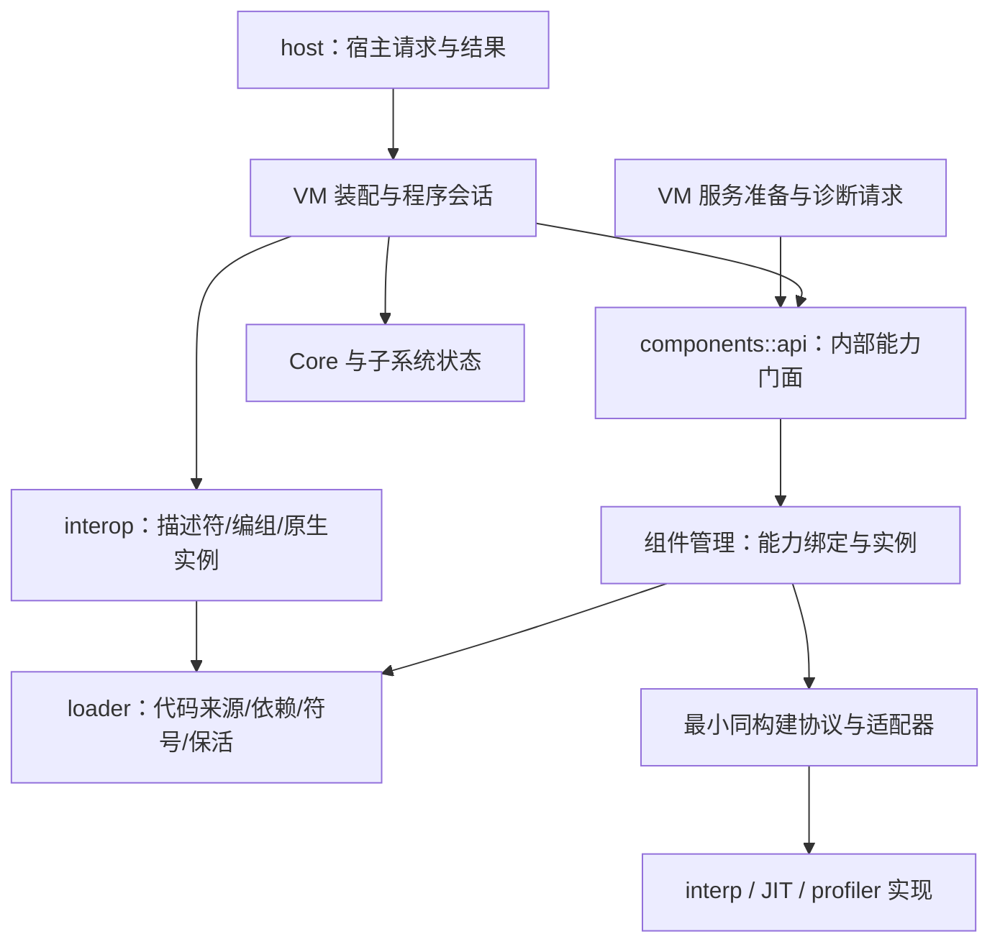

# 运行时模块边界

> 代码：`src/runtime/src/`、`src/runtime/crates/`
> 相关：[组件化运行时](componentized-runtime.md)、[VM 总体架构](vm-architecture.md)、[嵌入机制](embedding.md)
> 当前：普通 host 不暴露组件管理输入，VM 装配归 vm，原生来源许可归 loader；剩余低层上下文可达面与跨域编排见下表。

## 概述

目录已经分开，但可见性、状态所有权和访问入口仍跨越目录边界。组件管理属于 VM 内部设施；
普通宿主表达加载、执行模式和诊断请求，VM 使用统一能力接口，具体组件通过装配适配器接入。
文件名与这些职责对应，消费者不感知实现文件移动或组件改名。

## 设计目标与约束

区分三种接口：普通宿主契约、VM 内部访问门面、同构建组件间协议。它们的受众、版本约束与可见性不同。
`components::api` 是 crate 内部能力门面；同构建 C 协议位于 `components::abi`，核心身份/布局桥位于 `components::bridge`。
components 命名空间只公开同构建必需的 abi/bridge 子模块，内部 api 和管理子模块不对 crate 外开放，host 不转出协议符号。
独立 interp/JIT/profiler crate 所需的最小协议仍需跨 crate 可见，但不通过 host 提供，也不包含通用组件管理实现。

当前实际状态与目标分开描述；实施顺序在仓库 roadmap 中维护。收口保持 GC 根、写屏障、暂停协议、
代码租约、VM/worker 身份及明确请求失败的行为；不靠静默降级、兼容别名或逐指令动态查询消除表面引用。

## 方案与决策

### 已封闭的访问边界

VM 程序准备、执行角色查询和分析请求通过内部 `components::api`。基线/优化角色绑定由每 VM 的组件注册表保存，
先验证提供方存在、角色唯一及接口版本/大小/对齐，再创建实例；消费者不传 interp/JIT 的组件 ID。
附着返回成功但未登记所需引擎仍失败。执行循环继续使用准备时注册的引擎，不逐指令查询组件表。

支持性查询只核对目标能力，候选查询只读路径与已装入映像缓存；Android 未知的裸库名不会因查询触发装入。
显式准备仍可交给系统加载器按名称装入并校验。独立后端对核心模块使用私有导入，不再通过自身批量再导出。

对象协议定义在 object/protocol.rs，以不透明的上下文/错误类型参数连接提供方，不引用 exec/context 实现。
每 VM 的协议表由 Core 保存，worker 借用同一份不可变服务；exec 只保留托管 ToString 调用、异常与字符串物化。
独立执行组件经同构建 bridge 读取服务，协议表不拥有 VM/托管值，也不增加逐指令注册表查询。

通用代码映像由 loader/code 装入、缓存与保活，组件和独立 native 库共用，不解释消费者 ABI。
默认 native 路径归 loader/native_paths，host 为独立库提供路径时不再经过 components。
PAL 保留底层开库与符号原语；组件层只持有 loader 代码句柄和组件契约/实例依赖。

main.rs 只依赖 std/libloading，加载 libz42 的 z42_main_v1。命令行参数和环境由 Core 中 cli feature 下的私有 main_command/main_startup 处理，通过 host 的 VM 接口运行程序；不新增 CLI 目录或公开 Rust CLI API。入口无 Rust 参数，由库读取本进程 OS 参数并返回退出码。SDK 只有 bin/z42vm，native 不安装额外 exe。
一次性 run_app 接收模式、VFS、搜索目录和 resolver 等功能输入，在 host 内部构造 LoadedProgram 的加载请求，
不把历史 LoadOptions 中的组件管理状态扩散到该接口。环境、相对路径、搜索默认值由来源适配解析，
加载服务不读取 CLI probing 设置或隐式补目录。

领域根提供稳定消费契约：`exec::{EngineRegistry, Initialization, TierBackend}`、
`diagnostics::{RuntimeCounters, CounterSnapshot, RuntimeEvent}`、`object::ObjectProtocol`。
engine/init、counters/observer、protocol 实现模块私有；实现文件移动只需调整所属模块的声明与显式导出。
模块内的实现引用不做机械改写，也不建立总括所有领域的 prelude。正向 doctest 与私有路径 compile_fail 验证这条边界。

loader 与 interop 的双向引用已收口为单向：装载事务（Tier 1 类型库 `load_library` 与自描述模块
`load_native_module`：开库 → 校验描述符 → 注册 → 记入每 VM 映像缓存）整体归 `interop::install`，
loader/native 只留纯代码来源服务（开库、路径策略、映像缓存、符号解析），不再引用 interop；
interop 侧的 materialize/load_named 继续以 `loader::native::resolve_symbol` 消费符号来源服务
（目标图 V→N→L 的 N→L 边）。

对象表示的两条反向边已收口：环境堆附着（HeapGuard / current_heap / epoch）归 `gc::ambient`——它是 GC 分配服务
的线程级形态；载荷身份词汇 `ContextId` / `AssemblyId` 由 `object::identity` 拥有，loader 经再导出保持注册表路径。
`TypeDesc.id` 的 TypeId 仍指 metadata（见缺口表）。

元数据解析已按最小视图运行：`metadata::resolve::ResolveServices` 只暴露函数/builtin/静态字段身份查询与
类型加载查询/结算，`vm::VmResolveServices` 提供实现并拥有入队与排空时序（「可观察的已解析函数其类型已登记」
次序保持不变）；独立后端经 `components::bridge::resolve_function_tokens` 装配视图，resolve 模块不再接收 VmContext。

组件静态装配协议由 components 所有：Rust 最终组合根使用 `components::abi::register_static_component`，C 使用 `z42_component_register_static`。
登记只保存进程寿命工厂，空指针/冲突以组件状态返回，不依赖 host 会话或错误槽。
C 声明统一维护在 `include/`（宿主声明 `z42_host_api.h`、组件链接 `z42_components.h`）；`include/z42_host.h` 是 native 的统一聚合入口。
打包将只聚合、不单独安装的声明内联进伞头，输出平铺的 `native/include/z42_host.h`；workload 的 include 与 modulemap 不随实现目录变化。
这个发布聚合入口不等于 Rust host 的组件管理 API。

### 当前可核对的缺口

vm/mod.rs 只负责共享 Core 与线程视图的组合、布局、构造和生命周期。缺符号裁决已归 exec/exception，
异常交接直接归 ThreadExecState，静态默认值物化归对象执行层；不能将托管异常/GC 分配搬入纯 metadata。
加载查询、帧/GC 暂停协作和计数聚合已分别归 loader、exec/threads 与 diagnostics。组合层通过所属服务调用，
不把带有完整 VmContext 的 impl 块分散到其它目录当作解耦完成。

| 缺口 | 代码证据 | 影响与目标 |
|---|---|---|
| 宿主仍可访问低层上下文 | LoadedProgram::context、host 的 VmCore/VmContext 再导出 | LoadOptions 已只保留功能请求；继续按真实低层消费者收口可达面 |
| 组件协议中的依赖身份 | `components::abi::RuntimeApi` 的跨组件依赖查询 | VM 执行消费者按语义角色请求服务；按 ID 查询只在内部测试构建可见，生产 VM 经内部能力入口获取租约，协议内依赖 ID 由管理层拥有 |
| 低层上下文默认构造仍使用进程配置 | availability 的组件可用性查询已收口：JIT 目标矩阵以 build 脚本派生的 `z42_jit_supported` cfg 为单一来源，config 不再反向调 components（`execution_supported` 已删除） | 进程 bootstrap 与 VM 设置分开捕获；进程级 `runtime_config()` 逐 VM 化归 W3 |
| 普通宿主与 C 适配尚未分开 | C 适配五文件已归组 `host/c/`（经 host 根再导出），尚未归能力所有者 | CLI 已归 cli 适配且平台构建可排除；后续 C 适配/头文件归能力所有者，host 保留功能请求/环境服务契约 |
| 初始化层级含混 | `host/state.rs` 的会话保存多个 LoadedProgram；`ops::build_host_module` 每次创建程序/VM；`LoadedProgram::invoke` 执行一次性托管初始化 | 区分会话、VM/包准备与托管初始化，不把 C initialize 当作所有模块已初始化；统一装配但保持隔离和失败终态 |
| 进程策略混入每 VM 输入 | `config/vm_config.rs::process_loh_bytes` 在 Core 构造时修改进程级 LOH 设置 | 进程 bootstrap 与 VM 设置分开捕获，禁止任意 VM 构造改写其它 VM 可见的全局策略 |
| TypeDesc 引用 metadata 的 TypeId | `object/types/type_desc.rs` 的 `pub id`（原缺口三边中的其余两边已收口：ambient 堆附着迁 `gc::ambient`，`ContextId`/`AssemblyId` 身份词汇归 `object::identity`） | TypeId 属 `define_token!` token 家族（IMPORT_BASE/import_idx 语义一体），单独抽出会撕裂词汇一致性；抽出需整族设计裁决 |


这些是源码中的具体依赖，不是 Cargo 生产依赖环的证明。生产 core 不依赖具体后端，测试 dev-dependency 和
测试门面的内联路径另行统计。Rust import 的简单文本扫描还会漏掉分组导入、别名和宏，并误收测试/注释；
架构检查需要结合可见性、实际消费者和构建配置。

### 目标访问关系（未全部实施）



图中的箭头表示准备/访问流程；具体组件通过协议回调注册能力，不表示 core 在 Cargo 中链接具体实现。
执行热路径在准备阶段获得 Engine 等能力，后续直接调用已绑定接口。组件门面不成为转出全部 VM 类型的新总括模块。

仅将 `backends::attach` 换成 `api::attach(INTERP_COMPONENT)` 仍会泄露具体实现身份，不能达到实现透明。
目标接口按执行角色、堆快照、CPU 采样等稳定能力请求服务；管理层将其绑定到选定提供方与版本，
再在内部使用组件 ID 构造依赖闭包和实例。基线与优化引擎属于不同语义角色，即使接口形状相同也不会混选。
未配置的多提供方歧义与能力缺失均显式报错；能力查询仍不触发绑定、装库或创建实例。

组件实例间的语义依赖决定创建/销毁顺序；代码/外部依赖的装载由 loader 处理。普通 Rust/Cargo 依赖已在构建时组合，
不因拆成 crate 而增加运行时加载。三类 crate 的实际接入关系见[组件化运行时](componentized-runtime.md#1-库边界)。

### 宿主输入与初始化分工

main.rs 动态加载共享 Core 的进程入口；Core 的 cli feature 下解析参数、环境和相对路径，C 绑定和其它平台也消费同一 VM 服务契约。
同构建 Rust 宿主使用 Rust 接口；需要 C 互操作的边界才使用版本化 C 布局/回调，不跨 C ABI 传 Rust trait 对象。
VM 组合层提供单一准备流程，平台适配只转换输入，不复制模块初始化和包加载实现：

```text
CLI/C/Rust 输入 → 功能请求与配置快照 → 入口 zpkg/依赖解析及验证
→ Core/环境服务 → 元数据链接 → loader 准备代码 → components 绑定/实例
→ 发布已加载程序 → 首次调用的一次性托管初始化 → invoke
```

C initialize 当前建立进程单例宿主会话，不等于创建一个承载所有顶层模块的 Core；每个 LoadedProgram 仍拥有自己的 VM。
上述收口保留这一隔离行为和初始化失败终态，后续若改变生命周期需单独定义行为契约。C 句柄表、编组、线程错误通道归 C 适配，
参数来源/进程退出/hooks 归 CLI 宿主，Core 构造与服务/模块准备归 VM。C 导出及 .h 随实际能力所有者维护，SDK include 只聚合分发。

### 状态与协议归属

| 所有者 | 保存/提供 | 消费者需要什么 |
|---|---|---|
| host | VM 宿主功能请求与环境服务契约 | 功能级请求与结果，不是组件注册表、CLI 实现或 C 句柄表 |
| VM 装配层 | 构造输入、启动顺序和失败发布边界 | 接受显式配置及服务，产生可调用程序 |
| components 管理实现 | 能力到提供方的绑定、工厂缓存、实例依赖闭包、每 VM 实例及 loader 代码句柄 | 内部 api 的准备/能力查询；不让消费者传实现 ID，不返回可修改的 OnceLock，不保存映像缓存 |
| exec / diagnostics | 引擎与观察/采样的消费契约 | 装配时绑定的接口；不决定组件库路径或具体实现 |
| 同构建协议层 | 描述符、版本、身份、接口表及最小桥接 | 仅给 VM 与组件适配器；不是普通宿主 SDK 扩展面 |
| loader / interop | loader 拥有代码来源/装载依赖/符号/保活；interop 拥有描述符/编组/原生实例 | 窄接口与 VM 装配连接，不互相承担完整装入事务 |
| object / GC / threads | 表示、屏障、分配、暂停与根协议 | 共享必要数据契约，通过回调适配，逐步减少实现穿透 |

## 实现

### 文件命名与职责映射

模块有多个实现和测试时按所有者集中到目录，根目录不以 vm_* 等前缀代替模块组织；短小入口测试可以内联。具体实现移动通过模块声明和显式导出吸收，C 句柄从 host 根导入，不将 entry.rs/module.rs 等文件名公开为依赖路径。

同名并不自动等于重复实现：PAL 的 unix/windows/wasm 文件是同一契约的平台镜像，保留对称命名。
下表是职责收口后的候选名，未改名的文件仍在左列路径；最终名称随对应抽象同轮确认，不先制造兼容转发层。

| 当前文件/文件组 | 实际职责 | 候选名称/拆分方向 |
|---|---|---|
| host/config.rs、corelib/core/config.rs、gc/config.rs、JIT config.rs | C 宿主配置、托管查询、GC 输入、JIT 输入 | host_abi_config.rs、runtime_config_builtins.rs、gc_config.rs、jit_config.rs |
| host/state.rs、interop/state.rs | 宿主会话；原生模块/类型/buffer 状态 | host_session.rs、native_resources.rs |
| threads/state.rs、loader/state.rs、exec/state.rs、metadata/state.rs | mutator、加载、执行、链接状态 | mutator_state.rs、loader_state.rs、execution_state.rs、link_state.rs |
| 四处 builtins.rs | 组装提供方、声明导出、名称目录、执行派发 | builtin_registry_builder.rs、core_builtin_descriptors.rs、builtin_symbol_catalog.rs、builtin_dispatch.rs |
| components/backends.rs | 来源选择、平台发现、初始引擎注册表 | source/discovery 按职责拆分；装配协调由内部 api 拥有，同构建协议位于 components::abi |
| loader/native.rs、exec/native.rs | 原生库装入/注册；native 调用服务 | native_library_loader.rs、native_module_registration.rs、native_call_services.rs |
| host/profiling.rs、components/profiling.rs | 宿主诊断请求；profiler 装配 | diagnostic_requests.rs、profiler_attachment.rs |
| object/protocol.rs、exec/ops/stringify.rs | 对象能力契约；托管调用/默认文本物化 | 定义与执行桥已按所有者分开；继续检查 exec/ops 中布局/存储事实与执行编排的混合 |
| host/load.rs、vm/assembly.rs、vm/defaults.rs | 宿主请求、VM 装配、默认输入 | host 转换请求，vm 持有装配顺序；loader 拥有产物准备机制 |
| vm/ | Core、线程视图、布局、默认服务与装配 | 多个实现按共同所有者集中；crate::vm 的类型和组件 bridge 消费路径不随物理布局变化 |

`*_config`、`*_policy`、`*_registry` 等后缀表达不同职责。目录本身已足够限定的局部文件不为全仓唯一名机械改名；
对外引用面收口后，具体实现文件重命名只影响其模块声明、适配器和同目录测试。

### 对象相关文件的归属判定

相似文件名需要按实际执行职责判断，不能把带 object/struct 名称的代码整体归入表示层：

| 实际入口 | 源码中的职责 | 整理方向 |
|---|---|---|
| `object/protocol.rs` | 不拥有状态的四个能力回调 | 已归 object；Core 持有绑定，corelib 提供实现，exec 消费 |
| `exec/ops/object/field.rs` | 槽/名称读取、派发缓存、pin 视图和带屏障写入 | 缓存与执行视图留在 exec；堆写入和屏障使用 object::store_field_access/store_field_slot |
| `exec/ops/object/array.rs` | 数组读取/写入、类型实参解析、帧 arena 分配 | 元素编码、带屏障写入及存储地址查询归 object；泛型解析、arena 和执行错误保留 exec |
| `exec/ops/object/struct_leaf.rs` | 布局查询、快照、装箱分配和写屏障 | 布局、装箱、快照和堆叶子写入归 object；类型加载、命名字段编排与帧句柄解析留在 exec |
| `exec/ops/structs.rs` | 当前帧 struct 分配、拆箱、复制及布局解析 | arena 生命周期与 frame_id 校验归 exec；布局事实通过只读查询提供 |
| `exec/ops/object/error.rs` | OpError 到托管异常的物化 | 保留执行层；对象存储层返回自己的错误事实，不构造 VM 异常 |
| `exec/ops/scalar.rs` | 算术、比较、转换和指令错误判据 | 保留执行语义；输入是 Value 并不足以证明属于 object |

object 堆访问接口只接收 Heap、对象/数组句柄、字段位置或已解析的 TypeDesc，不依赖 VmContext、帧、OpError 或 IL。
实现通过 object 根导出，反射和异常栈迹直接使用对象写入接口；普通存储操作不需要动态注册查询。
SATB 删除屏障留在底层存储原语，插入屏障由对象写入接口补齐；struct 数组跟踪实际引用叶子，不能拿来源盒子代替。

`lib.rs` 的 `objops` 仍是 `exec/ops/object` 的转出路径。后续整理同时收口真实所有者与消费者，
避免长期维护多个路径；删除旧入口时连同后端、corelib、测试和文档迁移。

## 边界与限制

本页描述当前缺口和目标，不表示公开面已被封闭或架构检查已实现。当前 host、组件模块和后端仍有上表所列公开路径。
普通宿主 API 收口涉及 Rust 签名、C 静态装配头、launcher/workload 胶水与真实 SDK 消费者，需同轮迁移和验证。
GC/对象、线程/执行及元数据共享的数据契约需要单独建模，不能通过把全部目录改为私有或抽一个万能 trait 修复。

核心 builtin/provider 描述归 corelib，通用不可变目录归 interop，host 不再拥有 builtins 登记表。独立模块在首次限定调用时才经 loader 解析自描述入口，interop 校验并登记；lib.rs 的已链接入口清单仅表达链接事实，不在初始化时执行。动态 Core 不依赖 compression 的声明 crate，loader 的静态登记接受任意有效逻辑名，不写死库名单。

VM 组合和装配集中在 vm/，context 目录已删除。帧/arena/异常使用 ThreadExecState，包加载查找使用不持有 VmContext 的 RuntimeLoader，静态存储使用 StaticFields，初始化执行使用 Initialization。计数汇总归 DiagnosticsState，注册与注销归 ThreadState；vm/mod.rs 只提供组合、生命周期和借用。

组件消费 VM 上下文和布局事实的稳定位置为 components::bridge，interp/jit/profiler 不引用 vm 实现路径。bridge 只列出实际类型与常量，不把整个实现模块改名导出。静态初始化失败沿 exec 屏障的异常结果传递，不另设无人写入的全局错误槽；构造缓存纪元直接由 metadata 提供，不经过 loader 的空转发。

普通 host 不公开组件管理配置或查询。VM 装配由 vm::assembly/defaults/services 统一拥有；loader 拥有产物入口、native 来源许可、路径与代码缓存。ProfilingState 拥有分析来源/实例，diagnostics 只持有后端能力和注入的准备回调。

## 领域内部目录与稳定入口

对象存储、字段访问、堆外对象、Monitor 和反射载荷直接由 object 拥有，私有叶实现经 object 根导出稳定词汇，不再重复嵌套 object 目录。TLS 与 TCP/UDP 集中到 corelib/net，复用网络错误处理与测试辅助，TLS 仍独立受 feature 控制。文件系统接口和 LocalFs/MemoryFs 实现在 pal/fs 内聚合，Rust 与 Wasm 消费者只引用 pal::fs；物理文件位置不成为新的消费契约。
