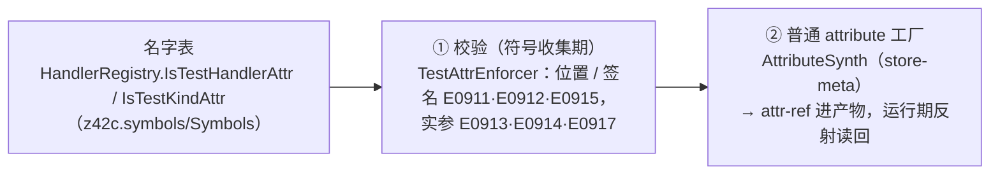

# 测试框架机制（反射发现 · runner 协议 · GREEN gate）

> 代码：
> `src/libraries/z42.harness/src/TestAttributes.z42`（`[Test]` 等 attribute 类）、
> `src/libraries/z42.core/src/Runtime/ModuleLoader.z42`（加载 / 隔离运行）、
> `src/libraries/z42.harness/src/`（`TestDiscovery` · `Runner` · `BundleRunner` · `TestReport`，以及作者侧 `Bencher` · `BenchStats` · `TestIO`）、
> `src/compiler/z42c.semantics/src/Testing/`（编译期校验）、
> `src/toolchain/builder/core/builder_test.z42`（z42b test/bench）、
> `scripts/test/xtask_test.z42`（GREEN gate）、`scripts/test/xtask_test_lib.z42`（stdlib 单元编排）。
>
> 要查 `[Test]` / `[Benchmark]` / `[Skip]` **怎么写**、`z42 test` **怎么用**、以及
> `Assert` 方法全表 → 看 reference，不在本页。本页只写这套东西**怎么实现的**。

z42 的测试发现是**运行期反射**：`[Test]` 等是 z42.harness 里的普通 attribute 类，编译器像对待任何
attribute 一样为每处应用合成反射工厂；runner（`Std.Harness.Runner`，z42 写的）把编好的测试产物并入
当前 VM，用通用反射（`Assembly.GetFunctions()` / `Type.GetMethods()` / `GetCustomAttributes()` /
`MethodInfo.Invoke`）找出并调用它们。测试链上**没有测试专用的元数据或 VM 能力**。读这页的时机：
要改运行器行为、加一个 attribute 的运行期语义、调 GREEN gate 的组成，或者搞清楚一条测试失败到底是哪一层报的。

## 1. 三层结构

| 层 | 是什么 | 在哪 |
|---|---|---|
| **发现** | 运行期反射：自由函数 + 各类型静态方法上的测试 attribute → `TestCase` | `src/libraries/z42.harness/src/TestDiscovery.z42` |
| **执行** | 逐条调度：Setup → 用例 → Teardown，归类 pass / fail / skip | `src/libraries/z42.harness/src/Runner.z42` |
| **编排** | 谁决定「跑哪些模块、怎么并行、结果怎么聚合」 | z42b（单目标）/ xtask（语料级），见 §5 |

层间契约只有两个：attribute 类的形状（§2）与 runner 的 JSON 报告形状（§4）。

## 2. attribute：作者与 runner 的契约

### 2.1 类与语义

全部在 z42.harness（命名空间 `Std.Harness`，与 runner 同包）——测试文件写 `using Std.Harness;` 才看得见：

| attribute | 实例上 runner 读什么 |
|---|---|
| `TestAttribute` / `BenchmarkAttribute` / `SetupAttribute` / `TeardownAttribute` | 只看类型：决定 kind（1–4） |
| `SkipAttribute(reason, platform, feature)` | 三个字段，空串 = 未给 |
| `IgnoreAttribute` | 只看类型 |
| `ShouldThrowAttribute<E>` | 经 `IExpectsException.ExceptionType()` 取 `typeof(E)`——runner 不必知道 E |
| `TimeoutAttribute(milliseconds)` | runner 当前**不执行**超时 |

漏写类型实参的 `[ShouldThrow]` 落到同名非泛型类（`ExceptionType()` 返回 null，永不匹配；E0913 照报）。

### 2.2 发现规则

`TestDiscovery.Discover(path)`：

1. `ModuleLoader.Load(path)`：并入当前 VM（可执行）；`AssemblyLoadContext.Default().Load(path)`：拿包的反射视图（枚举）。
2. 候选 = `Assembly.GetFunctions()`（自由函数）+ `GetTypes()` 里每个类型解析到活类型后 `GetMethods()` 的**静态**方法。
3. 带 kind attribute 的才成为 `TestCase`；同一函数上的 `[Skip]` / `[Ignore]` / `IExpectsException` 读进同一条。
4. 名字 = `<命名空间或类型>.<源码名>`（剥掉签名改名后缀）；**按名字排序**（同输入同输出）。

### 2.3 编译侧

编译器对测试**只做校验**，不改写、不生成任何测试专用的东西。一条 `[Test]` / `[Benchmark]` 经过两个点，
校验代码在 `z42c.semantics/src/Testing/`（名字表除外——它是全部 attribute 的分流表）：



| 点 | 负责什么 | 不变量 |
|---|---|---|
| 名字表 | 哪些 attribute 名属测试家族（8 名 / 4 名 kind 子集）。它们是**普通 store-meta**，名字表只服务编译期校验 | 名字只在这里写一次 |
| ① 校验 | 形状校验纯语法：零接收者、返回 `void`、零参（`[Benchmark]` 另允许恰好一个 `Bencher` 形参）、非泛型、有方法体；`[ShouldThrow]` 查符号表看异常类型链 | 允许的签名形状 = runner 会调用的形状（§3.2） |
| ② 工厂 | 与任何 attribute 相同 | — |

各码的触发条件与发射行见 [错误码参考](https://z42-lang.github.io/z42/reference/appendix/error-codes.html)
的「E0911–E0917 测试框架」一节。编译侧与运行侧**不共享代码**，只共享 z42.harness 的 attribute 类。

## 3. Runner 协议

### 3.1 用到的运行期能力

全是通用 API，不是测试专用：

| 能力 | API | 作用 |
|---|---|---|
| 并入 | `Std.Runtime.ModuleLoader.Load(path)`（`__load_module`） | 把 `.zbc` / `.zpkg` 并入活 VM，函数与类型可反射、可调用。按模块名幂等 |
| 枚举 | `AssemblyLoadContext.Default().Load(path)` → `GetFunctions()` / `GetTypes()` | 包的反射视图 |
| 调用 | `MethodInfo.Invoke(null, args)` | 无接收者调用；`args` 为空，或 `[Benchmark] f(Bencher b)` 时是 runner 建好的 `Bencher`（§3.2）。被调函数内抛出的异常按原类型透传 |
| 隔离运行 | `Std.Runtime.ModuleLoader.RunIsolated(paths, entries, libsDir, jobs)`（`__run_goldens_isolated`） | 每个 golden 程序在**全新隔离 VM**（各自 VmContext：堆 + 静态字段 + 函数表）里跑，返回各自捕获的 stdout。`jobs<=0` = 按核数并行 |

**为什么 golden 要隔离而 unit 不用**：golden 是整程序，多个 golden 共享 `Main`/命名空间必然撞车，
且静态状态会互相渗漏；unit 是带命名空间的 `[Test]` 模块，设计上不冲突，共享一个 VM 更省。
这条区分的**代价**见 [嵌入式运行与测试 agent](embedded-app-run.md) 里"同 namespace 多文件"那一条。

### 3.2 单条 `[Test]` 的生命周期

`Runner._runOne`（`src/libraries/z42.harness/src/Runner.z42`）：

```
[Ignore]?                      → skipped("ignored")，不调 body
[Skip] 且 _skipApplies()?      → skipped(SkipReason)，不调 body
否则：
  同组的全部 [Setup]            → Invoke（异常被吞）
  被测函数                      → Invoke（json 模式下 stdout 被 TestIO 捕获；
                                  `[Benchmark] f(Bencher b)` 由 runner 建 Bencher 传入，跑完 printSummary(函数名)）
  同组的全部 [Teardown]         → Invoke（**总是跑**，异常被吞）
  有 [ShouldThrow<E>]? → 抛了且 E 可赋值自抛出类型 = passed；否则 failed
  否则抛了            → failed（reason = "<ErrType>: <Message>"）
  否则                → passed
```

**fixture 按命名空间（自由函数）或类型（静态方法）分组**：没有共享实例，这是唯一可用的
locality 单位。Setup/Teardown 里的异常被静默吞掉——这是当前实现的取舍，不是疏漏能推翻的，
但它意味着一个坏掉的 Setup 会表现为"测试本身失败"。

### 3.3 skip 判定

`Runner._skipApplies(entry)` 三条，按顺序：

```
SkipPlatform != null → skip iff Platform.OS() == SkipPlatform
SkipFeature  != null → skip iff !Capabilities().contains(SkipFeature)
否则                  → 无条件 skip
```

**能力集是运行期真值，不是静态推断**：`Std.Platform.Capabilities()` 背后是
`corelib/platform.rs::builtin_platform_caps`，按 cfg 拼出这个二进制**实际编译进了什么**：

| cap | 何时出现 |
|---|---|
| `jit` | cargo feature `jit` |
| `native-interop` | cargo feature `native-interop` |
| `bundled-compression` | cargo feature `bundled-compression` |
| `threads` | `not(target_arch = "wasm32")`（不是 feature——`std::thread` 在哪儿有就在哪儿有） |
| `socket` | `not(target_arch = "wasm32")` |

`Std.Platform.ExecModes()` 另报可派发后端（`interp` 恒在 + cfg 门控的 `jit` / `aot`）。
两者的正交关系见 [执行画像矩阵](exec-profile-matrix.md)。

**deny-by-default 是免费得到的**：未知 feature 名不在 `Capabilities()` 里 → 视为"缺" → 跳过。
把 typo（`multi-threading`）当成"这环境不支持"，比 fail-open 静默吞掉安全。

### 3.4 `[ShouldThrow<E>]` 的类型匹配

`Runner._typeMatches(thrown, expected)` = `expected.IsAssignableFrom(thrown)`：抛出 `E` 本身或其任意
子类型都算命中。`expected` 来自 attribute 实例的 `typeof(E)`（运行期真值），子类型判定走运行期类型
层次，不受编译期可见范围限制。

### 3.5 退出码

`Runner.ExitCodeFor(runnable, failed)` 是抽出来的纯函数（便于直接单测）：

```
runnable == 0 → 1        // 「测试没跑」不得与「测试全过」在退出码上等价
failed   >  0 → 1
否则          → 0
```

`runnable == 0` 判红这条是刻意的：能触发它的都是真事故——attribute 拼错（`[Tests]` / `[test]`）、
`[sources]` glob 漏掉文件、测试函数被改名或误删、或调用方把一个根本没有测试的目录当成了测试单元。
报告照常打印（json 消费方不受影响），解释另走 stderr。

## 4. 报告契约

`format` 两个取值：

- **`pretty`**（默认）：每条一行 `PASS/FAIL/SKIP <FQN>`，末尾 `Result: P passed, F failed, S skipped`。
- **`json`**：`TestReport.toJson` 手搓一个对象到 stdout。

```json
{ "tool": "z42b", "module": "<artifact path>",
  "summary": { "total": N, "passed": P, "failed": F, "skipped": S },
  "results": [ { "name": "<FQN>", "status": "passed|failed|skipped",
                 "is_benchmark": false, "reason": "…", "bench_stats": { … } } ] }
```

`reason` 仅在 failed / skipped 时出现；`bench_stats` 仅在 benchmark 且成功解析出统计行时出现。

三处约束值得记住：

1. **z42.harness 不依赖 z42.json**——执行核要随设备端 agent 走，依赖面保持最小，JSON 是手搓的（`TestReport.esc` 只转义
   `" \ \n \r \t`，够这份报告携带的字符串用）。
2. **`module` 是 z42 保留字**，所以那个参数在源码里叫 `artifact`。曾经把它命名为 `module`
   一次就把 parser 弄崩、且当时诊断被丢弃导致**静默误编译了这个文件本身**。
3. **`--format json` 时 stdout 只许有那一份 JSON**。构建进度必须改走 stderr
   （`BuildLog.SetToStderr(format == "json")`），否则消费方解析不了——实测症状是 xtask 转发
   bench 时基线**静默捕获到 0 条**，不报错。

### 4.1 benchmark 统计的缝

`Bencher` 与 runner 之间**唯一**的数据通道是一行文本：

```
bench[<label>] min=<n>ns median=<n>ns max=<n>ns mean=<n>ns stddev=<n>ns samples=<n>
```

`Bencher.printSummary(label)` 打它——自建 `Bencher` 的 benchmark 自己调；`[Benchmark] f(Bencher b)` 由 runner
建好 `Bencher` 传入、跑完按函数名调（`TestCase.Invoke`）。runner 在 json 模式下用 `TestIO.captureStdout` 捕获 body 的
stdout，再由 `BenchStats.parse` 解回结构。**改了 `printSummary` 的输出形状就必须同 commit 改
`BenchStats._parseLine`**；老格式（无 `mean=` / `stddev=`）仍能解析，对应字段为 `-1`，消费方按
"没有置信区间"处理。

`new Bencher()` 是**自适应采样**：先跑一小段 pilot 估出单次耗时，再选 `n` 填满约 50 ms 的测量预算
（夹在 `[20, 2000]`）。显式 `new Bencher(W, S)` 保持固定 `S` 次，无自适应——已调过参的 benchmark
行为逐字节不变。`iter()` 返回后 `Samples` 是**实际**用的 n。

### 4.2 stdout 捕获是一个栈

`TestIO` 的四个 native 绑定（`__test_io_install_{stdout,stderr}_sink` /
`__test_io_take_{stdout,stderr}_buffer`）维护的是**栈**：install 压一层 buffer，take 弹一层。
嵌套合法（内层不影响外层）。body 抛异常时 take 在 catch 里调一次确保 sink 被弹出，再重抛——
每次 `captureStdout` 前后栈深度守恒。runner 自己捕获 benchmark stdout 时复用的就是这个栈，
所以用户在 benchmark body 里再调 `TestIO.captureStdout` 也不会串味。

## 5. 编排：z42b 与 xtask 的分工

runner 是库，**谁来驱动它**分两层：

| | z42b（`z42.builder.zpkg`） | xtask |
|---|---|---|
| 眼界 | **一个**目标（一个已编译产物、一个工程 `z42.toml`、或一份 bundle manifest） | 整个仓库的语料结构 |
| 职责 | 编译 → 部署 → 运行这一份 | 发现 `src/tests/**` + `src/libraries/<lib>/tests/**`、编全量、分片、聚合、门禁 |
| 入口 | `z42b test [target] [--name/--list/--rid/--format/--reuse-parent…]` | `xtask test <sub>` |

**缝是 bundle manifest**（一个 `{cases: [...]}` 的 JSON），`BundleRunner.RunBundle` 消费它：
golden 走隔离 VM + 比对 stdout，unit 走共享 VM + `Runner.RunModuleResults`。同一份
`BundleRunner` 被 host 侧的 `z42b test --rid host` 和设备侧的 test-agent 共用——
见 [嵌入式运行与测试 agent](embedded-app-run.md)。

两个对编排方很重要的 z42b 旗标：

- `--list`：只打印目标名（一行一个），不编不跑。xtask 靠它拿单元清单后并行拉起
  `z42b test <toml> --name <unit>`，**从此不必自带第二套发现规则**（两套规则各自漂移曾是真 bug 源）。
- `--reuse-parent`：父包 dist 已在就不重建。进程内编译器无增量，不带这个旗标时 N 个目标会把父包
  全量重编 N 遍——编排方的做法是先不带它跑一个目标把父包建好，其余目标并行时都带上。
- `--out-root <dir>`：替换默认的 `<清单目录>/artifacts` 产物根。不带它，目标产物写进
  `<清单目录>/artifacts/<kind>-targets`（**源码树**）；父包按 `BuildLayout` 落 —— stdlib / 编译器成员的清单
  没有 `[build]`、继承 workspace 布局，于是父包 dist 就是 z42c 建的**正式成员产物**，会被覆盖。xtask 因此传
  成员输出目录下的 `tests/` | `bench/`（`_devTargetOutRoot`）——**不能**是输出目录本身，理由同上。
  没声明任何目标、回落到「编项目自身再跑」时同样生效（回落路径也必须透传 `--out-root`，不能从磁盘重读清单）。

**执行模式不是 runner 的参数**：runner 与被加载的测试函数在同一个 VM、同一模式下跑，模式由承载
z42b 的 `z42vm --mode <mode>` 决定。所以"stdlib 测试在 JIT 下跑"就是拿 `--mode jit` 的 z42vm 跑 z42b，
不需要 per-test fork。

## 6. GREEN gate 的组成

`xtask test`（不带子命令）= `_testAll`，顺序执行、**首错即停**。stage 清单见[测试门禁](../devinfra/test-gate.md)
的 gate-stages 区（唯一权威，由下面 §6.1 的门禁对账）。

build wave 也算一个 stage：它同样走 `_stageStart` 打 banner、同样计入耗时表，对读日志的人就是一个 stage。

### 6.1 清单本身有门禁

这份清单若被复列在多处会互相漂移；收敛成一处"唯一权威清单"的文档页后，
那页自己也会烂——加 stage 时不同步，文档就会落后于 gate 实跑的 stage 数。

结论写进了代码：**纯纪律守不住一份没有测试盯着的清单**。现在 gate 名单是数据
（`_gateStageNames()`，代码侧唯一 SoT），`_checkGateStageDoc()` 在**构建波之前**（几毫秒）
把它与开发基础设施那页 test-gate 文档里 `<!-- gate-stages:begin/end -->` 区的
`` - `name` `` 行**逐项比对**，不一致就打印双方清单后返回 1。

> **加/删/改名一个 stage 的正确姿势**：改 `_gateStageNames()` + 改那份文档的 gate-stages 区，
> 两处一致才绿。只改一处 → 本门变红。对账放在最前面是刻意的：文档漂移不该让人等十几分钟的
> gate 跑完才发现。

### 6.2 `--skip`：让 CI 拆解这块整料

`xtask test --skip stdlib,cross-zpkg` 按名跳过 stage。CI 用它给每条 leg 减负——
被跳掉的 stage 由专门的并行 job 覆盖（见 §7）。本地 `xtask test` 传空串 → 全量 gate，不变。

## 7. CI 拓扑（谁跑哪一段）

真实 job 名（`.github/workflows/ci.yml`）：

| job | 显示名 | 跑什么 |
|---|---|---|
| `build-and-test` | `test-host(<platform>)` | 4 个 OS 各跑一遍 gate，`--skip stdlib,cross-zpkg` |
| `stdlib-interp-consistency` | `test-stdlib-interp(<platform>)` | 3 个 OS 各跑**全量** stdlib `[Test]`（interp，不分片） |
| `stdlib-jit-consistency` | `test-stdlib-jit(linux-x64) shard k` | stdlib `[Test]` 在 `--mode jit` 下，2 分片 × `--jobs 4` |
| `vm-jit-consistency` | `test-vm-jit(linux-x64) shard k` | golden 的 JIT pass，2 分片；消费 `assemble-current-sdk` 编好的 `.zbc`，`--no-rebuild` |
| `test-desktop` | `test-desktop-cabi(linux-x64)` | desktop Tier-1 C ABI 冒烟（R1–R7） |
| `test-wasm` / `test-ios` / `test-android` | 各带 `shard k` | Tier-2 平台语料，见 [跨平台测试](cross-platform.md) |

两条非显然的门控规则：

- **JIT 的 leg 要看 compiler 的改动，不只看 vm**。编译器的优化 pass（inline / LICM / CSE…）
  会重构 IR，于是 JIT 的**输入**变了、它对新 IR 的 lowering 才被跑到。test-host 的 interp golden
  只覆盖新 `.zbc` 的解释执行，**不覆盖**它的 JIT lowering。跳过这条 leg，优化后的 IR 就从没被 JIT 测过。
- **Tier-2（浏览器 / 模拟器 / 真机模拟器）是 nightly-only + 手动**，不进每个 PR；
  Tier-1 的 `test-desktop` 仍按 `platform` 变更过滤器进 PR。

## 8. 在哪改

| 要改什么 | 改哪 |
|---|---|
| 加一个测试 attribute / 改它的字段 | `src/libraries/z42.harness/src/TestAttributes.z42` + 发现 `src/libraries/z42.harness/src/TestDiscovery.z42` + 编译期名字表 / 校验 |
| 一个 attribute 的运行期行为 | `src/libraries/z42.harness/src/Runner.z42` |
| 一个 attribute 的编译期校验 | `src/compiler/z42c.symbols/src/Symbols/TestAttrEnforcer.z42`（名字表在 `Symbols/HandlerRegistry.z42`） |
| `[Benchmark]` 的调用形状（零参 / 单个 `Bencher`） | `TestCase.Invoke` / `TakesBencher`（`TestDiscovery.z42`）**和** `TestAttrEnforcer` 的 R3，同一个 commit |
| 报告字段 | `src/libraries/z42.harness/src/TestReport.z42`（json）+ `Runner._runOne`（pretty） |
| benchmark 统计形状 | `Bencher.printSummary` **和** `BenchStats._parseLine`，同一个 commit |
| 加载/调用能力 | `src/runtime/src/corelib/reflection/module_load.rs` + `builtin_table.rs` 登记 |
| gate 组成 | `_gateStageNames()` **和** test-gate 文档的 gate-stages 区 |
| 单元编排 / 并行 / 分片 | `scripts/test/xtask_test_lib.z42`、`scripts/cli/xtask_cli_test.z42`（命令面） |
