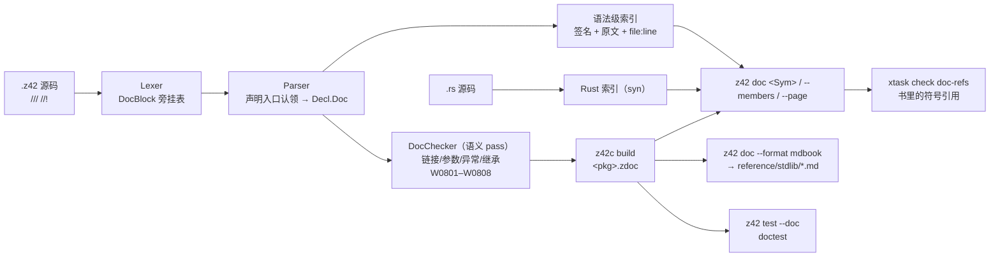

# z42-doc 设计与推进底稿

> 临时迭代底稿（协作规范的文档总纲 §1）：一轮多 PR 迭代的设计、决策与进度。
> 迭代完成后：语法规则上浮 `reference/src/language/doc-comments.md`，工具用法上浮
> `reference/src/toolchain/`，实现机制上浮 `internals/src/toolchain/doc.md`，写法约束进
> `agent/rules/doc-comments.md`，然后删除本文件。

## 0. 要解决的问题

| 现状 | 证据 | 代价 |
|---|---|---|
| 同一个 API 写三遍 | `Random.z42` 的 `///` + `z42.random/README.md`「入口点」签名清单 + `reference/stdlib/random.md` | 每次改 API 要改三处；三处必然漂移 |
| 没有任何东西比对源码签名与 reference 页 | `xtask test docs` 只查死链；`diagcodes` 只管错误码 | 漂移只能靠人工 |
| `///` 没有格式约定 | 2.5k 行 `///`，纯散文，中英混杂；`String.z42`、`Stack.z42` 等用 `//` 写 API 说明 | 机器无法提取参数 / 异常 / 示例 |
| `///` 里混着历史注记与实现笔记 | `/// extend-z42-random (2026-06-03): ...` | 违反 doc-system §6「不写历史」；agent 读到大量无效 token |
| 编译器丢弃全部注释（P1 已改为收集） | 词法器把注释当 trivia 跳过 | 没有提取、校验、发布的基础 |
| agent 查一个 API 要读整个源文件 | 没有符号索引 / LSP；`String.z42` 398 行只为查一个签名 | token 消耗与 API 面积成正比 |

**目标（按优先级）**

1. **单一事实源**：stdlib 公开 API 的说明只写在源码 `///` / `//!` 里；`reference/src/stdlib/` 的包页与索引
   全部由工具生成，包 README 的入口清单改成一行链接。
2. **注释可校验**：参数名、符号链接、异常类型、示例代码都由编译器检查，错了就报警告。
3. **agent 低成本导航**：`z42 doc <符号>` 一条命令拿到签名、摘要、`file:line`；`--members` 拿到类型轮廓；
   `--page <书页>` 把一页书里引用的符号一次解析成当前位置。书里引用代码只写符号、不写行号，由门禁校验。
4. **增量迁移**：现有散文 `///` 不改也能解析；机制全部落地后再按包迁移注释。

**范围（User 裁决）**：

| 位置 | 方式 |
|---|---|
| `reference/src/stdlib/*.md` + `stdlib/README.md` | 由 `z42 doc` **全部生成**，页内无手写部分 |
| internals 全书 | **手写**，不从代码生成任何内容；其中的代码引用由检查器校验（只校验、不生成） |
| reference 其余页（语言、工具链、错误码、旋钮、`z42.toml`） | 手写，现有检查不变 |

**不做**：HTML 站点主题（沿用 mdBook）；跨包「查找所有引用」（归 LSP）；从代码生成 internals 或 reference 的
非 stdlib 页。

## 1. 各语言取舍

| 来源 | 借鉴 | 不借鉴 |
|---|---|---|
| **Rust** rustdoc | `///` 外部注释 + `//!` 内部注释；正文是 Markdown；首段即摘要；intra-doc 链接 ``[`Sym`]`` 按作用域解析；doctest；`missing_docs` / `broken_intra_doc_links` lint；`--document-private-items` | `# Errors` 这类 Markdown 标题分节（每节多两行，token 偏多） |
| **C#** XML doc | **编译器校验**参数名（CS1572/1573）；文档**旁挂文件**随程序集分发（`.xml` → IntelliSense）；稳定的 **Doc ID**（`M:Ns.T.M(System.String)`）；`<inheritdoc/>` | XML 标签本身（同样信息约多 3～5 倍 token） |
| **Go** godoc | `go doc pkg.Sym` 终端直查，输出极简——这是给 agent 用的最佳形态；摘要一句话 | 摘要必须以名字开头（中文语序不适用） |
| **Javadoc / KDoc / TSDoc** | 单行 `@tag`：每条一行、无需 Markdown 解析即可提取，所有 LLM 都熟 | 必填的样板 tag（`@param x the x`） |
| **Zig** | doc 注释是语法的一部分：**挂错位置直接报**（孤立 doc 注释） | 直接报错（这里降为警告，便于迁移） |
| **Elixir** | 文档进编译产物、REPL 里 `h Mod.fun` 直查；doctest 比较的是**输出文本** | 把文档塞进运行时产物（这里改用旁挂文件，不动 zpkg 版本） |
| **API Extractor** (TS) / `cargo public-api` | 生成的 API 面**提交进仓库**，PR diff 里直接看见 API 变化；CI 重新生成比对 | 单独的 `.api.md` 文件（生成的 reference 页同时承担这个角色，不另起一份） |
| **Swift DocC / Sphinx** | 文档按 ID 外挂翻译层 | 独立的文档目录（文档留在源码旁） |

## 2. 注释语法（用户可见，将上浮 reference）

### 2.1 三种注释

| 写法 | 作用对象 | 用途 |
|---|---|---|
| `///` | 紧随其后的声明 | API 文档：给**调用者**看——做什么、契约、例外、示例 |
| `//!` | 所在文件的 `namespace`（写在 `namespace X;` 之前） | 命名空间 / 包的概述：页头简介、注意事项 |
| `//`、`/* */` | 无 | 实现笔记：给**维护者**看——为什么这样实现、踩过的坑 |

挂靠规则：

- 只认**行首**的 `///` / `//!`（本行此前没有 token）；写在代码后面的是普通注释。`////`（四个及以上斜杠）
  也是普通注释，可用作分隔线。
- 连续的同种行合成一块；空行、普通注释行或代码都会把块断开。每行去掉前缀及其后一个空格。
- `///` 块挂到紧随其后的声明：块与声明之间只能有空白、普通注释和属性（与 rustdoc 相同）。约定写法是
  **doc 在前、属性在后**；写在属性与修饰符之间也认。同一声明前若有多块（被空行隔开），只认最近的一块。
- `//!` 块必须写在文件的第一个 token 之前（`namespace X;` 之上），挂到该文件的命名空间；多块按空行拼接。
- 没被认领的块（方法体里的 `///`、文件中间的 `//!`、悬空的块）是**孤立块**，由文档检查报 W0801。
- 同一个命名空间只能有一个文件写 `//!`（违反报 W0808）。约定放在包的主文件里，例如 `Random.z42`。

### 2.2 块结构

```
/// 摘要：一句话，句号结束。          ← 首段。用于索引、outline、hover，超过 80 个字报 W0807
///
/// 正文：Markdown（CommonMark 子集）。可多段、可列表、可 `代码`、可 > ⚠️ 提示。
///
/// @param   名字  说明                  ← 以下 tag 区：每个 tag 从行首 @ 开始，
/// @typeparam T   说明                     续行缩进 ≥2 空格
/// @returns 说明
/// @throws  类型  何时抛出
/// @see     [`符号`]
/// @warning 说明                         ← 渲染为醒目提示（线程安全、非 CSPRNG 之类）
/// @example [no_run|compile_fail|ignore]
///     代码（缩进 4 格）
/// @hidden                               ← public 但不进文档（跨包用的内部入口）
```

**tag 是闭集**，只有上面 8 个；写了未知 tag 报 W0804。不设 `@deprecated`：弃用只用现有的
`[Deprecated("msg")]` 属性表达，生成器读属性渲染（同一事实只出现在一个地方）。不设 `@since`：
不写历史。

**全部 tag 都是可选的。** 不要求每个参数都写 `@param`，只为签名表达不了的东西写：取值范围、单位、
所有权、边界行为。写了就会校验：`@param` 名必须是真实存在的形参（W0802），`@throws` 后的类型必须能解析
（W0803）。

### 2.3 符号链接

- 链接写法只有两种：``[`Sym`]`` 和「方括号文字后紧跟圆括号、括号内是带反引号的符号」（如 ``[文字]\(`Sym`)``，此处反斜杠仅为避开链接检查）。**不带反引号的 `[...]` 一律当普通文本**，所以
  `[0.0, 1.0)` 这种区间写法不会误判成链接。
- 解析顺序与代码里的名字查找一致：当前声明 → 所在类型的成员 → 当前命名空间 → 本文件的 `using` → 全限定名。
- 方法有重载时用参数表消歧：``[`PadLeft(string, int, char)`]``。只有一个候选时可以省略参数表。
- 解析失败报 W0803。解析成功后，`.zdoc` 里记录目标的 Doc ID，渲染成跨页锚点。

### 2.4 Doc ID（全工具链共用的符号身份）

```
类型        Std.Random.Random
嵌套类型    Std.Json.JsonValue+Kind               （与现有 Outer+Inner 扁平化一致）
泛型类型    Std.Collections.List<T>
方法        Std.Text.Strings.PadLeft(string,int,char)
泛型方法    Std.Json.Json.Deserialize<T>(string)
构造器      Std.Random.Random.ctor(long,long)
属性/字段   Std.Core.String.Length
索引器      Std.Collections.List<T>.this[int]
枚举成员    Std.IO.FileMode.Append
命名空间    Std.Random
```

规则：参数类型写声明时的类型名，非内建类型写全限定名；不含参数名、不含返回类型。Doc ID 是 `.zdoc`
的主键、mdBook 锚点的来源（slug 化）、`z42 doc` 的查询键，将来也是 LSP hover 和翻译层的键。

### 2.5 示例即测试（doctest）

```z42
/// @example
///     var r = new Random(42);
///     r.NextIntRange(5, 6)             // => 5
///     Strings.PadLeft("42", 5, '0')    // => 00042
```

- 每个 `@example` 合成为一个带 `[Test]` 的独立测试函数，由现有的反射发现（`TestDiscovery`）收集，
  不另设测试索引。
- 一行 `expr // => text` 的含义是断言 `expr.ToString() == "text"`。这借鉴 Elixir：比较的是输出文本，
  不需要 `Assert.Equal` 样板，也正好沿用了现有注释里 `→` 的写法习惯。
- 模式：默认编译并运行；`no_run` 只编译；`compile_fail` 期望编译失败；`ignore` 两者都不做。
- 用 `z42 test --doc` 跑，并入 stdlib 的 GREEN gate。

### 2.6 继承

`override` 方法和接口实现方法如果没有 `///`，**自动继承**基类或接口的文档（rustdoc 处理 trait impl
的方式）。不需要写 `@inheritdoc`，也禁止复制粘贴文档：两份内容相同的文档就是漂移源。自己写了 `///`
则以自己的为准。

### 2.7 完整样例（以 `Random` 为例迁移后）

```z42
//! 确定性伪随机数：给同一个 seed 得到同一串数。
//!
//! 适合测试 fixture、模拟、洗牌、临时 ID、UI 抖动。
//!
//! @warning **不是 CSPRNG**——观察少量输出即可反推内部状态。安全场景用 [`Std.Crypto.SecureRandom`]。
//! @warning **非线程安全**。多线程请每线程一个实例，并用不同 `streamId` 保证序列不重叠。
namespace Std.Random;

/// PCG-XSH-RR 伪随机数发生器。
public class Random {
    /// 用墙钟时间作 seed。每次运行结果不同，**不可复现**。
    public Random() { ... }

    /// 固定 seed：相同 seed ⇒ 逐位相同的序列。
    public Random(long seed) { ... }

    /// 固定 seed 并选一条独立的流。
    ///
    /// seed 相同、`streamId` 不同的两个实例，产生的序列互不重叠。
    /// @param streamId 内部取 `streamId | 1` 作为 PCG 增量
    public Random(long seed, long streamId) { ... }

    /// 返回 `[min, max)` 内的整数。
    ///
    /// 用取模映射，不做 rejection sampling：span 不整除 2³² 时存在微小偏差。
    /// @throws ArgumentException `max <= min`
    /// @example
    ///     new Random(42).NextIntRange(5, 6)    // => 5
    public int NextIntRange(int min, int max) { ... }
}
```

原来的 `// add-z42-random (2026-05-15)`、`/// extend-z42-random (2026-06-03): ...` 删除（历史归
git blame）。算法常量的来源说明保留，但改成方法体里的 `//`。

## 3. 写法约束（将上浮 `agent/rules/doc-comments.md`）——同时是省 token 的关键

1. **`///` 只写调用者需要的**：契约、边界、例外、示例。「怎么实现、为什么」写 `//`，放进方法体。
2. **摘要一句话，动词开头**：「返回…」「把…写入…」。不复述类型名和方法名。
3. **不写签名已经表达的**：`@param seed 种子` 这种写了等于没写。
4. **不写历史**：日期、spec 名、「原来是…」一律不写。W0806 会机械拦截 `(20xx-xx-xx)` 和 `add-xxx:` 这类模式。
5. **能链接就不复述**：要说明「见 PadLeft 的规则」就写 ``[`PadLeft`]``，不要抄一遍。
6. **覆盖范围**：stdlib 的 `public` 声明必须有 `///`（W0805，ratchet）。编译器和工具链内部代码在契约不显然时写 `///`，`z42 doc --private` 能直接查到。
7. **语种**：中文（标识符与代码保持英文），见 §9 D1。

## 4. 架构



### 4.1 词法与语法（`z42c.syntax`，P1 已实现）

- 词法器在跳过行注释时识别行首的 `///` / `//!`，收进 `DocBlock` 旁挂表（`Kind`、去前缀的原文、`Span`、
  块后第一个 token 的下标 `NextTok`），**不改 token 流**——表达式与语句解析完全不受影响。
- 解析器在三个声明入口认领：顶层声明循环、`MemberParser._parseMember`（类 / 接口 / impl 成员与嵌套类型）、
  枚举成员循环。入口记下「前置 attribute 之前」与「attribute 之后、修饰符之前」两个 token 下标，认领
  `NextTok` 等于其一的外部块（二分查找，幂等，回溯重解析不受影响）。`AttributedDecl` 的 doc 挂在 `Inner` 上。
- 收尾时文件开头的 `//!` 块合成 `CompilationUnit.Doc`；全部块挂在 `CompilationUnit.DocBlocks`，未认领的即孤立块。
- 只保存原文和 Span，**不解析 Markdown 或 tag**；文件里没有 doc 块时认领直接跳过。
- `z42c --dump-doc <f.z42>`：每个声明一行 `<种类> <名字> = <doc>`，孤立块记作 `orphan@<行>`。
- 新字段都不进构造函数签名（`z42c.syntax` 是编译器运行期自依赖库，见自举轴 ④ 的种子 ABI 约束）。

### 4.2 文档模型与校验（新包 `z42.doc` + `z42c.semantics` 一个 pass）

`src/compiler/z42.doc/`（编译器域库，z42c 与 z42d 都依赖它）：

| 文件 | 职责 |
|---|---|
| `DocParser.z42` | 原文 → `DocComment{Summary, Body, Tags[], Links[], Examples[]}`。只识别 tag 区和链接，正文 Markdown 原样保留，不在这里渲染 |
| `DocId.z42` | 由符号生成 Doc ID；解析 Doc ID 或短名 |
| `ZdocModel.z42` / `ZdocWriter.z42` / `ZdocReader.z42` | `.zdoc` 读写（语法级索引与语义级产物同一格式，`level` 字段区分） |

`z42c.semantics` 的 `DocChecker`：放在绑定完成之后、代码生成之前。**只在需要时运行**，即
`[doc] emit = true`（库默认开启）或 `z42 doc`、`z42 test --doc` 驱动时。职责：

- 用声明所在的作用域解析 ``[`Sym`]`` 和 `@throws` 类型（复用 binder 的名字查找）；
- 校验 `@param`、`@typeparam` 名；
- 计算继承文档（§2.6）、基类与接口、**反向的实现者列表**（rustdoc 的 Implementors，跨包时在 z42 doc 侧汇总）；
- 报全部 W08xx：孤立块（W0801）与重复 `//!`（W0808）也在这里报，而不是在解析器里——这样 doc 诊断只有一个
  出口，统一走 `[lints]` 的级别决策与 `#suppress`。现状 `[lints]` 只作用于 analyzer 规则，本 pass 落地时把
  `LintConfig` 的决策扩到编译器内建的 doc 规则。

### 4.3 `.zdoc` 旁挂文件

为什么不新增 zpkg section：zbc/zpkg 是 strict-pin 版本，新增 section 要 minor bump，Rust 和 z42 两侧
reader 都得改（见产物格式的版本纪律）。`.zsym` 已经开了「旁挂文件」的先例。文档本来就不是运行时数据，
发布时也应该能整个丢掉。

- 位置：与 `<pkg>.zpkg` 同目录，命名 `<pkg>.zdoc`。
- SDK 打包：stdlib 的 `.zdoc` 进 `packages.toml` 新组件 `[component.docs]`。装了 SDK 就能 `z42 doc Std.xxx`。
- 格式：**JSON，带 `format` 版本号**。理由：给工具和 agent 用，可读可 `jq`；体积不敏感（stdlib 全量预计几百 KB）。

```json
{
  "format": 1,
  "package": "z42.random",
  "version": "0.4.0",
  "namespaces": [
    { "id": "Std.Random", "summary": "确定性伪随机数：给同一个 seed 得到同一串数。",
      "body": "...", "warnings": ["**不是 CSPRNG**——..."], "loc": "src/Random.z42:1" }
  ],
  "items": [
    {
      "id": "Std.Random.Random.NextIntRange(int,int)",
      "kind": "method",
      "parent": "Std.Random.Random",
      "sig": "public int NextIntRange(int min, int max)",
      "loc": "src/Random.z42:112",
      "summary": "返回 `[min, max)` 内的整数。",
      "body": "用取模映射，不做 rejection sampling：...",
      "params": { },
      "throws": [ { "type": "Std.ArgumentException", "when": "`max <= min`" } ],
      "examples": [ { "mode": "run", "code": "new Random(42).NextIntRange(5, 6)    // => 5" } ],
      "links": { },
      "attrs": [ ],
      "docFrom": null,
      "bases": [ ], "implements": [ ]
    }
  ]
}
```

`sig` 存渲染好的签名字符串，这是 agent 最需要的字段，也免得每个消费者各自拼一遍。`loc` 相对包根，
`z42 doc` 输出时转换成相对仓库根的路径。私有成员只有在 `[doc] private = true` 时才写入。

### 4.4 `z42 doc`（`z42d doc`，launcher 转发）

现状：z42d 的 `devtools_cli` 已经登记了 `doc`，但只打印 "planned"，参数还是 `<project.z42.toml>`；
launcher 没有任何转发到 z42d 的通道，需要补一个 `_forwardZ42d`，写法对照 `_forwardZ42b`。

**查询模式（agent 主入口，输出刻意极简）**

```console
$ z42 doc Random.NextIntRange
public int NextIntRange(int min, int max)          Std.Random.Random
  返回 `[min, max)` 内的整数。
  用取模映射，不做 rejection sampling：span 不整除 2³² 时存在微小偏差。
  throws ArgumentException  `max <= min`
  @ src/libraries/z42.random/src/Random.z42:112

$ z42 doc Random --members              # 类型轮廓：每成员一行
class Std.Random.Random                             src/libraries/z42.random/src/Random.z42:12
  PCG-XSH-RR 伪随机数发生器。
  ctor()                                   用墙钟时间作 seed。                   :20
  ctor(long seed)                          固定 seed：相同 seed ⇒ 逐位相同的序列。 :26
  long NextLong()                          …                                    :70
  int  NextIntRange(int min, int max)      返回 `[min, max)` 内的整数。          :112
  ...

$ z42 doc --search "shuffle"            # 名字 + 摘要模糊搜索，每条一行
$ z42 doc Std.Random                     # 命名空间：概述 + 类型列表
$ z42 doc --impls Std.Collections.IEnumerable<T>   # 实现者
$ z42 doc ... --json                     # 原样输出 .zdoc 条目
$ z42 doc --private --pkg z42c.semantics TypeChecker --members   # 编译器内部
$ z42 doc --page docs/internals/src/compiler/attribute-pipeline.md  # 书页里引用的符号 → 当前 file:line
$ z42 doc HandlerRegistry.KindOf --docs  # 反查：哪些书页引用了这个符号
$ z42 doc z42::gc::heap::Heap --members  # Rust 符号（仓库内开发用）
```

- 名字解析：先精确匹配 Doc ID，再匹配后缀（`Random.NextIntRange`），再做模糊匹配。多个命中时列出候选（每个一行），不报错。
- 数据来源（统一一种索引格式，不区分语言）：
  1. **语法级索引**：有源码的包（当前工程与仓库内各 workspace）直接用 `z42c.syntax` 解析源码得到声明、签名、
     原文 doc 与 `file:line`，私有成员也收录。按文件 (size, mtime) 缓存，只重解析改过的文件，所以改完代码
     立即可查、不必先 build。
  2. **语义级 `.zdoc`**：SDK 内的 stdlib（没有源码）与 `z42 build` 产出的 `.zdoc`，额外带解析后的链接、
     异常类型、继承文档与实现者列表。同一符号两者都有时取语义级。
  3. **Rust 索引**：仓库内开发用。一个基于 `syn` 的小工具扫 `src/runtime/` 各 crate，输出同一格式（`fn` /
     `struct` / `trait` / `impl` 方法、首段 rustdoc、`file:line`）。
- `--page`：读一页书的「代码」页头声明的范围，解析正文里每个反引号符号，逐行输出 `符号 → file:line`；
  解析不了的标 `?`。agent 读完书页后跑一次，就能按 offset/limit 直接读实现，全程不 grep。
- **省 token 估算**：查 `Random` 的完整 API，原来要读 257 行源码（约 3k token），`--members` 只有约 25 行（约 400 token）；查单个成员大约 5 行。拿到 `file:line` 之后，按 offset/limit 精确读实现即可。

**生成模式**

```console
$ z42 doc --format mdbook --out docs/reference/src/stdlib   # 生成 reference 包页
$ z42 doc --format md --out <dir>                            # 普通工程用
```

### 4.5 reference 包页：从手写改为生成

- 仍然**一包一页**（`docs/reference/src/stdlib/<pkg>.md`），文件名不变，SUMMARY 和现有链接都不受影响。
  特别大的包（如 `z42.core`）可以设置 `[doc] split = "type"`，改为一个类型一页。
- 页面结构（满足书的写法规范里参考页的「概述 / 约定 / 逐项条目」骨架）：
  1. 标题 = 包名 —— 命名空间 `//!` 的摘要；
  2. `> 包路径 …；命名空间 …`（自动生成）+ `//!` 正文 + `@warning` 提示框；
  3. 每个类型一个 `##`：类型文档，加一个 ```` ```z42 ```` 签名总览块（保留现有页面的这种写法，也方便 grep）；
  4. 每个成员一个 `###`：签名、正文、参数表（只有写了 `@param` 的才列）、异常、示例。锚点 = Doc ID slug；
  5. `[Deprecated]` 成员标注删除线和弃用说明，`@hidden` 不输出。
- 页首写 `<!-- 由 z42 doc 生成，勿手改。源：src/libraries/z42.random/ -->`。
- **生成的页面提交进仓库**（决策 D3）。好处：mdBook 部署流程不用改；PR diff 里直接看到 API 和文档的变化，起到 API Extractor 的作用；agent 也能直接 grep。
- `stdlib/README.md` 的「包 → 页 → 类型」索引也改为生成。
- 页面内容全部来自源码：页首简介、跨类型的用法说明、`## 不支持` 写在包主文件的 `//!` 正文；成员的取值
  范围、边界与异常写在该成员的 `///`；用法代码块写成 `@example`（同时是 doctest）。
- 门禁按包生效：一个包迁移完成（主文件有 `//!`）后才纳入生成与漂移检查，未迁移的包页保持手写。
- 包 README 的「入口点」签名清单删除，改成一行链接到 reference 包页（README 写法规范本来就禁止在 README 里列签名）。

### 4.6 门禁

| 门 | 内容 | 对照的现有先例 |
|---|---|---|
| `xtask doc gen` | 编译 stdlib，重新生成 reference 包页 | `xtask deps install vscode` 重新生成 grammar |
| `xtask check docs-api` | 重新生成并与仓库内文件 diff，不一致即失败，并提示运行 `xtask doc gen` | `xtask check vscode-syntax` |
| `xtask check doc-lints` | stdlib 的 W08xx 计数不得超过 `scripts/test/doc-lint-baseline.txt` 里的基线（ratchet，只降不升） | `doc-link-baseline.txt`、`diag-untested-codes.txt` |
| `z42 test --doc` | stdlib 的 doctest 并入 GREEN gate | learn ↔ examples 重放 |
| `xtask check doc-refs` | 书与 README 里的代码引用可解析、不写行号（§4.9），未解析数不得超过基线 | `doc-link-baseline.txt` |
| CI `docs-check` job | 纯文档 PR 也跑 `check docs-api` 与 `check doc-refs` | 现有 docs-check job |

改完之后，doc-system 三问的第 1 问对 stdlib 来说变成：**改 `///`，然后运行 `xtask doc gen`**。漏掉了门禁会拦下来，不再依赖人工记得。

### 4.7 诊断码（W08xx，当前空闲）

| 码 | 含义 | 默认级别（用户工程 / stdlib） |
|---|---|---|
| W0801 | 孤立的 `///`，后面没有声明 | warn / warn |
| W0802 | `@param` / `@typeparam` 名不存在 | warn / error |
| W0803 | 文档链接或 `@throws` 类型无法解析 | warn / error |
| W0804 | 未知 tag，或 tag 格式错误 | warn / error |
| W0805 | `public` 声明缺少 `///` | allow / warn（ratchet） |
| W0806 | 文档里出现历史注记（日期、spec 名） | allow / error |
| W0807 | 摘要缺失或超长（>80 字） | allow / warn |
| W0808 | 同一命名空间有多个文件写了 `//!` | warn / error |

级别通过 `[lints]` 调整（需把 `LintConfig` 的决策扩到编译器内建的 doc 规则，见 §4.2）。stdlib 的默认级别在
stdlib 工作区的 toml 里统一设置。新增码按现有四步走：注册表、发出点、`error-codes.md` 行、断言测试，
由 `xtask check diagcodes` 双向守护。

### 4.8 `z42.toml` 的 `[doc]` 表

```toml
[doc]
emit    = true        # 库默认 true，exe 默认 false：build 时产出 .zdoc
private = false       # 是否收录非 public 成员（编译器各包设为 true，供 agent 查询）
split   = "package"   # mdbook 输出粒度："package" | "type"
```

解析写法照 `ManifestLoader` 里现有的 `_parseSyntax` / `_parseLints`：加一个 `_parseDoc` 填充函数，再给
`ProjectManifest` 加字段，键登记进 `ManifestKeys`（`z42.toml` 键的唯一事实源）。同步更新
`reference/toolchain/z42-toml.md`。新清单键要按自举纪律拆两步：先让解析器认识 `[doc]`，晚一个 nightly
再在仓内清单里写它。

### 4.9 书里的代码引用（D6）

现状：internals 与 reference 里约 158 处 `file:line`，抽查约 90% 已过期；387 处只写了文件名、没有目录，其中
29 个在仓库里不唯一；27 个 internals 页没有「代码」页头行；`xtask test docs` 先剥掉代码片段再检查，所以这些
引用从来没被校验过。

规则（书照样手写，本节只规定引用代码的写法并加门禁）：

- 页头「代码」行声明作用范围：包名或目录，后接本页涉及的主要类型 / 模块，例如
  `> 代码：z42c.semantics — HandlerRegistry, AttributeSynth`，Rust 写 crate 路径
  `> 代码：z42 runtime — gc::heap, gc::tlab`。
- 正文用反引号写符号短名（`` `HandlerRegistry.KindOf` ``、`` `heap::Heap::alloc` ``），检查器在页头声明的范围内
  解析；范围内唯一即通过。
- **禁止写行号**（`Foo.z42:57`、`:78-83`），检查器直接报错；位置由 `z42 doc --page` 现查。
- 不是符号的反引号内容（命令、字面量、路径片段）不做解析：只解析形如 `A.B` / `a::b` 的标识符链与页头范围里
  出现过的名字。解析失败计入基线，只降不升。
- 代码注释里指向书页的路径（`docs/internals/src/...md`）一并检查能否解析。
- 好处：改名或删除符号时，门禁直接指出哪些书页要同步；`z42 doc <Sym> --docs` 反查同一份数据。

## 5. agent 工作流改造（省 token 的落地点）

1. 开工导航里「先读 README 再读书」之后加一步：**读完书页跑 `z42 doc --page <页>`，查符号用 `z42 doc <Sym>`
   或 `--members`，再按返回的 `file:line` 用 offset/limit 读实现**，不 grep、不整文件读取。
2. 在 `AGENTS.md`（或所用工具的 skill / 斜杠命令机制）里加一个很薄的查询命令速查表，写清「改 API 后运行 `xtask doc gen`」的流程。
3. 编译器各包设置 `[doc] private = true`。之后 agent 改编译器时，可以用 `z42 doc --private --pkg z42c.semantics Binder --members`
   拿到内部类的轮廓。这对 1.8 万行 `//` 的编译器帮助最大。
4. `z42 doc --search` 补上「不知道叫什么名字」的场景：按摘要搜，比 grep 源码噪声小得多。

## 6. 现有注释迁移（机制全部落地之后统一进行）

挂靠实测（全仓非测试源码）：现有 `///` 几乎都写在声明上，孤立块只有 2 处；主要问题是历史注记、实现笔记
写进了 `///`，以及一部分 API 说明用 `//` 写。

| 类别 | 处理 |
|---|---|
| 散文式 `///`（多数） | 不改也能解析：首段成为摘要，其余成为正文。之后按包补 tag |
| `///` 里的历史注记 | 删除（W0806 定位） |
| `///` 写的实现笔记 | 改为 `//`，移进方法体（W0801 + 人工判断） |
| 用 `//` 写的 API 说明（`String.z42`、`Stack.z42` 等） | 改为 `///` |
| reference 页里手写的内容 | 契约、警告、示例回填到源码 `///` / `//!` 后，删除手写页，改为生成 |
| 包 README「入口点」 | 改为一行链接 |
| `[Native]` extern 声明 | 文档写在 z42 侧的声明上，Rust 侧 `builtin_*` 的 rustdoc 不变 |

迁移顺序：先拿 `z42.random`（小、已有现成的手写页可以对照）做试点，然后 `z42.text`、`z42.json`。
书里的 `file:line` 与缺目录的文件名同期清理，补齐缺失的「代码」页头行。
接着批量迁移剩下的 26 个包：一个包一个 PR，各包互相独立，可以多个 agent 并行。最后是 `z42.core`（最大，使用 `split = "type"`）。

## 7. 阶段计划

User 裁决：**先把机制全部做完（含测试与示例），最后统一迁移注释和书里的引用。** 每个阶段 = 一个或几个 PR，
合并时都是 GREEN。

| 阶段 | 内容 | 状态 |
|---|---|---|
| **P1 挂靠** | Lexer `DocBlock` 旁挂表、Parser 声明入口认领、`Decl.Doc` / `EnumMember.Doc` / `CompilationUnit.Doc`、`--dump-doc`；本文件写入裁决 | ✅ #1276 |
| **P2a z42 索引与查询** | `z42.doc` 包（语法级索引、增量缓存、名字解析、输出）+ `z42d doc <Sym>` / `--members` / `--search` / `--private` / `--pkg` / `--json`；launcher 转发 `z42 doc`；示例工程；reference / internals / README 同步 | ✅ #1278 |
| **P2b Rust 索引** | `src/toolchain/devtools/rust-index`（syn）+ `xtask doc index` → `artifacts/doc/rust.idx`；`z42.doc` 的 `ExternalIndex` 并入、`::` 名字解析、模块 / trait 轮廓、过期提示 | 本 PR |
| **P3 书引用检查** | `z42 doc --page` / `--docs`；`xtask check doc-refs`（§4.9）+ 基线；`internals/devinfra` 与 reference 工具链页记录用法 | 待做 |
| **P4 模型与校验** | `z42.doc` 包（DocParser / DocId / Zdoc）、`DocChecker`、W0801～W0808、`LintConfig` 扩到内建 doc 规则、`[doc]` 表（两步）；reference `language/doc-comments.md` 与 agent 写法规则 | 🟡 进行中：DocParser（`@tag`/链接解析 + `DocComment` 模型 + `z42 doc` 结构化展示）已落地；DocId / Zdoc / DocChecker / W08xx / `[doc]` 表待做 |
| **P5 产出与生成** | build 产出 `.zdoc`；SDK `[component.docs]`；mdbook 渲染器；`xtask doc gen`；`check docs-api`（按已迁移的包生效） | 🟡 进行中：mdbook 渲染器 + `xtask doc gen` / `check docs-api` 已落地；同名声明合并页（partial 并为代表、泛型委托各元数一页）、页内 `file:line` 源码位置行（生成物随 gen 重写不腐；经 `SourceBase` 渲染成 GitHub `#L<行>` 直达链接）、成员锚点（`<a id>` = Doc ID）与成员索引行（mdBook SUMMARY 不支持锚点条目，成员级导航在类型页内）、SUMMARY 的 type-split 区段生成（命名空间草稿章 → 类型，配 book.toml fold 逐级展开）已落地；`.zdoc` 产出、SDK `[component.docs]`、stdlib/README 概览表生成待做 |
| **P6 doctest** | `@example` 合成 `[Test]` 方法，经反射发现；`z42 test --doc` 进 gate | 待做 |
| **P7 迁移** | 代码注释按包迁移（先 `z42.random`）；stdlib 页改为生成；README 入口点改链接；书里引用清理；W0805 ratchet 降到 0 | ✅ 全部 19 个包已迁移（中文 `//!` + `///` + `@tag`、删历史注记），包页改为生成，README 入口点改链接；`z42.core` 走 `split = "type"`（156 个类型页，9 个手写主题页删除、SUMMARY 区段生成）；`z42.harness` 收录（在 `default_members`、用户可见）。W0805 ratchet 待 P4 机制落地后建基线 |
| **P8 延伸** | REPL `:doc`；LSP hover 复用 `.zdoc`；英文翻译层（按 Doc ID 叠加） | 按 roadmap 排期 |

## 8. 风险

| 风险 | 对策 |
|---|---|
| 解析器挂靠改动触及所有声明路径 | DocBlock 走旁挂表、不进 token 流，解析器只在三个声明入口按 token 下标认领；回归靠全量编译器测试 |
| 生成的页面和手写页面风格不一致 | 试点阶段并排对比 random 页，调好渲染器再批量迁移 |
| 语法级索引查询变慢 | 按文件 (size, mtime) 缓存，只重解析改过的文件 |
| 生成页提交进仓库，PR 可能冲突 | 一包一文件，冲突面只限同一个包；冲突时重新运行 `xtask doc gen` 即可解决 |
| doctest 拖慢 gate | 按包增量运行（复用 `xtask test changed` 的影响面判定） |
| `.zdoc` 格式演进 | 自带 `format` 版本号；读取方拒绝更高版本并提示升级 SDK |

## 9. 裁决（User 2026-10-14「按推荐」）

| # | 问题 | 裁决 |
|---|---|---|
| **D1** | doc 注释用什么语言 | **中文**（标识符和代码保持英文）；英文版以后按 Doc ID 加翻译层 |
| **D2** | 结构化信息的写法 | **单行 `@tag`**（§2.2） |
| **D3** | 生成的 stdlib 页是否提交 | **提交**，加漂移门禁 |
| **D4** | 文档数据放哪里 | **`.zdoc` 旁挂文件**，不动 zpkg 格式 |
| **D5** | `public` 缺文档 | stdlib 设为 warn + ratchet，用户工程默认 allow |
| **D6** | 书里怎么引用代码 | 页头声明范围 + 正文写短名，检查器解析；禁止行号（§4.9） |
| **D7** | Rust 符号索引 | 基于 `syn` 的小工具，输出与 z42 侧同一格式 |
| **D8** | 生成的边界 | 只有 reference 的 stdlib 页由 doc 生成；internals 与 reference 其余页手写 |
| **D9** | 顺序 | 机制先行（含测试与示例），注释与书引用的迁移最后统一做 |
